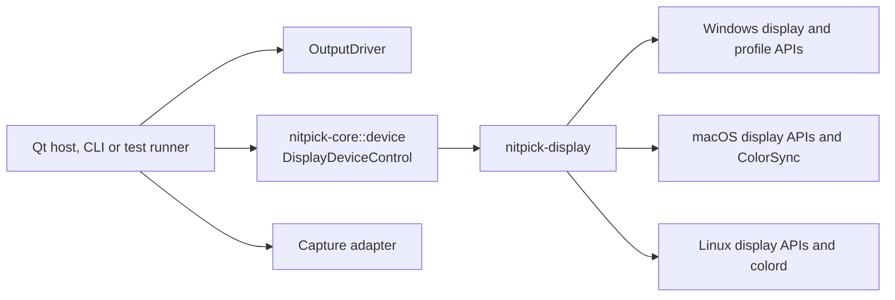

# Display device operations

## Overview

`DisplayDeviceControl` in `nitpick-core::device` enumerates local display devices, reads their capabilities and current state, and controls their OS settings. The first write operation is ICC profile assignment, including the state needed to restore the previous assignment. `nitpick-display` implements this trait for Windows, macOS and Linux. Both the Qt host and the command-line host can use it.

**Status:** design only. The shared trait, native crate and ICC assignment are not implemented. The remaining work is in [the output driver plan](../plan/output_driver.md).

The host coordinates three separate interfaces:

- [`OutputDriver`](output_driver/overview.md#interface) presents pattern pixels and reports output capabilities.
- `DisplayDeviceControl` enumerates physical display capabilities and reads or changes device profile assignments.
- The [capture adapter](output_driver/testing.md#host-boundary) reads samples for verification.

The [Little CMS profile adapter](output_driver/testing.md#colour-library-boundary) reads profile contents and performs colour calculations. It does not install or assign an OS profile. `nitpick-display` does not evaluate the MHC2 matrix or LUT. OS acceptance of a profile does not prove that its calibration reached the display.



### Crate boundary

| Component | Responsibility | Dependencies |
|---|---|---|
| `nitpick-core::device` | Trait, device identity, capabilities, mode state, profile requests, saved state and errors | Rust data types; no OS, GUI, executor or colour library |
| `nitpick-display` | Device and capability enumeration, native profile changes, readback and restoration | Core plus native bindings selected for the target OS |
| Host or test runner | Device selection, durable recovery record, worker lifetime and test sequence | Core and the selected implementations |
| Profile test support | ICC contents, MHC2 extraction and display model | Little CMS through its separate adapter |

The core does not import `nitpick-display`. The browser server and optional webview do not import it. The CLI exposes device control as an optional build feature, so a browser-only host still builds and runs without a local display service. The Qt host uses the same native implementations; profile changes do not pass through its C++ presentation bridge.

QRhi reads physical capabilities and mode fields through this trait. Its adapter combines them with swap-chain support and conversion limits to build the output query. Native capability discovery belongs in `nitpick-display`. Qt supplies window geometry and QRhi checks its actual swap-chain support.

## Interface

The following types are owned Rust data. Their exact fields are implementation work.

| Type | Required meaning |
|---|---|
| `DeviceId` | Backend and native device identity. It is distinct from an output driver's `DisplayId`. |
| `DeviceInfo` | Device ID, name and identity evidence used to detect replacement or ambiguous matches. |
| `DeviceCapabilities` | Detected HDR, WCG, wire-depth and ICC-management support. Keep supported settings distinct from the active settings. Use `Yes`, `No` or `Unknown` with reasons; unknown lists are not empty supported lists. |
| `DeviceMode` | Current HDR state, gamut, wire depth, luminance limits, SDR white and native pixel size where readable. Unknown values remain unknown. |
| `DeviceQuery` | Capabilities, mode, identity/topology revision and the source of each native report. |
| `ProfileTarget` | Device, native profile role and scope, including user and host scope where applicable. The backend lists the targets it can address. |
| `ProfileState` | Observed associations and selected default or override. Distinguish no override, inherited state and an unreadable value. Include a state revision for change detection. |
| `IccProfile` | Owned profile bytes and content hash. A caller's path is not the profile identity. |
| `PreparedProfileChange` | Versioned device identity, target, original state, desired profile and planned resources owned by this change. It can be saved for recovery before any mutation. |
| `DeviceError` | Unsupported operation or scope, permission denied, invalid profile, device disconnected, state conflict, timeout or native error. Retain the native reason. |

Pseudo-code (Rust):

```rust
pub trait DisplayDeviceControl {
    fn devices(&mut self) -> Result<Vec<DeviceInfo>, DeviceError>;
    fn query_device(
        &mut self, device: &DeviceId,
    ) -> Result<DeviceQuery, DeviceError>;
    fn profile_targets(
        &mut self, device: &DeviceId,
    ) -> Result<Vec<ProfileTarget>, DeviceError>;
    fn profile_state(
        &mut self, target: &ProfileTarget,
    ) -> Result<ProfileState, DeviceError>;
    fn prepare_icc_profile(
        &mut self, target: &ProfileTarget, profile: &IccProfile,
    ) -> Result<PreparedProfileChange, DeviceError>;
    fn set_icc_profile(
        &mut self, change: &PreparedProfileChange,
    ) -> Result<ProfileState, DeviceError>;
    fn restore_profile(
        &mut self, change: &PreparedProfileChange,
    ) -> Result<ProfileState, DeviceError>;
}
```

Device queries are read-only. Query again before opening output or preparing a device change, and after a display-state notification. Return partial mode information when a field is unavailable. Do not infer active HDR from generic Advanced Color support, a panel's advertised peak, or an FP16 storage format.

Device capabilities do not describe the output transport. Accepted pattern encodings, 10/12-bit input paths, FP16 conversion limits, pixel mapping, metadata transport and code preservation remain in the output driver's `Capabilities`. Physical fields in QRhi `ModeSettings` come from `DeviceQuery`; the output adapter adds its presentation description and pixel ratio. The browser supplies its own client reports and unknown fields. It does not query a server display to fill gaps in a remote client's report.

`prepare_icc_profile` reads and validates state without changing it. It rejects a target whose original assignment cannot be read or restored. The host saves the prepared change before calling `set_icc_profile`. The backend rechecks device identity, scope and state before a write. A conflicting external change returns `StateConflict`; it must not redirect the write to another display.

Setting a profile includes installation or registration when the OS requires it, association with the selected device and selection in the requested role. Use an existing identical profile when possible. Read back the requested state before reporting success. Native resources created for the change have unique planned identities. Partial failure still requires restoration from the saved record.

Restoration removes the override when the original state had none. It restores the previous selection and associations otherwise. It removes only resources created by the change and no longer used. User profiles and unrelated assignments remain intact. Repeated restoration is safe. If another actor changed the device state, preserve the recovery record and report a conflict instead of overwriting that state.

Success means the OS profile assignment matches the request. Calibration activation is a separate [verification check](output_driver/testing.md#instrumented-windows-idd). Profile state does not certify HDR rendering, MHC2 execution, wire values or panel light.

### Identity and execution

Screen order, display names and EDID hashes alone are not unique device keys. A backend maps its native identity to the current display topology and revalidates it before each change. Reconnection can require a new mapping. Ambiguous or disconnected targets fail without a write.

The host maps a local QRhi screen to a device through native identity. A browser client ID does not identify a device on the server. An explicit local-device selection is required for a local browser test. Remote browser profile control is unsupported by this interface; the host must not change its own monitor as a substitute.

Trait calls can perform native I/O. Hosts run blocking work on a worker and serialize changes for a device. Backends handle native thread requirements without depending on Qt. Cached query results can serve the synchronous output query; refresh them before opening a surface. Waiting must not block the Qt GUI thread or CLI event loop. Dropping a host wait or reaching its timeout does not undo an OS write. Keep the worker and recovery record until the outcome is known, then query and restore as needed. Do not start a replacement mutation while the old operation can still write.

Before a profile change, the host cancels pending presentation and measurement timing. After the assignment is read back, it queries the output again, opens a new surface if needed and submits a new frame. Old callbacks, captures and ready events cannot qualify that frame. The measurement delay still starts after the new presentation acknowledgement.

## Platform implementations

| Platform | Selected implementation | Qualification needed |
|---|---|---|
| Windows | Native display queries through DXGI and DisplayConfig, with Advanced Color queries where needed. Native profile installation and [display association](https://learn.microsoft.com/en-us/windows/win32/api/icm/nf-icm-colorprofileadddisplayassociation) APIs, with explicit scope and [default profile role](https://learn.microsoft.com/en-us/windows/win32/api/icm/nf-icm-colorprofilesetdisplaydefaultassociation) | Resolve display identity across the query and profile APIs. Keep supported HDR, active HDR and SDR WCG distinct. Keep ordinary and Advanced Color profile roles distinct. Check assignment and restoration in both modes. |
| macOS | Native display identity and available EDR reports; [ColorSync device profile assignment](https://developer.apple.com/documentation/colorsync/colorsyncdevicesetcustomprofiles(_:_:_:)) | Map the display to its ColorSync device UUID and profile ID. Keep EDR headroom separate from absolute luminance. Save user and host scope. Restore a prior custom profile or remove its override. |
| Linux | Wayland output or XRandR reports, with compositor/DRM colour state only where readable; [colord device profile association and default selection](https://www.freedesktop.org/software/colord/gtk-doc/CdDevice.html) | Match native output identity to the colord device. Record which capability fields are available. Check service availability, authorization and persistence. Establish separately whether the compositor uses the assigned profile. |

**Unverified:** these implementations and their restoration behaviour on the selected OS versions. Search existing Rust bindings before adding native declarations. Pin the chosen dependencies. Use only the bindings needed on the target OS.

The crate must build on all three operating systems. Missing APIs, services, roles or permissions return explicit errors or unknown capability fields. Linux without a usable colord display mapping has no profile setter in this design; display enumeration can still work. A successful colord assignment does not establish compositor application. A successful ColorSync assignment does not establish a Windows MHC2 path. Keep these limits separate from build support.

## Technical decisions

| Decision | Options | Selected and reason |
|---|---|---|
| Device queries and writes | Put native operations in each output driver; use a separate trait | Separate trait. Physical capabilities and settings are shared across presentation paths. |
| Implementation location | Qt bridge; test scripts; native Rust crate | `nitpick-display`. The same implementation serves both hosts and tests. |
| Profile contents | Parse inside the native backend; separate colour adapter | Separate adapter. OS assignment and colour evaluation have different dependencies and tests. |
| Profile selection | One unqualified path; explicit native role and scope | Explicit target. The OS can have different defaults and overrides for one device. |
| Call model | Native work in the UI; synchronous trait on a worker | Worker. Native APIs can block, and cancellation must not hide an unfinished write. |
| Recovery | Save after assignment; prepare and save before assignment | Prepare first. A partial native failure or process crash must leave enough state to recover. |

## Usage

Select a local device and a supported profile target. Use the current user scope where supported; other scopes must be explicit. Prepare the change and persist its recovery record before assignment. Confirm the OS state, then run the presentation and measurement sequence. Restore and confirm the original state at the end of the run.

On startup, inspect unresolved recovery records before changing that device again. An unreadable or incompatible record fails recovery with a reason. Keep it for investigation. Follow [test setup and restoration](output_driver/testing.md#usage-and-restoration) for other display controls.

## Testing

Run the same trait contract against a fake backend and each native backend. Ordinary CI uses injected native calls and does not change the developer's display profile. Test capability tri-states, supported versus active modes, partial query data, stale caches and profile queries without write permission. Test device replacement, duplicate display names, role and scope selection, no prior override, wrong profile bytes and unsupported services.

Inject failure after installation, association and default selection. Verify recovery after each step, timeout, cancellation and process restart. Test concurrent external changes, shared pre-existing profiles and repeated restoration. A completed assignment must have matching readback. Failed restoration fails the run.

Native integration tests use a selected test display and known ICC profiles. Run assignment, readback and restoration on each supported OS. Apply MHC2 fixtures only in the Windows calibration tests. Confirm calibration activation and light output at their own boundaries in [Output verification](output_driver/testing.md).

## Future enhancements

- HDR mode, output depth, brightness and vendor LUT controls through explicit device operations. These setters are outside the current ICC assignment scope.
- Remote device agents with their own identity and authorization contract.
- Additional Linux profile services after their assignment and restoration contracts are defined.
