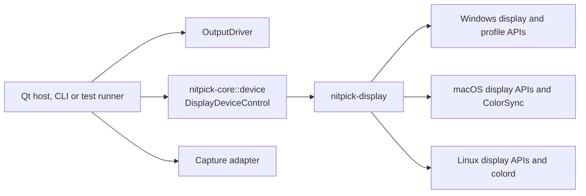

# Display device operations

## Overview

`DisplayDeviceControl` in `nitpick-core::device` enumerates local display devices, reads their capabilities and current state, and controls their OS settings. The first write operation is ICC profile assignment, including the state needed to restore the previous assignment. `nitpick-display` implements this trait for Windows, macOS and Linux. Both the Qt host and the command-line host can use it.

**Status:** the trait and its types are in `nitpick-core::device`, with a fake-backend contract test. `nitpick-display` has the Windows, macOS and Linux device and capability queries and the recovery-record format. ICC assignment is not implemented; it returns `Unsupported`. The remaining work is in [the output driver plan](../plan/output_driver.md).

The host coordinates three separate interfaces:

- [`OutputDriver`](output_driver/overview.md#interface) presents pattern pixels and reports output capabilities.
- `DisplayDeviceControl` enumerates physical display capabilities and reads or changes device profile assignments.
- The [capture adapter](output_driver/testing.md#host-boundary) reads samples for verification.

The [Little CMS profile adapter](output_driver/testing.md#colour-library-boundary) reads profile contents and performs colour calculations. It does not install or assign an OS profile. `nitpick-display` does not evaluate the MHC2 matrix or LUT. OS acceptance of a profile does not prove that its calibration reached the display.



### Crate boundary

| Component | Responsibility | Dependencies |
|---|---|---|
| `nitpick-core::device` | Trait, device identity, capabilities, mode state, profile requests, saved state and errors | Rust data types, with optional `serde` forms; no OS, GUI, executor or colour library |
| `nitpick-display` | Device and capability enumeration, native profile changes, readback and restoration, recovery-record text form | Core plus native bindings selected for the target OS |
| Host or test runner | Device selection, durable recovery record, worker lifetime and test sequence | Core and the selected implementations |
| Profile test support | ICC contents, MHC2 extraction and display model | Little CMS through its separate adapter |

The core does not import `nitpick-display`. The browser server and optional webview do not import it. The CLI exposes device control as an optional build feature, so a browser-only host still builds and runs without a local display service. The Qt host uses the same native implementations; profile changes do not pass through its C++ presentation bridge.

QRhi reads physical capabilities and mode fields through this trait. Its adapter combines them with swap-chain support and conversion limits to build the output query. Native capability discovery belongs in `nitpick-display`. Qt supplies window geometry and QRhi checks its actual swap-chain support.

## Interface

The following types are owned Rust data. Native values use `Report<T>`: a known value with the name of its native report, or unknown with a reason. A `Report<bool>` converts to the output driver's `Support` tri-state.

| Type | Required meaning |
|---|---|
| `DeviceId` | Backend and native device identity. It is distinct from an output driver's `DisplayId`. |
| `DeviceInfo` | Device ID, name and identity evidence used to detect replacement or ambiguous matches. |
| `DeviceCapabilities` | Detected HDR, WCG, wire-depth and ICC-management support. Keep supported settings distinct from the active settings. Use `Yes`, `No` or `Unknown` with reasons; unknown lists are not empty supported lists. |
| `DeviceMode` | Current HDR state, gamut, wire depth, luminance limits, SDR white, native pixel size and macOS EDR headroom where readable. Unknown values remain unknown. |
| `DeviceQuery` | Capabilities, mode, identity/topology revision and the source of each native report. |
| `ProfileTarget` | Device, native profile role and scope, including user and host scope where applicable. The backend lists the targets it can address. |
| `ProfileState` | Observed associations and selected default or override. Distinguish no override, inherited state and an unreadable value. Include a state revision for change detection. |
| `IccProfile` | Owned profile bytes and their SHA-256 content hash. A caller's path is not the profile identity. Construction checks only the ICC header size and `acsp` signature. |
| `PreparedProfileChange` | Versioned device identity, target, original state, desired profile and planned resources owned by this change. It can be saved for recovery before any mutation. |
| `DeviceError` | Unsupported operation or scope, permission denied, invalid profile, device disconnected, ambiguous identity, state conflict, timeout or native error. Retain the native reason. |

Pseudo-code (Rust):

```rust
pub trait DisplayDeviceControl {
    fn devices(&mut self) -> Result<Vec<DeviceInfo>, DeviceError>;
    fn query_device(
        &mut self, device: &DeviceId,
    ) -> Result<DeviceQuery, DeviceError>;
    fn profile_targets(
        &mut self, device: &DeviceId,
    ) -> Result<Vec<ProfileTarget>, DeviceError>;
    fn profile_state(
        &mut self, target: &ProfileTarget,
    ) -> Result<ProfileState, DeviceError>;
    fn prepare_icc_profile(
        &mut self, target: &ProfileTarget, profile: &IccProfile,
    ) -> Result<PreparedProfileChange, DeviceError>;
    fn set_icc_profile(
        &mut self, change: &PreparedProfileChange,
    ) -> Result<ProfileState, DeviceError>;
    fn restore_profile(
        &mut self, change: &PreparedProfileChange,
    ) -> Result<ProfileState, DeviceError>;
}
```

Device queries are read-only. Query again before opening output or preparing a device change, and after a display-state notification. Return partial mode information when a field is unavailable. Do not infer active HDR from generic Advanced Color support, a panel's advertised peak, or an FP16 storage format.

Device capabilities do not describe the output transport. Accepted pattern encodings, 10/12-bit input paths, FP16 conversion limits, pixel mapping, metadata transport and code preservation remain in the output driver's `Capabilities`. Physical fields in QRhi `ModeSettings` come from `DeviceQuery`; the output adapter adds its presentation description and pixel ratio. The browser supplies its own client reports and unknown fields. It does not query a server display to fill gaps in a remote client's report.

`prepare_icc_profile` reads and validates state without changing it. It rejects a target whose original assignment cannot be read or restored; `ProfileState::check_restorable` is the shared check. A record of another format version fails with `Unsupported`. The host saves the prepared change before calling `set_icc_profile`. The backend rechecks device identity, scope and state before a write. A conflicting external change returns `StateConflict`; it must not redirect the write to another display.

Setting a profile includes installation or registration when the OS requires it, association with the selected device and selection in the requested role. Use an existing identical profile when possible. Read back the requested state before reporting success. Native resources created for the change have unique planned identities. Partial failure still requires restoration from the saved record.

Restoration removes the override when the original state had none. It restores the previous selection and associations otherwise. It removes only resources created by the change and no longer used. User profiles and unrelated assignments remain intact. Repeated restoration is safe. If another actor changed the device state, preserve the recovery record and report a conflict instead of overwriting that state.

Success means the OS profile assignment matches the request. Calibration activation is a separate [verification check](output_driver/testing.md#instrumented-windows-idd). Profile state does not certify HDR rendering, MHC2 execution, wire values or panel light.

### Identity and execution

Screen order, display names and EDID hashes alone are not unique device keys. A backend maps its native identity to the current display topology and revalidates it before each change. Reconnection can require a new mapping. Ambiguous or disconnected targets fail without a write.

The host maps a local QRhi screen to a device through native identity. A browser client ID does not identify a device on the server. An explicit local-device selection is required for a local browser test. Remote browser profile control is unsupported by this interface; the host must not change its own monitor as a substitute.

Trait calls can perform native I/O. Hosts run blocking work on a worker and serialize changes for a device. Backends handle native thread requirements without depending on Qt. Cached query results can serve the synchronous output query; refresh them before opening a surface. Waiting must not block the Qt GUI thread or CLI event loop. Dropping a host wait or reaching its timeout does not undo an OS write. Keep the worker and recovery record until the outcome is known, then query and restore as needed. Do not start a replacement mutation while the old operation can still write.

Before a profile change, the host cancels pending presentation and measurement timing. After the assignment is read back, it queries the output again, opens a new surface if needed and submits a new frame. Old callbacks, captures and ready events cannot qualify that frame. The measurement delay still starts after the new presentation acknowledgement.

## Platform implementations

| Platform | Selected implementation | Qualification needed |
|---|---|---|
| Windows | Native display queries through DXGI and DisplayConfig, with Advanced Color queries where needed. Native profile installation and [display association](https://learn.microsoft.com/en-us/windows/win32/api/icm/nf-icm-colorprofileadddisplayassociation) APIs, with explicit scope and [default profile role](https://learn.microsoft.com/en-us/windows/win32/api/icm/nf-icm-colorprofilesetdisplaydefaultassociation) | Resolve display identity across the query and profile APIs. Keep supported HDR, active HDR and SDR WCG distinct. Keep ordinary and Advanced Color profile roles distinct. Check assignment and restoration in both modes. |
| macOS | Native display identity and available EDR reports; [ColorSync device profile assignment](https://developer.apple.com/documentation/colorsync/colorsyncdevicesetcustomprofiles(_:_:_:)) | Map the display to its ColorSync device UUID and profile ID. Keep EDR headroom separate from absolute luminance. Save user and host scope. Restore a prior custom profile or remove its override. |
| Linux | DRM connectors in sysfs and KMS connector properties; [colord device profile association and default selection](https://www.freedesktop.org/software/colord/gtk-doc/CdDevice.html) | Check service availability, authorization and persistence. Establish separately whether the compositor uses the assigned profile. |

Each platform module maps native reports to the core types through an injected native-call trait. Only the module that calls the OS is limited to its target, so the mapping tests run on every OS.

### Windows reports

The device key is the monitor device interface path from `DISPLAYCONFIG_TARGET_DEVICE_NAME`. It survives a restart and distinguishes identical monitors. The identity evidence holds only fields that survive a restart: EDID IDs, connector instance and output technology. The backend re-resolves the adapter LUID and source ID from the key before each native call.

| Field | Source | Rule |
|---|---|---|
| `hdr`, `sdr_wcg` support | `DISPLAYCONFIG_GET_ADVANCED_COLOR_INFO_2` (Windows 11 24H2 and later) | Without it, the legacy support bit covers both kinds. A kind is then known only when it is active, or when no Advanced Color is supported. |
| `hdr_on`, active kind | `INFO_2` active colour mode; otherwise the legacy enabled bit and the DXGI PQ colour space | The legacy enabled bit alone does not set HDR. |
| `gamut` | Active kind | HDR is BT.2020; plain SDR is sRGB; SDR WCG is unknown. |
| `wire_depth` | `bitsPerColorChannel` of either Advanced Color report | 0 is unknown. Supported depths are unknown: Windows reports the active depth only. |
| Luminance | `DXGI_OUTPUT_DESC1`, matched by GDI source name | 0 is unknown. A minimum is known only with a known peak. |
| `sdr_white_nits` | `DISPLAYCONFIG_SDR_WHITE_LEVEL` | HDR active only. |
| `native_size` | Active signal size of the target mode | |

**Unverified:** whether DXGI substitutes OS default luminance for an EDID without HDR static metadata, whether the legacy wide-colour bit is set only for SDR WCG, and the wire gamut of SDR WCG. A check on Windows 11 build 26200 with one HDR display read every field above, with HDR on at 8 bits per channel.

### macOS reports

The device key is the ColorSync display device UUID from `CGDisplayCreateUUIDFromDisplayID`. ColorSync profile assignment uses this UUID with the display device class. The `CGDirectDisplayID` changes after a reconnect; it only links the Core Graphics, ColorSync and `NSScreen` reports in one query. Without a UUID, the key is the display ID. The identity evidence is the vendor and model numbers, the EDID serial number and the built-in flag.

| Field | Source | Rule |
|---|---|---|
| Name | `NSScreen.localizedName`; otherwise the ColorSync device description | |
| `hdr`, `hdr_on` | none | Unknown. EDR headroom does not establish HDR: macOS can give headroom on an SDR panel at reduced brightness. |
| `sdr_wcg` support | `NSScreen.canRepresentDisplayGamut(P3)` | |
| `gamut` | none | Unknown. macOS converts to the display profile and does not report the signal gamut. |
| `wire_depths`, `wire_depth` | none | Unknown. |
| Luminance, `sdr_white_nits` | none | Unknown. EDR headroom does not fill these fields. |
| `native_size` | Pixel size of the mode with `kDisplayModeNativeFlag`, from `CGDisplayCopyAllDisplayModes` with the duplicate low-resolution modes | Not the current mode: a scaled mode has a framebuffer of another size. No flagged mode or more than one flagged size is unknown. |
| `edr` | Current, potential and reference EDR component values of the `NSScreen` | A ratio to SDR white = 1.0, not a luminance. A value below 1 or not finite is unknown. A reference value of 0 means no reference preset. |
| `icc_profiles` | `ColorSyncDeviceCopyDeviceInfo` | No if ColorSync has no device for the UUID; otherwise unknown until assignment exists. |

Core Graphics and ColorSync calls run on the calling worker. `NSScreen` is main-thread only. A call on another thread goes to the main dispatch queue and waits at most 2 s. The main queue runs only when the main thread runs a run loop, as in the Qt host. Without it, or after `dispatch_main`, the name falls back and the `NSScreen` fields are unknown with the reason. The other fields remain.

**Unverified:** that the UUID survives a restart, whether two identical monitors without EDID serial numbers get the same UUID (the backend then reports an ambiguous identity), whether every panel flags its native mode, whether the P3 report follows the panel or the assigned profile, and whether `NSScreen` updates after a topology change in a process without `NSApplication`. A check on macOS 27.0.1 with a MacBook Pro (M1 Max) built-in XDR display read every field above. It reported P3 support, native size 3024 × 1964, EDR headroom 1.2 current and 16 potential, no reference preset, and ColorSync default profile ID 1. No external display was checked.

### Linux reports

The backend reads the kernel display state, not a compositor report. The devices are the connectors in `/sys/class/drm` with the status `connected`. A device list reads only sysfs. A query also opens the card node `/dev/dri/cardN` of that device to read its KMS connector properties, and reads the display devices of colord. The KMS reads need seat access to the card node. Without access, the KMS fields are unknown with the reason, and the EDID fields remain.

The device key is the bus ID of the card device, the kernel connector name and the EDID identity, for example `0000:01:00.0/DP-6/DEL40E7-<serial>`. The EDID identity is the PNP ID, the product code, and the serial number descriptor or else the numeric serial number. Another unit on the same connector, or the same unit on another connector, gets a new key. Without a readable bus ID, the key holds the card number, which can change after a restart. The identity evidence is the connector name, the EDID IDs, both serial number forms and the EDID MD5. A compositor can use another connector name: GNOME 50 calls the kernel connector `HDMI-A-2` `HDMI-2`.

The colord device of an output is the display device whose `OutputEdidMd5` metadata is the MD5 of the connector's EDID. Only devices of the calling user count. Two outputs with the same EDID, or two matching devices, make the match ambiguous.

| Field | Source | Rule |
|---|---|---|
| Name | EDID display product name | Otherwise the connector name. |
| `hdr` support | SMPTE ST 2084 bit of the EDID HDR Static Metadata Data Block; the KMS property `HDR_OUTPUT_METADATA` | `No` if either reports no. A DisplayID extension without the CTA-861 block is unknown. Compositor support is not reported. |
| `hdr_on` | `HDR_OUTPUT_METADATA` blob | On for a PQ or HLG EOTF. Off for blob 0 or without the property. |
| `sdr_wcg` support | none | Unknown. |
| `gamut` | KMS `Colorspace` | Known for the BT.2020 and DCI-P3 D65 values only. `Default` signals no colorimetry, and a colour-managed compositor can send the panel gamut. |
| `wire_depths`, `wire_depth` | none | Unknown. `max bpc` is a limit, not the link depth. |
| Luminance | Desired content max, max frame-average and min luminance of the EDID HDR Static Metadata Data Block | Peak, full frame and minimum. Code 0 of a maximum is unknown. A minimum is known only with a known peak. |
| `sdr_white_nits` | none | Unknown. Compositor settings are not read. |
| `native_size` | Mode of the CRTC of the connector | No CRTC is unknown. |
| `icc_profiles` | colord `GetDevicesByKind` | No if colord runs and no device matches. Otherwise unknown until assignment exists; the reason names the matched device. The query does not start colord. |

The first process that opens a card without a DRM master becomes its master. The backend drops the master immediately, so a compositor that starts during the query can take the card.

**Unverified:** that code 0 of a maximum luminance means "not given", that every driver signals no colorimetry for `Default`, that the wire size is the CRTC mode on an internal panel with a GPU scaler, and that colour daemons other than the GNOME daemon set `OutputEdidMd5`. A check on Ubuntu 26.04 (kernel 7.0, GNOME 50.1 on Wayland, NVIDIA driver 595.99.02, colord 1.4.8) with an SDR monitor on DisplayPort and an HDR10 recorder on HDMI read every field above. With HDR on in GNOME, the HDMI output reported `hdr_on`, BT.2020 and 3840 × 2160; its EDID has no luminance codes. Each output matched one colord device. X11 sessions and other drivers were not checked.

**Unverified:** these implementations and their restoration behaviour on the selected OS versions. Search existing Rust bindings before adding native declarations. Pin the chosen dependencies. Use only the bindings needed on the target OS.

The crate must build on all three operating systems. Missing APIs, services, roles or permissions return explicit errors or unknown capability fields. Linux without a usable colord display mapping has no profile setter in this design; display enumeration can still work. A successful colord assignment does not establish compositor application. A successful ColorSync assignment does not establish a Windows MHC2 path. Keep these limits separate from build support.

## Technical decisions

| Decision | Options | Selected and reason |
|---|---|---|
| Device queries and writes | Put native operations in each output driver; use a separate trait | Separate trait. Physical capabilities and settings are shared across presentation paths. |
| Implementation location | Qt bridge; test scripts; native Rust crate | `nitpick-display`. The same implementation serves both hosts and tests. |
| Profile contents | Parse inside the native backend; separate colour adapter | Separate adapter. OS assignment and colour evaluation have different dependencies and tests. |
| Profile selection | One unqualified path; explicit native role and scope | Explicit target. The OS can have different defaults and overrides for one device. |
| Call model | Native work in the UI; synchronous trait on a worker | Worker. Native APIs can block, and cancellation must not hide an unfinished write. |
| Recovery | Save after assignment; prepare and save before assignment | Prepare first. A partial native failure or process crash must leave enough state to recover. |
| Recovery-record format | Separate record types in `nitpick-display`; `serde` forms of the core types | `serde` behind a core feature: one definition of each type. The reader checks `version` before other fields, because another version can give a field another meaning. Profile bytes and hashes are hex text, and the stored hash must match the bytes. |
| Native-call tests | Test only on each OS; inject native reports | Inject. The mapping compiles on every OS, and unknown or failed fields can be tested without a display. |
| macOS EDR headroom | Put it in the luminance fields with an assumed SDR white; a separate ratio field | Separate `edr` field. The SDR white luminance changes with brightness and is not reported. An assumed scale would give false absolute values and enable the unsupported QRhi FP16 path. |
| macOS `NSScreen` thread | Require the main thread; synchronous dispatch to the main queue; asynchronous dispatch with a bounded wait | Bounded wait. The trait runs on a worker. A synchronous dispatch blocks for ever in a host without a main run loop. A late block sends to a closed channel. |
| Linux report source | Wayland output reports; XRandR; DRM sysfs and KMS properties | DRM sysfs and KMS. KMS holds the signalled HDR state and colorimetry for any compositor, and it works without a window system. A Wayland client needs a session connection, and the colour-management protocol is optional and gives the compositor's output description. GNOME 50 Xwayland gives no EDID through RandR. Cost: the KMS fields need seat access to the card node. |
| Linux profile-service mapping | Connector name; colord device ID; EDID MD5 | EDID MD5 in the colord device metadata. Connector names differ between the kernel and compositors. The colord device ID is made by the session daemon and does not name the connector. |
| Topology revision | std hasher; fixed hash | FNV-1a 64 over sorted identity fields. Recovery records store the value, so it must not change between builds or runs. |

## Usage

Select a local device and a supported profile target. Use the current user scope where supported; other scopes must be explicit. Prepare the change and persist its recovery record before assignment. Confirm the OS state, then run the presentation and measurement sequence. Restore and confirm the original state at the end of the run.

On startup, inspect unresolved recovery records before changing that device again. An unreadable or incompatible record fails recovery with a reason. Keep it for investigation. Follow [test setup and restoration](output_driver/testing.md#usage-and-restoration) for other display controls.

## Testing

Run the same trait contract against a fake backend and each native backend. To print the readable fields of each local display, run `cargo run -p nitpick-display --example devices`. Ordinary CI uses injected native calls and does not change the developer's display profile. Test capability tri-states, supported versus active modes, partial query data, stale caches and profile queries without write permission. Test device replacement, duplicate display names, role and scope selection, no prior override, wrong profile bytes and unsupported services.

Inject failure after installation, association and default selection. Verify recovery after each step, timeout, cancellation and process restart. Test concurrent external changes, shared pre-existing profiles and repeated restoration. A completed assignment must have matching readback. Failed restoration fails the run.

Native integration tests use a selected test display and known ICC profiles. Run assignment, readback and restoration on each supported OS. Apply MHC2 fixtures only in the Windows calibration tests. Confirm calibration activation and light output at their own boundaries in [Output verification](output_driver/testing.md).

## Future enhancements

- HDR mode, output depth, brightness and vendor LUT controls through explicit device operations. These setters are outside the current ICC assignment scope.
- Remote device agents with their own identity and authorization contract.
- Additional Linux profile services after their assignment and restoration contracts are defined.
