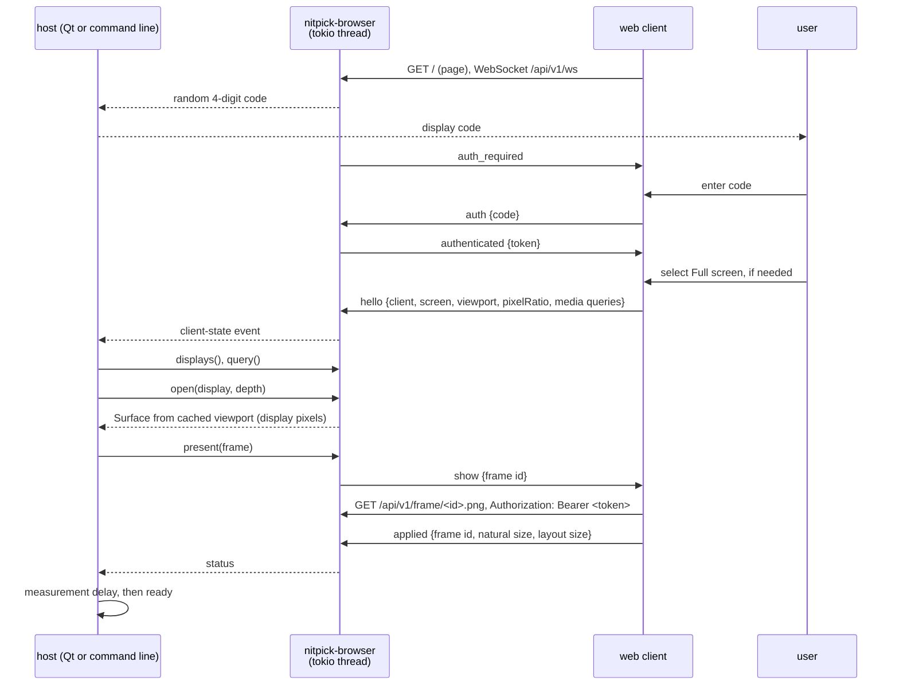

# Browser output driver

## Overview

The browser driver shows test patterns in a web page. It implements `OutputDriver` (see [overview.md](overview.md)). Its host can be the Qt launcher or a command-line program. Neither the driver nor its server needs Qt or Tauri.

Use:
- Real use: a remote display without a video input, for example an iPad with Safari. The measurement is of the display light with a probe. There is no wire to measure with a scope.
- Tests: a local browser, or an optional Tauri webview window (`nitpick-webview`) on a desktop screen.

Scope:
- An HTTP and WebSocket server in the host process (crate `nitpick-browser`). It owns a Tokio thread and exposes the Rust service handle defined in [Host and dependency boundary](overview.md#host-and-dependency-boundary).
- A static web client (HTML and JavaScript, no framework), embedded in the server crate.
- An optional Tauri shell (crate `nitpick-webview`) that opens the client URL full screen on one local monitor. It is a separate build and process.

After authentication, the client sends `hello`. It sends `hello` again on each change of the media queries, the viewport, full-screen state or the pixel ratio. The server keeps the last state of the single authenticated client. Only a client with a valid `hello` appears in `displays`. `query` reads this state. A client that closes its WebSocket is removed from `displays`.

`open` checks the selected depth and takes a snapshot of the current viewport. It does not send a command or wait for the client. With no valid client state it returns `Disconnected`. A viewport or pixel-ratio change invalidates an open surface. The service notifies the host, which cancels presentation and measurement timing, then opens and renders again. `present` also checks that its surface is still valid and reports `Platform` with a viewport-change reason if it is stale.

The page enters full screen from its "Full screen" button. A WebSocket message cannot supply the [user activation required by the Fullscreen API](https://fullscreen.spec.whatwg.org/#dom-element-requestfullscreen). Until full screen is active, the surface covers only the reported viewport and the host shows a warning. The client reports the new viewport after the change. A command-line host selects a client by `DisplayId`; it does not enumerate local monitors.

## Graphics path

Result of the API survey (Edge/Chrome, Firefox, Safari; November 2026):

| API | HDR output | Wide gamut | Bits |
|---|---|---|---|
| Canvas 2D | Chromium: behind a flag only (`colorType: "float16"`, `rec2100-pq`) | `display-p3` | 8 (float16 behind the flag) |
| WebGL 1 / 2 | none: `drawingBufferToneMapping` is an open Khronos proposal; Chromium has it behind a flag | `drawingBufferColorSpace = "display-p3"` | 8; float16 (`drawingBufferStorage`) Chromium only, not in Safari |
| WebGPU | Chromium 129+: `rgba16float` + `toneMapping: {mode: "extended"}`. Safari 26: in question (an earlier WebKit accepted `extended` and showed SDR on macOS). Firefox: none | `display-p3` | float16 |
| HDR image (``) | Chromium, Safari 26 (all platforms, iPadOS included): PQ and HLG images. Firefox: macOS only | via the image colour space (BT.2020) | 16-bit PNG |

Selected: the HDR image. A 16-bit PNG with a `cICP` chunk (BT.2020 primaries, PQ or HLG transfer, RGB) in an `` element. Reasons:
- It is the only HDR path in Safari on iPadOS that WebKit documents.
- The image carries code values, not linear light. This is the same model as the pattern (`Image` of codes). The WebGPU `extended` mode needs linear values relative to the SDR white, and no web API gives the SDR white luminance.
- No shader. The page does not change the decoded values.

If `dynamicRange` is `standard`, the browser tone maps the image to SDR. The driver shows it, and the status line shows "SDR preview". Firefox on Windows and Linux, and WebKitGTK (Tauri on Linux), show SDR also on an HDR display. The driver identifies them by the user agent and gives `hdr_on = Some(false)`.

### Code to PNG sample

All PNGs use full-range RGB samples. For input code $D$ at bit depth $n$, let $s = 2^{n-8}$ and calculate the normalized signal $E'$:

| Input encoding | cICP (primaries, transfer, matrix, full range) | $E'$ |
|---|---|---|
| `pq-full` | 9, 16, 0, 1 | $D / (2^n - 1)$ |
| `pq-narrow` | 9, 16, 0, 1 | $(D - 16s) / (219s)$ |
| `hlg-narrow` | 9, 18, 0, 1 | $(D - 16s) / (219s)$ |

The stored sample is $V = \mathrm{round}(65535 \cdot \min(1, \max(0, E')))$. PQ stays PQ. HLG stays HLG. At 10 bits, narrow black 64 maps to 0 and nominal peak 940 maps to 65535. At 12 bits, the same endpoints are 256 and 3760.

Deviation from a lossless code transport: values below narrow black or above nominal peak are clipped. They cannot be stored in unsigned full-range RGB while keeping the same transfer function. The driver reports clipping in the status. The reference table marks affected levels as "clipped"; they are not valid tests of those signal excursions. Inside the nominal range, conversion adds at most half a 16-bit sample step. The inverse range mapping recovers the original 10-bit or 12-bit code there.

The [PNG specification](https://www.w3.org/TR/png-3/#cICP-chunk) permits narrow-range cICP. However, [Skia's PNG decoder](https://github.com/google/skia/blob/main/src/codec/SkPngRustCodec.cpp) ignores cICP when the full-range flag is zero. Full-range samples avoid that dependency. The driver does not fall back from HLG to PQ or preserve narrow codes under full-range signalling. **Unverified:** the browser and compositor preserve the signalled transfer function and luminance. `interpretation` stays `Unknown` until device tests confirm it.

QRhi instead transports the input codes under full-range PQ signalling. See [Signalling](qt.md#signalling).

HDR10 metadata: the driver writes PNG `mDCV` and `cLLI` chunks from the resolved values in [HDR10 static metadata](../test_patterns.md#hdr10-static-metadata). For automatic PQ light levels, it supplies $V / 65535$ to the shared calculation after clipping and quantization. HLG requires explicit light levels. PNG chunk layouts and units come from the [PNG specification](https://www.w3.org/TR/png-3/#mDCV-chunk); do not copy the core SEI payload bytes into these chunks. **Unverified:** a browser uses these chunks for tone mapping.

### Pixel mapping

The client shows the image at one image pixel per display pixel:
- `open` gives the viewport size in display pixels: $\mathrm{round}(w_{css} \cdot r) \times \mathrm{round}(h_{css} \cdot r)$, $r$ = `devicePixelRatio`.
- The `` has the CSS size $W / r \times H / r$, `image-rendering: pixelated`, no transform, opacity 1 and `dynamic-range-limit: no-limit`. A transform or an opacity below 1 can clamp HDR to SDR (reported for WebKit).
- `pixel_exact` is `Yes` only if $r$ is an integer, `visualViewport.scale` is 1 and the client reports a layout size equal to the image size. Otherwise the browser resamples and changes codes. The driver continues and shows a warning.
- iPad: $r = 2$. Safari ignores `user-scalable=no`, so a pinch zoom changes `visualViewport.scale`. The client reports it.
- Tauri on Windows: the shell starts WebView2 with `--force-device-scale-factor=1`, so $r = 1$ at all Windows scale settings.

## Interface

HTTP uses fixed paths. API paths start with `/api/v1/`:

| Path | Content |
|---|---|
| `GET /` | client page; no authentication |
| `GET /api/v1/ws` | WebSocket, JSON messages; authenticate after the connection opens |
| `GET /api/v1/frame/<id>.png` | the frame PNG; bearer token required; `Cache-Control: no-store` |

WebSocket messages:

| Direction | Message | Fields |
|---|---|---|
| server → client | `auth_required` | – (the client asks for the code shown by the server) |
| client → server | `auth` | `code` (string) |
| server → client | `authenticated` | `token` (random bearer token for this session) |
| client → server | `hello` | `client` (user agent, `webview` flag), `screen` (`width`, `height` in CSS px), `viewport` (`width`, `height`, `scale`), `pixelRatio`, `dynamicRange` (`high`/`standard`), `colorGamut` (`rec2020`/`p3`/`srgb`), `fullscreen` |
| server → client | `show` | `id`, `width`, `height` |
| client → server | `applied` | `id`, `naturalWidth`, `naturalHeight`, `layoutWidth`, `layoutHeight` (display px) |
| client → server | `error` | `id`, `message` (for example decode failure) |
| server → client | `close` | – (the client shows a black page) |

### Authentication

The server permits one WebSocket session, including a connection that waits for authentication. It reserves this slot when it accepts the connection. It rejects another WebSocket upgrade with HTTP `409 Conflict`. A second client cannot replace the current session.

After the WebSocket opens:

1. The server generates a random 4-digit code, from `0000` to `9999`. It displays the code in the launcher or server console. It sends `auth_required` without the code to the client.
2. The user enters the code in the client. The client sends `auth` with the code as a string to preserve leading zeros.
3. The server compares the strings exactly. A wrong code, a message other than `auth`, or no reply within 60 s closes the WebSocket and releases the slot. The server limits failed attempts to restrict code guessing.
4. On success, the server generates a new bearer token with a cryptographic random generator and sends `authenticated`. Only then can the client send `hello` and take part in pattern presentation. The server accepts no further `auth` messages on this connection.

For headless use or tests, the server can use an explicitly configured fixed string in place of the random code. The client submits the same string in `auth`. This option changes only the code; the server still issues a new random bearer token for each session.

The client keeps the bearer token in memory. Every image asset request must include `Authorization: Bearer <token>`. Missing, wrong or expired tokens give HTTP `401 Unauthorized`. Tokens do not appear in URLs. When the WebSocket closes, the server revokes the token and releases the slot. A new connection must authenticate again.

### Image requests and presentation

The client uses `fetch` with the authorization header to load the PNG. It checks the response status, reads the body as a `Blob`, and sets the `` source to an object URL for that blob. It releases each object URL when the image is replaced or discarded. The image bytes and colour metadata stay unchanged.

The client sends `applied` after `HTMLImageElement.decode()`, the DOM change and two `requestAnimationFrame` callbacks. This acknowledges client processing, not physical presentation. The `present` future awaits `applied` with the current frame ID and yields to the host executor. The 10 s acknowledgement timeout starts when `show` is sent. A missing acknowledgement gives `Timeout`; a closed client gives `Disconnected`. Dropping the future removes the pending reply registration. Late acknowledgements for older frames do not complete a new request. The host then applies the [measurement delay](overview.md#measurement-delay).

The client keeps the latest requested frame ID. After decode, it checks this ID before changing the DOM or sending `applied`. A newer `show` or `close` invalidates the old request, so a slow decode cannot replace a newer pattern or the black close page.

### Mapping to `ModeSettings`

- `hdr_on`: `dynamicRange == "high"`.
- `gamut`: `colorGamut`.
- `pixel_ratio`: `pixelRatio`.
- `wire_depth`, `peak_nits`, `min_nits`, `sdr_white_nits`: `None`. No web API gives them.

## Technical decisions

| Decision | Options | Selected | Reason |
|---|---|---|---|
| Graphics path | Canvas 2D; WebGL; WebGPU `extended`; HDR `` | HDR `` | See [Graphics path](#graphics-path). |
| Narrow input | narrow-range cICP; rescale to full range; relabel unchanged codes | rescale to full range, keep the transfer function | Skia ignores narrow-range cICP. Rescaling preserves nominal light levels; clipping is an explicit limit. |
| Render location | server (`nitpick-core`, PNG); client (`nitpick-core` as WASM) | server | One renderer for the pattern, the reference table and the light level. A 4K pattern PNG is small, because the patterns have large flat regions. |
| Server | `axum` + `tokio` on a separate thread; `tiny_http` + `tungstenite` | `axum` + `tokio` | HTTP and WebSocket in one library. The server runtime is independent of the host event loop. |
| Surface setup | wait for a remote reply in `open`; use cached client state | cached client state | Keeps `open` synchronous. Authentication and full-screen user actions occur before the call. |
| Presentation | block on the server reply; await a reply by frame ID | await the reply | The host stays active during image encoding, transfer and client processing. See [Asynchronous presentation](overview.md#asynchronous-presentation). |
| PNG encoder | `png` crate; own encoder | `png` crate | Writes 16-bit RGB. **Unverified:** it writes `cICP`, `mDCV` and `cLLI`. If not, the driver writes them with `Writer::write_chunk`. |
| Local test window | system browser; Tauri; `wry` direct | system browser for basic use; optional Tauri process for controlled tests | Tauri gives a fixed engine (WebView2 on Windows), monitor selection and browser arguments. A separate process keeps its event loop independent of the host. |
| Monitor selection (Tauri) | monitor index; screen position | screen position | The shell accepts a position and selects the monitor that contains it. The Qt launcher derives the position from its screen list; a command-line caller can supply it. The server does not use Qt screen geometry. |
| Access | open; token in the URL; WebSocket authentication and bearer token | fixed API paths and [session authentication](#authentication), server bound to localhost by default | The server code controls display access. The bearer token controls image access without a secret in the URL. A LAN address only when the user turns on remote displays. The host gives a specific interface address; the service rejects an unspecified address (`0.0.0.0`, `::`), because the URL shown to the user contains the bound address. |
| Sessions | multiple clients; one client | one session, including authentication | One client controls the display state. A second connection cannot replace it. |
| Full screen | Fullscreen API; Home Screen web app | Fullscreen API with a "Full screen" button | The API needs a user gesture. The client shows the button until `fullscreen` is true. |

## Usage

Qt launcher, local webview test:
1. In the launcher, select the driver "Browser (local webview)" and a screen.
2. "Show pattern" starts `nitpick-webview --url <url> --at <x>,<y>` if no session exists.
3. Enter the code shown by the launcher in the webview. After authentication, the launcher waits 10 s for `hello`.

Qt launcher, remote display (iPad):
1. In the launcher, turn on remote displays. The launcher shows the URL with the LAN address.
2. Open the URL in Safari on the iPad. Enter the code shown by the launcher. After authentication, tap "Full screen".
3. Select the iPad in the display list. Then select the pattern and "Show pattern".

Command-line host (planned): follow [Host and dependency boundary](overview.md#host-and-dependency-boundary). The host supplies bind address, port, pattern, format and measurement-delay options, and prints status events. Bind to loopback for a local browser, or an explicit LAN address for a remote browser. Qt, Tauri and a local screen are not required. The command name and flags are not implemented yet.

Headless use can use the random code printed in the console. Automated tests can configure the server and client with the same fixed string. See [Authentication](#authentication). Close the current client before connecting a different client or selecting a different screen.

For all paths, use the [measurement delay](overview.md#measurement-delay) before taking a reading.

## Testing

Settings before a measurement on an iPad:
- Turn off True Tone, Night Shift and auto-brightness. Set the brightness to a fixed value; the EDR headroom changes with it.
- iPad Pro with reference mode: turn it on for a known SDR white. **Unverified:** Safari keeps the PQ luminance in reference mode.

Tests and pass criteria are in [Output verification](testing.md): [browser unit tests](testing.md#browser-output), [browser integration](testing.md#browser-integration), and [physical output criteria](testing.md#pass-criteria). Use a probe for the remote display; a capture on the server does not test it.

Service unit tests (`nitpick-browser`, `service_tests.rs`) cover start, loopback default, bind failures, the embedded page, event order on a Rust executor and bounded shutdown. **Not done:** all other tests. The graphics path survey is from documentation and bug reports, not from tests on devices.

## Future enhancements

- WebGPU `extended` mode as a second path in Chromium, for a display-relative signal without browser PQ tone mapping. It needs the SDR white luminance from the user.
- A QR code of the URL in the launcher.
