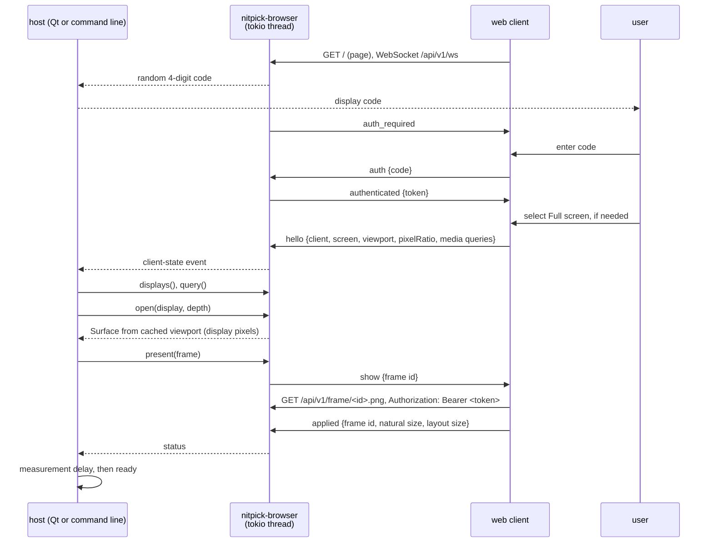
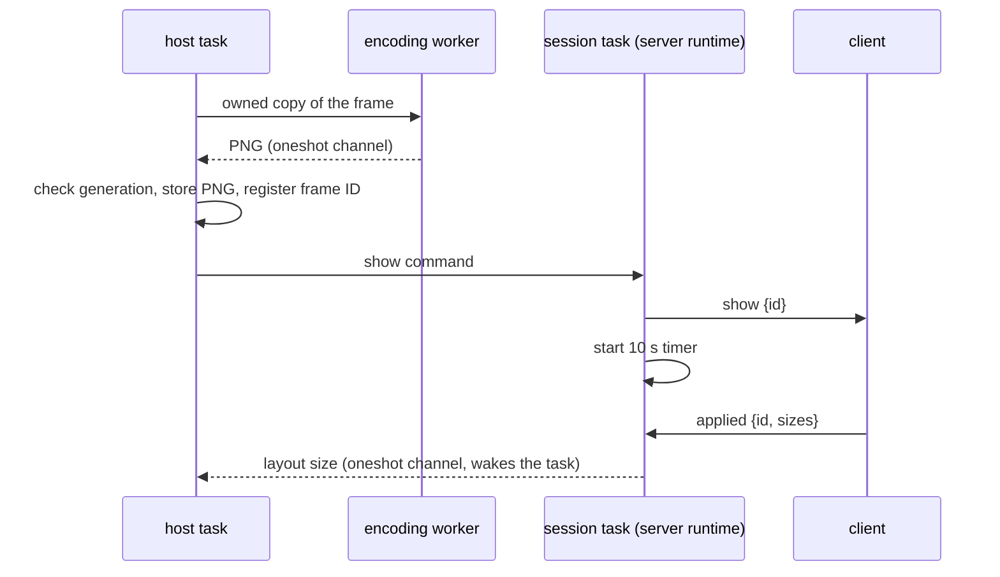

# Browser output driver

## Overview

The browser driver shows test patterns in a web page. It implements `OutputDriver` (see [overview.md](overview.md)). Its host can be the Qt launcher or a command-line program. Neither the driver nor its server needs Qt or Tauri.

Use:
- Real use: a remote display without a video input, for example an iPad with Safari. The measurement is of the display light with a probe. There is no wire to measure with a scope.
- Tests: a local browser, or an optional Tauri webview window (`nitpick-webview`) on a desktop screen.

Scope:
- An HTTP and WebSocket server in the host process (crate `nitpick-browser`). It owns a Tokio thread and exposes the Rust service handle defined in [Host and dependency boundary](overview.md#host-and-dependency-boundary).
- A static web client (HTML and JavaScript, no framework), embedded in the server crate.
- An optional Tauri shell (crate `nitpick-webview`) that opens the client URL full screen on one local monitor. It is a separate build and process.



After authentication, the client sends `hello`. It sends `hello` again on each change of the media queries, the viewport, full-screen state or the pixel ratio. The server keeps the last state of the single authenticated client. Only a client with a valid `hello` appears in `displays`. `query` reads this state. A client that closes its WebSocket is removed from `displays`.

Each authenticated session gets a new `DisplayId` (`browser:client-N`). A surface of an earlier session therefore cannot match a new client. The display name is the engine name and the client IP address, for example "Safari at 192.168.1.20". The display size is the viewport in display pixels.

A `hello` is valid if it has all fields in [Interface](#interface) with the specified types and values. All sizes, `scale` and `pixelRatio` must be positive. Each side of the viewport in display pixels must be in 1 to 16384; this limit stops a client from making the host render a very large frame. An invalid `hello` ends the session with close code 4003.

The service sends a `Ready` client-state event for each valid `hello`. Before `Ready`, it sends `ViewportChanged` if the surface geometry changed: the viewport size in display pixels, `pixelRatio` or `viewport.scale`. Other changes, such as `dynamicRange` or `fullscreen` with the same viewport, keep the surface valid. The host queries again after each `Ready`.

`open` checks the selected depth and takes a snapshot of the current viewport. It does not send a command or wait for the client. With no valid client state it returns `Disconnected`. A geometry change invalidates an open surface. On `ViewportChanged`, the host cancels presentation and measurement timing, then opens and renders again. `present` also checks that its surface is still valid. It reports `Platform` with a viewport-change reason if the surface is stale, or `Disconnected` if the session ended or the surface was closed. These checks use the cached state only and do not wait for the network.

The SDR preview reason and the full-screen layout warning appear in the mode description and the surface description, so the status line shows them.

The page enters full screen from its "Full screen" button. A WebSocket message cannot supply the [user activation required by the Fullscreen API](https://fullscreen.spec.whatwg.org/#dom-element-requestfullscreen). Until full screen is active, the surface covers only the reported viewport and the host shows a warning. The client reports the new viewport after the change. A command-line host selects a client by `DisplayId`; it does not enumerate local monitors.

## Graphics path

Result of the API survey (Edge/Chrome, Firefox, Safari; November 2026):

| API | HDR output | Wide gamut | Bits |
|---|---|---|---|
| Canvas 2D | Chromium: behind a flag only (`colorType: "float16"`, `rec2100-pq`) | `display-p3` | 8 (float16 behind the flag) |
| WebGL 1 / 2 | none: `drawingBufferToneMapping` is an open Khronos proposal; Chromium has it behind a flag | `drawingBufferColorSpace = "display-p3"` | 8; float16 (`drawingBufferStorage`) Chromium only, not in Safari |
| WebGPU | Chromium 129+: `rgba16float` + `toneMapping: {mode: "extended"}`. Safari 26: in question (an earlier WebKit accepted `extended` and showed SDR on macOS). Firefox: none | `display-p3` | float16 |
| HDR image (``) | Chromium, Safari 26 (all platforms, iPadOS included): PQ and HLG images. Firefox: macOS only | via the image colour space (BT.2020) | 16-bit PNG |

Selected: the HDR image. A 16-bit PNG with a `cICP` chunk (BT.2020 primaries, PQ or HLG transfer, RGB) in an `` element. Reasons:
- It is the only HDR path in Safari on iPadOS that WebKit documents.
- The image carries code values, not linear light. This is the same model as the pattern (`Image` of codes). The WebGPU `extended` mode needs linear values relative to the SDR white, and no web API gives the SDR white luminance.
- No shader. The page does not change the decoded values.

If `dynamicRange` is `standard`, the browser tone maps the image to SDR. The driver shows it, and the status line shows "SDR preview". Firefox on Windows and Linux, and WebKitGTK (Tauri on Linux), show SDR also on an HDR display. The driver identifies them by the user agent and gives `hdr_on = Some(false)`. With SDR preview, every encoding has `interpretation = No`; otherwise `interpretation` is `Unknown`.

User-agent rules (substring tests):

| Engine | Rule | SDR only |
|---|---|---|
| Firefox | `Firefox/`, and `Windows`, or `Linux` or `X11` without `Android` | yes |
| WebKitGTK | `AppleWebKit/`, `Linux` or `X11`, no `Android`, no `Chrome/` or `Chromium/` | yes |
| other | – | no |

**Unverified:** these rules come from documentation and bug reports. Firefox on Android has no rule.

### Code to PNG sample

All PNGs use full-range RGB samples. For input code $D$ at bit depth $n$, let $s = 2^{n-8}$ and calculate the normalized signal $E'$:

| Input encoding | cICP (primaries, transfer, matrix, full range) | $E'$ |
|---|---|---|
| `pq-full` | 9, 16, 0, 1 | $D / (2^n - 1)$ |
| `pq-narrow` | 9, 16, 0, 1 | $(D - 16s) / (219s)$ |
| `hlg-narrow` | 9, 18, 0, 1 | $(D - 16s) / (219s)$ |

The stored sample is $V = \mathrm{round}(65535 \cdot \min(1, \max(0, E')))$. PQ stays PQ. HLG stays HLG. At 10 bits, narrow black 64 maps to 0 and nominal peak 940 maps to 65535. At 12 bits, the same endpoints are 256 and 3760.

Deviation from a lossless code transport: values below narrow black or above nominal peak are clipped. They cannot be stored in unsigned full-range RGB while keeping the same transfer function. The driver reports clipping in the status. The reference table marks affected levels as "clipped"; they are not valid tests of those signal excursions. Inside the nominal range, conversion adds at most half a 16-bit sample step. The inverse range mapping recovers the original 10-bit or 12-bit code there.

The [PNG specification](https://www.w3.org/TR/png-3/#cICP-chunk) permits narrow-range cICP. However, [Skia's PNG decoder](https://github.com/google/skia/blob/main/src/codec/SkPngRustCodec.cpp) ignores cICP when the full-range flag is zero. Full-range samples avoid that dependency. The driver does not fall back from HLG to PQ or preserve narrow codes under full-range signalling. **Unverified:** the browser and compositor preserve the signalled transfer function and luminance. `interpretation` stays `Unknown` until device tests confirm it.

QRhi instead transports the input codes under full-range PQ signalling. See [Signalling](qt.md#signalling).

HDR10 metadata: the driver writes PNG `mDCV` and `cLLI` chunks from the resolved values in [HDR10 static metadata](../test_patterns.md#hdr10-static-metadata). For automatic PQ light levels, it supplies $V / 65535$ to the shared calculation after clipping and quantization. HLG requires explicit light levels. PNG chunk layouts and units come from the [PNG specification](https://www.w3.org/TR/png-3/#mDCV-chunk); do not copy the core SEI payload bytes into these chunks. `mDCV` stores the primaries in the order red, green, blue; the SEI payload uses green, blue, red. `cLLI` stores two 32-bit values in 0.0001 cd/m²; the SEI payload uses two 16-bit values in whole cd/m². PNG reads a `cLLI` value of 0 as "unknown". An automatic light level of an all-black frame is 0, so the chunk states "unknown" for that frame. **Unverified:** a browser uses these chunks for tone mapping.

### Pixel mapping

The client shows the image at one image pixel per display pixel:
- `open` gives the viewport size in display pixels: $\mathrm{round}(w_{css} \cdot r) \times \mathrm{round}(h_{css} \cdot r)$, $r$ = `devicePixelRatio`.
- The `` has the CSS size $W / r \times H / r$, `image-rendering: pixelated`, no transform, opacity 1 and `dynamic-range-limit: no-limit`. A transform or an opacity below 1 can clamp HDR to SDR (reported for WebKit).
- `pixel_exact` is `Yes` only if $r$ is an integer, `visualViewport.scale` is 1 and the client reports a layout size equal to the image size. Otherwise the browser resamples and changes codes. The driver continues and shows a warning. A non-integer $r$ or a scale other than 1 gives `No`. Before the client reports a layout size in `applied`, the result is `Unknown`.
- iPad: $r = 2$. Safari ignores `user-scalable=no`, so a pinch zoom changes `visualViewport.scale`. The client reports it.
- Tauri on Windows: the shell starts WebView2 with `--force-device-scale-factor=1`, so $r = 1$ at all Windows scale settings.

## Interface

HTTP uses fixed paths. API paths start with `/api/v1/`:

| Path | Content |
|---|---|
| `GET /` | client page; no authentication |
| `GET /api/v1/ws` | WebSocket, JSON messages; authenticate after the connection opens |
| `GET /api/v1/frame/<id>.png` | the frame PNG; bearer token required; `Cache-Control: no-store` |

WebSocket messages:

| Direction | Message | Fields |
|---|---|---|
| server → client | `auth_required` | – (the client asks for the code shown by the server) |
| client → server | `auth` | `code` (string) |
| server → client | `authenticated` | `token` (random bearer token for this session) |
| client → server | `hello` | `client` (`userAgent` string, `webview` boolean), `screen` (`width`, `height` in CSS px), `viewport` (`width`, `height` in CSS px, `scale`), `pixelRatio`, `dynamicRange` (`high`/`standard`), `colorGamut` (`rec2020`/`p3`/`srgb`), `fullscreen` (boolean) |
| server → client | `show` | `id`, `width`, `height` |
| client → server | `applied` | `id`, `naturalWidth`, `naturalHeight`, `layoutWidth`, `layoutHeight` (display px) |
| client → server | `error` | `id`, `message` (for example decode failure) |
| server → client | `close` | – (the client shows a black page) |

Limits and error codes:

| Case | Result |
|---|---|
| WebSocket upgrade while a session exists | HTTP `409 Conflict` |
| WebSocket upgrade during a failed-attempt lock | HTTP `429 Too Many Requests` with `Retry-After` in whole seconds |
| Frame request with a missing, wrong or revoked token | HTTP `401 Unauthorized` with `WWW-Authenticate: Bearer` |
| Frame request for an ID that is not the current frame | HTTP `404 Not Found` |
| Client message larger than 64 KiB | the server ends the connection |
| Wrong code | close code 4001 |
| No `auth` within 60 s | close code 4002 |
| Malformed, unknown, binary or out-of-order message; `auth` after authentication; invalid `hello` | close code 4003 |
| No random data from the OS for the code or token | close code 1011 |

All frame responses, including errors, have `Cache-Control: no-store`. The server checks the token before it looks up the frame, so a client without the token cannot test frame IDs. The bearer scheme name is case-insensitive.

### Authentication

The server permits one WebSocket session, including a connection that waits for authentication. It reserves this slot when it accepts the connection. It rejects another WebSocket upgrade with HTTP `409 Conflict`. A second client cannot replace the current session.

After the WebSocket opens:

1. The server generates a random 4-digit code, from `0000` to `9999`. It displays the code in the launcher or server console. It sends `auth_required` without the code to the client.
2. The user enters the code in the client. The client sends `auth` with the code as a string to preserve leading zeros.
3. The server compares the strings exactly. A wrong code, a message other than `auth`, or no reply within 60 s closes the WebSocket and releases the slot. The 60 s period starts when the session starts. See [Failed-attempt limit](#failed-attempt-limit).
4. On success, the server generates a new bearer token with a cryptographic random generator and sends `authenticated`. Only then can the client send `hello` and take part in pattern presentation. The server accepts no further `auth` messages on this connection.

For headless use or tests, the server can use an explicitly configured fixed string in place of the random code. The client submits the same string in `auth`. This option changes only the code; the server still issues a new random bearer token for each session. The fixed string must have 1 to 256 bytes.

The client keeps the bearer token in memory. Every image asset request must include `Authorization: Bearer <token>`. Missing, wrong or expired tokens give HTTP `401 Unauthorized`. Tokens do not appear in URLs. When the WebSocket closes, the server revokes the token and releases the slot. A new connection must authenticate again.

#### Failed-attempt limit

A wrong code or any first message other than a valid `auth` is a failed attempt. A timeout or a client close before `auth` is not a failed attempt, because no code was tried. After $n$ consecutive failed attempts, the server rejects WebSocket upgrades for $\min(2^{n-1}, 60)$ s with HTTP `429`. A successful authentication sets $n$ to 0. The random code changes on each connection, so one guess succeeds with probability $10^{-4}$. At the 60 s maximum, a guesser gets at most 1440 guesses a day. With a fixed string, the guess probability depends on that string.

### Client page

The page is one HTML file with inline JavaScript (`client/index.html`). It connects when it loads. A panel shows the status, the code entry and the buttons. The page works in a normal browser; it does not need Tauri.

Session:
- On `auth_required`, the page shows the code entry. It sends the entered text unchanged as the `auth` code.
- It keeps the token in a script variable only. It does not write the token to storage, cookies or the URL. When the WebSocket closes, the page discards the token.
- After each close, the page shows the reason and a "Connect again" button. It does not connect again automatically, because a new session needs a new code. Close codes 4001, 4002, 4003 and 1011 have their own text.
- The WebSocket API does not give the HTTP status of a rejected upgrade. A `409`, a `429` and a server that cannot be reached therefore show the same text. The page identifies this case as a close before `auth_required`.

`hello` sources:

| Field | Source |
|---|---|
| `client.userAgent` | `navigator.userAgent` |
| `client.webview` | the URL has the query parameter `webview`; `nitpick-webview` adds it |
| `screen` | `screen.width`, `screen.height` |
| `viewport.width`, `viewport.height` | `document.documentElement.clientWidth`, `clientHeight`: the layout viewport, in which the image is laid out |
| `viewport.scale` | `visualViewport.scale`; 1 without `visualViewport` |
| `pixelRatio` | `devicePixelRatio` |
| `dynamicRange` | `(dynamic-range: high)` |
| `colorGamut` | the first match of `rec2020`, `p3`, `srgb` |
| `fullscreen` | `document.fullscreenElement`, or `webkitFullscreenElement` |

The page sends `hello` after authentication. It watches window and `visualViewport` resize events, full-screen changes, the media queries above and a `(resolution: <r>dppx)` query for the current ratio. It registers a new resolution query after each ratio change. After an event, it waits 100 ms for further events and then sends `hello` only if a value changed. A full-screen change or a window drag gives many events; each `hello` with a new geometry makes the host cancel and render again.

Panel:
- The "Full screen" button shows while the page is not full screen. It requests full screen on `document.documentElement` with `navigationUI: "hide"`. Without the Fullscreen API, the button is disabled.
- An authenticated full-screen page hides the panel and the mouse cursor. A click on the page shows the panel. "Hide" hides it until the next click or full-screen change.

**Unverified:** on iPadOS Safari, `clientHeight` equals the visible height in full screen, and the prefixed full-screen API is not necessary.

### Image requests and presentation

The client uses `fetch` with the authorization header and `cache: "no-store"` to load the PNG. It checks the response status, reads the body as a `Blob`, and sets the source of a new `` to an object URL for that blob. The new element decodes outside the page; the previous image stays on the page until the new one replaces it. The client releases each object URL when its image is replaced or discarded, and when a request becomes stale. The image bytes and colour metadata stay unchanged.

The client sets the CSS size of the decoded image from its natural size and the current `devicePixelRatio` (see [Pixel mapping](#pixel-mapping)). It sends `applied` after `HTMLImageElement.decode()`, the DOM change and two `requestAnimationFrame` callbacks. The first callback runs before the next paint, the second after it. `naturalWidth` and `naturalHeight` come from the element. `layoutWidth` and `layoutHeight` are the size from `getBoundingClientRect()` multiplied by `devicePixelRatio`, without rounding. This acknowledges client processing, not physical presentation. The `present` future awaits `applied` with the current frame ID and yields to the host executor. The 10 s acknowledgement timeout starts when `show` is sent. A missing acknowledgement gives `Timeout`; a closed client gives `Disconnected`. Dropping the future removes the pending reply registration. Late acknowledgements for older frames do not complete a new request. The host then applies the [measurement delay](overview.md#measurement-delay).

The client keeps the latest requested frame ID. After decode, it checks this ID before changing the DOM or sending `applied`. A newer `show` or `close` invalidates the old request, so a slow decode cannot replace a newer pattern or the black close page. The client aborts the fetch of an invalidated request.

The client sends `error` with the pending ID for an HTTP status other than 2xx, a failed fetch or a failed decode. It then shows the black page, so that the previous pattern does not stay on the page after a failed frame. `close` and the end of the WebSocket session also show the black page. The black page has no `` and holds no object URL.

Server side of `present`:



- The encoding worker is one thread with one queued job. A new job replaces a queued job that has not started. A job of a dropped future skips the encoding if it has not started; otherwise it discards its result. At most one job runs and one job waits.
- Frame IDs increase and are not reused, also across sessions. The server keeps the PNG of the latest frame only. A new frame, `close` or the end of the session releases it. A cancelled frame stays available until then, because the client can already fetch it.
- The session sends only the latest command. A `show` that it did not send yet is replaced by the next `show` or `close`.
- The driver checks the surface generation again after the encoding. A resize during the encoding gives the viewport-change error and sends no `show`.
- `applied` with the pending ID resolves the frame. Its natural size must equal the image size; otherwise `present` gives `Platform`. An `error` with the pending ID gives `Platform` with the client message. Messages with other IDs are late and change nothing. An `applied` with a negative or non-finite layout size ends the session with close code 4003.
- A geometry change resolves the pending frame with the viewport-change error. The end of the session resolves it with `Disconnected`.
- `close` sends `close` to the client, releases the PNG and removes the pending registration.
- The layout size of the last matching `applied` stays in the client state until the next geometry change. `query` and `open` use it for `pixel_exact`.

The status line names the frame ID, format and surface size, then the mode description. It adds "Pixel-exact layout" for `pixel_exact = Yes`, then the warnings of the open and frame checks with the state after `applied`, and the PNG clipping.

### Mapping to `ModeSettings`

- `hdr_on`: `dynamicRange == "high"`, and `Some(false)` for an SDR-only engine. See [Graphics path](#graphics-path).
- `gamut`: `colorGamut`.
- `pixel_ratio`: `pixelRatio`.
- `wire_depth`, `peak_nits`, `min_nits`, `sdr_white_nits`: `None`. No web API gives them.

## Technical decisions

| Decision | Options | Selected | Reason |
|---|---|---|---|
| Graphics path | Canvas 2D; WebGL; WebGPU `extended`; HDR `` | HDR `` | See [Graphics path](#graphics-path). |
| Narrow input | narrow-range cICP; rescale to full range; relabel unchanged codes | rescale to full range, keep the transfer function | Skia ignores narrow-range cICP. Rescaling preserves nominal light levels; clipping is an explicit limit. |
| Render location | server (`nitpick-core`, PNG); client (`nitpick-core` as WASM) | server | One renderer for the pattern, the reference table and the light level. A 4K pattern PNG is small, because the patterns have large flat regions. |
| Server | `axum` + `tokio` on a separate thread; `tiny_http` + `tungstenite` | `axum` + `tokio` | HTTP and WebSocket in one library. The server runtime is independent of the host event loop. |
| Surface setup | wait for a remote reply in `open`; use cached client state | cached client state | Keeps `open` synchronous. Authentication and full-screen user actions occur before the call. |
| Presentation | block on the server reply; await a reply by frame ID | await the reply | The host stays active during image encoding, transfer and client processing. See [Asynchronous presentation](overview.md#asynchronous-presentation). |
| PNG encoder | `png` crate; own encoder | `png` crate | Writes 16-bit RGB. Version 0.18.1 decodes `cICP`, `mDCV` and `cLLI`, but its encoder does not write them. The driver writes them with `Writer::write_chunk` after the header and before `IDAT`. |
| Local test window | system browser; Tauri; `wry` direct | system browser for basic use; optional Tauri process for controlled tests | Tauri gives a fixed engine (WebView2 on Windows), monitor selection and browser arguments. A separate process keeps its event loop independent of the host. |
| Monitor selection (Tauri) | monitor index; screen position | screen position | The shell accepts a position and selects the monitor that contains it. The Qt launcher derives the position from its screen list; a command-line caller can supply it. The server does not use Qt screen geometry. |
| Access | open; token in the URL; WebSocket authentication and bearer token | fixed API paths and [session authentication](#authentication), server bound to localhost by default | The server code controls display access. The bearer token controls image access without a secret in the URL. A LAN address only when the user turns on remote displays. The host gives a specific interface address; the service rejects an unspecified address (`0.0.0.0`, `::`), because the URL shown to the user contains the bound address. |
| Sessions | multiple clients; one client | one session, including authentication | One client controls the display state. A second connection cannot replace it. |
| Failed-attempt limit | permanent lock after $N$ failures; fixed delay; exponential lock per failure | exponential lock, 1 s to 60 s, reset on success | A user who mistypes the code waits about 1 s. A permanent lock needs a service restart. A fixed short delay allows too many guesses. |
| Full screen | Fullscreen API; Home Screen web app | Fullscreen API with a "Full screen" button | The API needs a user gesture. The client shows the button until `fullscreen` is true. |

## Usage

Qt launcher, local webview test:
1. In the launcher, select the driver "Browser (local webview)" and a screen.
2. "Show pattern" starts `nitpick-webview --url <url> --at <x>,<y>` if no session exists.
3. Enter the code shown by the launcher in the webview. After authentication, the launcher waits 10 s for `hello`.

Qt launcher, remote display (iPad):
1. In the launcher, turn on remote displays. The launcher shows the URL with the LAN address.
2. Open the URL in Safari on the iPad. Enter the code shown by the launcher. After authentication, tap "Full screen".
3. Select the iPad in the display list. Then select the pattern and "Show pattern".

Command-line host: follow [Host and dependency boundary](overview.md#host-and-dependency-boundary). Qt, Tauri and a local screen are not required. Build and run by package:

```sh
cargo run -p nitpick-cli -- --host 192.168.1.10 --port 8080 --pattern bt2111 --encoding pq-narrow --depth 10
```

| Flag | Value | Default |
|---|---|---|
| `--host` | interface address for a remote browser; it must be a specific address | `127.0.0.1` |
| `--port` | TCP port; 0 lets the OS select one | 0 |
| `--code` | fixed pairing code, see [Authentication](#authentication) | a random code for each connection |
| `--pattern` | `bt2111` or `pq-grayscale` | `bt2111` |
| `--encoding` | `pq-narrow`, `pq-full` or `hlg-narrow` | `pq-narrow` |
| `--depth` | `10` or `12` | `10` |
| `--delay` | [measurement delay](overview.md#measurement-delay) in ms after the client acknowledgement; an integer >= 0 | `1000` |

The host prints one event per line: `url:`, `pairing code:`, `client:` (connected, authenticated, ready with the name, size and mode, viewport changed, disconnected), `output:` and `warning:` (the [output limits](overview.md#interface) before each frame), `surface:`, `status:` and `error:`. After the acknowledgement, `status: waiting for measurement delay: N ms.` and then `status: ready after delay: N ms.` follow, each with the driver status and its warnings. With a zero delay, only the ready line follows. It reads one command per stdin line:

| Command | Action |
|---|---|
| `displays` | list the clients with a valid `hello` |
| `select <display id>` | select a client, for example `browser:client-1`; a different client closes the current surface |
| `pattern <id>`, `format <encoding> <depth>`, `delay <ms>` | change the settings for the next `show`; a pending frame keeps its delay |
| `show` | query, open, render at the surface size and present; replaces a pending or current frame |
| `table` | print the reference table for the selected client |
| `close` | cancel the pending frame and close the surface |
| `help`, `quit` | list the commands; close the surface and stop the service |

A viewport change of the shown client cancels the pending frame or delay; the host shows the pattern again at the next `Ready`. Each delay cancellation in [Measurement delay](overview.md#measurement-delay) prints `status: measurement delay cancelled`. The end of stdin is the same as `quit`. The exit status is 0 after `quit`, 1 if the service stopped with an error, and 2 if the service or executor cannot start.

Headless use can use the random code printed in the console. Automated tests can configure the server and client with the same fixed string. See [Authentication](#authentication). Close the current client before connecting a different client or selecting a different screen.

For all paths, use the [measurement delay](overview.md#measurement-delay) before taking a reading.

## Testing

Settings before a measurement on an iPad:
- Turn off True Tone, Night Shift and auto-brightness. Set the brightness to a fixed value; the EDR headroom changes with it.
- iPad Pro with reference mode: turn it on for a known SDR white. **Unverified:** Safari keeps the PQ luminance in reference mode.

Tests and pass criteria are in [Output verification](testing.md): [browser unit tests](testing.md#browser-output), [browser integration](testing.md#browser-integration), and [physical output criteria](testing.md#pass-criteria). Use a probe for the remote display; a capture on the server does not test it.

Service unit tests (`nitpick-browser`, `service_tests.rs`) cover start, loopback default, bind failures, the embedded page, event order on a Rust executor and bounded shutdown. They also run WebSocket authentication over real HTTP with a `tokio-tungstenite` client: `409`, `429`, `401`, `no-store`, revocation on close and the message size limit. Session unit tests (`session_tests.rs`) use a mock transport and the paused Tokio clock. They cover leading-zero and fixed codes, wrong and out-of-order messages, the 60 s timeout, the lock steps, the one-session reservation, token checks, revocation and reconnect. They also cover `hello` caching, invalid `hello`, the event order on resize and a new display ID for each session. For presentation, they cover frame storage and release, the latest-command rule, matching `applied` and `error` IDs, a wrong natural size, the 10 s timeout from `show`, late replies, resize, disconnect, cancellation, `close`, invalid `applied` and frame IDs across sessions. Client unit tests (`client_tests.rs`) cover `hello` validation, display-pixel rounding, the user-agent rules, the capability and mode report, the pixel-mapping rules and the surface geometry. Driver unit tests (`driver_tests.rs`) cover `displays`, `query` and `open` from cached state, disconnect, warnings, and stale, closed or mismatched surfaces in `present` on the first poll. With a session task, a mock transport and injected workers, they cover the status line, `pixel_exact` after `applied`, clipping warnings, late replies and late worker results, a resize during the encoding, the timeout on the server runtime without host polls, resize and disconnect while pending, `close` after cancellation, and service events during the mutable driver borrow. A service test presents a frame over real HTTP and WebSocket, and decodes the fetched PNG with `zune-png`. Worker unit tests (`worker_tests.rs`) cover the job thread, the replacement of a queued job and drop. PNG unit tests (`encode_tests.rs`) cover samples, clipping and the cICP chunk; they decode with `zune-png` and check chunk CRCs with `crc32fast`, not with the `png` crate.

Page tests (`tests/browser_page`, Python with pytest and Playwright) run the [client page](#client-page) in a real browser against the real service. The example `page_host` of `nitpick-browser` starts the service with a fixed code and prints each service event and the driver view of each `Ready` client as JSON lines. Its stdin commands open the last `Ready` client and present a uniform or 1-pixel column frame through `BrowserDriver`, or close the surface. It awaits the `present` future on a Tokio current-thread runtime and keeps reading service events and commands while the frame is pending. A new command cancels the pending frame. The tests cover the `auth` and `hello` messages, the token storage, pixel ratios 1, 2 and 1.5, the `webview` parameter, an HDR colour profile, a wrong code with the following lock and reconnect, reload as a new session, a rejected second client, the close-code texts, a server stop, browser zoom, pinch zoom, a media-query change, the full-screen button and the panel, and no `hello` without a change. Image tests (`test_image.py`) cover the natural and layout sizes and the computed image style at pixel ratios 1, 2 and 1.5, the bearer header without a token in the URL, one image pixel per display pixel at ratios 1 and 2 (screenshot, column order only), the order decode, DOM change, two animation-frame callbacks and `applied`, object-URL release on replacement, error and `close`, HTTP and decode errors, a wrong natural size, a new frame or `close` during fetch and during decode, and the black page after a disconnect. An init script records object URLs, decode calls, DOM changes, animation-frame callbacks and the page replies, and holds a decode on request; a route holds or replaces the frame response. Chromium DevTools calls change the pixel ratio, pinch zoom and media features at run time; a routed WebSocket gives the close codes 4002, 4003 and 1011. Run, from `tests/browser_page`:

```sh
NITPICK_BROWSER_CHANNEL=msedge uv run pytest
```

`NITPICK_BROWSER` selects the Playwright engine (`chromium`, `firefox` or `webkit`); `NITPICK_BROWSER_CHANNEL` selects an installed Chromium browser. Without a channel, install the engine with `uv run playwright install <engine>`. The tests that need DevTools skip on other engines. Image tests use Pillow to read screenshots. Results: all pass with headless Edge 156 on Windows 11. Firefox, WebKit and iPadOS Safari are not tested.

**Not done:** all other tests. The graphics path survey is from documentation and bug reports, not from tests on devices.

## Future enhancements

- WebGPU `extended` mode as a second path in Chromium, for a display-relative signal without browser PQ tone mapping. It needs the SDR white luminance from the user.
- A QR code of the URL in the launcher.
