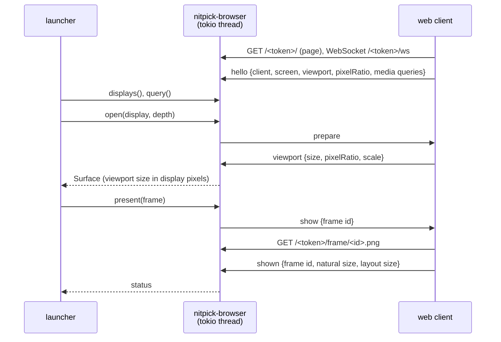

# Browser output driver

## Overview

The browser driver shows test patterns in a web page. It implements `OutputDriver` (see [overview.md](overview.md)).

Use:
- Real use: a remote display without a video input, for example an iPad with Safari. The measurement is of the display light with a probe. There is no wire to measure with a scope.
- Tests: a local Tauri webview window (`nitpick-webview`) on a desktop screen.

Scope:
- An HTTP and WebSocket server in the launcher process (crate `nitpick-browser`).
- A static web client (HTML and JavaScript, no framework), embedded in the server binary.
- A Tauri shell (crate `nitpick-webview`) that opens the client URL full screen on one local monitor.

The client sends `hello` again on each change of the media queries, the viewport or the pixel ratio. The server keeps the last state per client. `query` reads this state. A client that closes its WebSocket is removed from `displays`.

## Graphics path

Result of the API survey (Edge/Chrome, Firefox, Safari; November 2026):

| API | HDR output | Wide gamut | Bits |
|---|---|---|---|
| Canvas 2D | Chromium: behind a flag only (`colorType: "float16"`, `rec2100-pq`) | `display-p3` | 8 (float16 behind the flag) |
| WebGL 1 / 2 | none: `drawingBufferToneMapping` is an open Khronos proposal; Chromium has it behind a flag | `drawingBufferColorSpace = "display-p3"` | 8; float16 (`drawingBufferStorage`) Chromium only, not in Safari |
| WebGPU | Chromium 129+: `rgba16float` + `toneMapping: {mode: "extended"}`. Safari 26: in question (an earlier WebKit accepted `extended` and showed SDR on macOS). Firefox: none | `display-p3` | float16 |
| HDR image (``) | Chromium, Safari 26 (all platforms, iPadOS included): PQ and HLG images. Firefox: macOS only | via the image colour space (BT.2020) | 16-bit PNG |

Selected: the HDR image. A 16-bit PNG with a `cICP` chunk (BT.2020 primaries, PQ or HLG transfer, RGB) in an `` element. Reasons:
- It is the only HDR path in Safari on iPadOS that WebKit documents.
- The image carries code values, not linear light. This is the same model as the pattern (`Image` of codes). The WebGPU `extended` mode needs linear values relative to the SDR white, and no web API gives the SDR white luminance.
- No shader. The page does not change the decoded values.

If `dynamicRange` is `standard`, the browser tone maps the image to SDR. The driver shows it, and the status line shows "SDR preview". Firefox on Windows and Linux, and WebKitGTK (Tauri on Linux), show SDR also on an HDR display. The driver identifies them by the user agent and gives `hdr_on = Some(false)`.

### Code to PNG sample

Code $D$ at bit depth $n$ to the 16-bit sample $V$:

| Signalled range | cICP (primaries, transfer, matrix, full range) | $V$ |
|---|---|---|
| full (`pq-full`) | 9, 16, 0, 1 | $\mathrm{round}(D \cdot 65535 / (2^n - 1))$ |
| narrow (`pq-narrow`) | 9, 16, 0, 0 | $D \cdot 2^{16-n}$ |
| narrow (`hlg-narrow`) | 9, 18, 0, 0 | $D \cdot 2^{16-n}$ |

In all rows, $V$ decodes back to $D$ at bit depth $n$. The full-range rule is the same normalisation $D / (2^n - 1)$ as the FP16 path (see [Swap chain output](qt.md#swap-chain-output)).

Deviations from the QRhi driver:
- The browser driver signals the encoding of the pattern. QRhi always signals full-range PQ (see [Signalling](qt.md#signalling)). Thus `pq-narrow` shows black at code 64 as black, and `hlg-narrow` shows as HLG.
- **In question:** browser support of the narrow-range flag (full range = 0) in PNG `cICP`. If it is not supported, the driver writes all encodings as full-range PQ, as QRhi does. `query` gives `Unknown` for the narrow encodings until a test on each browser confirms it.

HDR10 metadata: the driver writes the PNG `mDCV` (ST 2086) and `cLLI` (CTA-861.3) chunks. **Unverified:** a browser uses these chunks for tone mapping.

### Pixel mapping

The client shows the image at one image pixel per display pixel:
- `open` gives the viewport size in display pixels: $\mathrm{round}(w_{css} \cdot r) \times \mathrm{round}(h_{css} \cdot r)$, $r$ = `devicePixelRatio`.
- The `` has the CSS size $W / r \times H / r$, `image-rendering: pixelated`, no transform, opacity 1 and `dynamic-range-limit: no-limit`. A transform or an opacity below 1 can clamp HDR to SDR (reported for WebKit).
- `pixel_exact` is `Yes` only if $r$ is an integer, `visualViewport.scale` is 1 and the client reports a layout size equal to the image size. Otherwise the browser resamples and changes codes. The driver continues and shows a warning.
- iPad: $r = 2$. Safari ignores `user-scalable=no`, so a pinch zoom changes `visualViewport.scale`. The client reports it.
- Tauri on Windows: the shell starts WebView2 with `--force-device-scale-factor=1`, so $r = 1$ at all Windows scale settings.

## Interface

HTTP (all paths under a random session token, see [Technical decisions](#technical-decisions)):

| Path | Content |
|---|---|
| `GET /<token>/` | client page |
| `GET /<token>/ws` | WebSocket, JSON messages |
| `GET /<token>/frame/<id>.png` | the frame PNG; `Cache-Control: no-store` |

WebSocket messages:

| Direction | Message | Fields |
|---|---|---|
| client → server | `hello` | `client` (user agent, `webview` flag), `screen` (`width`, `height` in CSS px), `viewport` (`width`, `height`, `scale`), `pixelRatio`, `dynamicRange` (`high`/`standard`), `colorGamut` (`rec2020`/`p3`/`srgb`), `fullscreen` |
| server → client | `prepare` | – (the client enters full screen if possible and sends `hello`) |
| server → client | `show` | `id`, `width`, `height` |
| client → server | `shown` | `id`, `naturalWidth`, `naturalHeight`, `layoutWidth`, `layoutHeight` (display px) |
| client → server | `error` | `id`, `message` (for example decode failure) |
| server → client | `close` | – (the client shows a black page) |

The client sends `shown` after `HTMLImageElement.decode()`, the DOM change and two `requestAnimationFrame` callbacks. `present` waits for `shown` for 10 s, then returns `Timeout`.

Mapping to `ModeSettings`:
- `hdr_on`: `dynamicRange == "high"`.
- `gamut`: `colorGamut`.
- `pixel_ratio`: `pixelRatio`.
- `wire_depth`, `peak_nits`, `min_nits`, `sdr_white_nits`: `None`. No web API gives them.

## Technical decisions

| Decision | Options | Selected | Reason |
|---|---|---|---|
| Graphics path | Canvas 2D; WebGL; WebGPU `extended`; HDR `` | HDR `` | See [Graphics path](#graphics-path). |
| Render location | server (`nitpick-core`, PNG); client (`nitpick-core` as WASM) | server | One renderer for the pattern, the reference table and the light level. A 4K pattern PNG is small, because the patterns have large flat regions. |
| Server | `axum` + `tokio` on a separate thread; `tiny_http` + `tungstenite` | `axum` + `tokio` | HTTP and WebSocket in one library. The Qt main thread does not run the server. |
| PNG encoder | `png` crate; own encoder | `png` crate | Writes 16-bit RGB. **Unverified:** it writes `cICP`, `mDCV` and `cLLI`. If not, the driver writes them with `Writer::write_chunk`. |
| Local test window | system browser; Tauri; `wry` direct | Tauri (`nitpick-webview`), separate process | A fixed engine (WebView2 on Windows), a borderless full-screen window on a selected monitor, browser arguments. Counter-intuitive: a separate process, because Tauri and Qt both need the main thread for their event loop. |
| Monitor selection (Tauri) | monitor index; screen position | screen position | Qt and Tauri do not use the same monitor order. The launcher gives the centre of the Qt screen geometry. The shell selects the monitor that contains it. |
| Access | open; random token in the URL | random token, server bound to localhost by default | A LAN address only when the user turns on remote displays. The token prevents an unknown client from becoming a display. |
| Full screen | Fullscreen API; Home Screen web app | Fullscreen API with a "Full screen" button | The API needs a user gesture. The client shows the button until `fullscreen` is true. |

## Usage

Local test:
1. In the launcher, select the driver "Browser (local webview)" and a screen.
2. "Show pattern" starts `nitpick-webview --url <url> --at <x>,<y>` if no webview client is on that screen. It waits 10 s for `hello`.

Remote display (iPad):
1. In the launcher, turn on remote displays. The launcher shows the URL with the LAN address.
2. Open the URL in Safari on the iPad. Tap "Full screen".
3. Select the iPad in the display list. Then select the pattern and "Show pattern".

## Testing

Settings before a measurement on an iPad:
- Turn off True Tone, Night Shift and auto-brightness. Set the brightness to a fixed value; the EDR headroom changes with it.
- iPad Pro with reference mode: turn it on for a known SDR white. **Unverified:** Safari keeps the PQ luminance in reference mode.

Tests:
- Unit: code to PNG sample for all codes of both depths and all three signalled ranges; decode with the `png` crate and the inverse rule gives the same code.
- Unit: the server with a mock WebSocket client: `hello` updates `query`; `present` without `shown` returns `Timeout`; a closed client gives `Disconnected`.
- Pixel mapping: with $r = 1$ and $r = 2$, the client reports a layout size equal to the image size. A screenshot of the Tauri window (SDR, `pq-grayscale` ramp) shows each ramp step at its pixel column.
- HDR: show `pq-grayscale` on a Windows HDR display in Tauri and on an iPad Pro in Safari. Measure the 100, 203 and 1000 cd/m² patches with a probe. Done when the error of each patch below the display peak is within the probe uncertainty. Record the result and the tone mapping above the peak here.

**Not done:** all tests. The graphics path survey is from documentation and bug reports, not from tests on devices.

## Future enhancements

- WebGPU `extended` mode as a second path in Chromium, for a display-relative signal without browser PQ tone mapping. It needs the SDR white luminance from the user.
- A QR code of the URL in the launcher.
