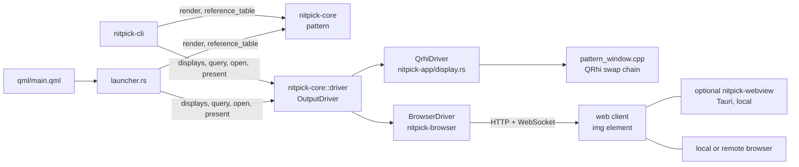

# Output drivers

## Overview

An output driver shows a rendered test pattern on one display. This design defines two drivers:
- **QRhi** (`qrhi`): a full-screen Qt window with an HDR swap chain on a local screen. See [qt.md](qt.md).
- **Browser** (`browser`): a web page that shows the pattern as an HDR image. The page runs in a local or remote browser, or in an optional Tauri webview for tests. See [browser.md](browser.md).

The compatibility API is one Rust trait, `OutputDriver`, in `nitpick-core` (module `driver`). It has no Qt, Tauri or network dependency. A host selects the driver, renders the pattern and controls measurement timing. The host can be the Qt launcher or a command-line program. Both use this trait for output. Driver setup, such as starting the browser server, is outside the trait. The drivers do not have the same features. The API reports each feature as supported, not supported or unknown, so that the host can reject options and the reference table can show the limits.

**Not implemented:** the common trait, browser driver and command-line host. The existing core library has no Qt dependency. The only current executable, `nitpick-app`, needs Qt. See [the output driver plan](../../plan/output_driver.md) for the remaining work.



### Host and dependency boundary

| Crate | Role | Dependencies at this boundary |
|---|---|---|
| `nitpick-core` | patterns, reference values, pixel calculations, driver types | Rust data and arithmetic; no GUI, server or executor |
| `nitpick-browser` (planned) | browser driver, PNG encoder, HTTP and WebSocket service | `nitpick-core`, Rust server and image libraries; no Qt or Tauri |
| `nitpick-cli` (planned) | command-line host for the browser driver | `nitpick-core`, `nitpick-browser`, a Rust executor; no `nitpick-app` |
| `nitpick-app` | Qt launcher and QRhi adapter | `nitpick-core`, `nitpick-browser`, Qt and its C++ bridge |
| `nitpick-webview` (planned) | optional local display process | Tauri; connects to the server by URL |

Dependencies go from each host or driver to the core. The core must not import a driver or host. Its current `output` module does pixel calculations without Qt or a GPU. Each host selects its concrete driver. The command-line host does not build or register QRhi. Build it by package; a workspace build also selects the Qt application.

The browser service has a Rust handle separate from the mutable `OutputDriver` borrow. It supplies the bound URL, pairing-code events, client-state events and shutdown. The host can receive a disconnect or viewport change while `present` or the measurement delay is pending. The console and Qt UI consume the same events. Server startup, authentication and client discovery must not require a `QObject`, a Qt screen list or a Tauri process.

For a command-line session:
1. Start the browser service. Print its URL and each pairing code when it arrives. Keep its event receiver active.
2. Open the URL in a local or remote browser. Authenticate and select full screen in the page if needed.
3. Wait for a valid client state, select its `DisplayId`, then call `query` and `open`. Render at the returned surface size.
4. Await `present`, then the measurement delay. Print the status and warnings.
5. Keep the service and current frame alive until replacement or exit. On exit, cancel pending work, close the surface and stop the service.

The browser page and browser process supply the display. The command-line host needs no local window system. HDR and code preservation still depend on the browser and display; see [browser limits](browser.md#graphics-path).

## Interface

Pseudo-code (Rust). The host gives code values and metadata settings. The driver converts pixels, calculates automatic light levels and encodes metadata.

```rust
use std::future::Future;
use std::pin::Pin;

pub enum Support {
    Yes,
    No(String),      // reason, shown by the host
    Unknown(String), // the driver cannot detect it; reason
}

pub struct DisplayId { pub driver: &'static str, pub key: String }

pub struct DisplayInfo {
    pub id: DisplayId,
    pub name: String,             // screen name, or client name and address
    pub size: (usize, usize),     // native pixels; the size of the reference table
}

/// Features available with the current display and OS settings.
pub struct Capabilities {
    pub depths: Vec<(BitDepth, DepthSupport)>,
    pub encodings: Vec<(Encoding, EncodingSupport)>,
    pub hdr_metadata: Support,                // ST 2086 + CTA-861.3 reach the display
    pub pixel_exact: Support,                 // one pattern pixel = one display pixel
}

pub struct DepthSupport {
    pub available: Support, // the driver can open this output path
    pub path: String,      // for example "HDR10 swap chain", "16-bit PNG, cICP PQ"
    pub exact: Support,    // the codes reach the wire or the panel without change
}

pub struct EncodingSupport {
    pub input: Support,           // the driver accepts frames in this encoding
    pub interpretation: Support,  // the output preserves the intended transfer and range
    pub auto_light_level: Support, // the driver can calculate absolute content light levels
}

/// Current settings of the OS, the driver and the browser. Read-only.
/// `None`: the driver cannot read the value.
pub struct ModeSettings {
    pub hdr_on: Option<bool>,
    pub gamut: Option<Gamut>,           // srgb, p3, rec2020
    pub wire_depth: Option<u8>,         // bits per component
    pub peak_nits: Option<f64>,
    pub min_nits: Option<f64>,
    pub sdr_white_nits: Option<f64>,
    pub pixel_ratio: f64,               // display pixels per layout pixel
    pub description: String,
}

pub struct Query { pub capabilities: Capabilities, pub mode: ModeSettings }

pub struct Surface { pub display: DisplayId, pub size: (usize, usize), pub description: String }

pub enum ContentLightLevel {
    FromFrame,
    Explicit { max_cll: f64, max_fall: f64 }, // cd/m²
}

pub struct Hdr10Request {
    pub primaries: [[f64; 2]; 3], // CIE xy, red, green, blue
    pub white: [f64; 2],
    pub max_mastering_nits: f64,
    pub min_mastering_nits: f64,
    pub light_level: ContentLightLevel,
}

pub struct Frame<'a> {
    pub image: &'a Image,                     // codes, size = surface size
    pub format: Format,
    pub metadata: Option<&'a Hdr10Request>,   // None: no metadata
}

pub enum OutputError {
    Unsupported { feature: String, reason: String },
    Disconnected,
    Timeout,
    Platform(String),
}

// No Send bound: QRhi must stay on the Qt GUI thread.
pub type PresentFuture<'a> =
    Pin<Box<dyn Future<Output = Result<String, OutputError>> + 'a>>;

pub trait OutputDriver {
    fn id(&self) -> &'static str;
    fn displays(&mut self) -> Vec<DisplayInfo>;
    fn query(&mut self, display: &DisplayId) -> Result<Query, OutputError>;
    /// Opens an available surface for `depth` and gives its pixel size.
    /// The host renders the pattern at this size.
    fn open(&mut self, display: &DisplayId, depth: BitDepth) -> Result<Surface, OutputError>;
    /// Resolves after driver acknowledgement, or an error. Yields while waiting.
    /// Returns a status line. Physical presentation is not confirmed.
    fn present<'a>(
        &'a mut self, surface: &'a Surface, frame: &'a Frame<'a>,
    ) -> PresentFuture<'a>;
    fn close(&mut self, display: &DisplayId);
}
```

Rules:
- `open` rejects a depth whose `available` is `No`. `present` rejects an encoding whose `input` is `No`, or metadata whose `hdr_metadata` is `No`. `FromFrame` also requires `auto_light_level` other than `No`.
- `interpretation = No` does not reject the frame. The host accepts the encoding and shows the reason in the status and reference table. This permits QRhi scope use with HLG codes and PQ signalling.
- `exact = No` and `pixel_exact = No` also produce warnings. They do not disable approximate output. For any selected feature with `Unknown`, continue with a warning.
- The driver resolves `Hdr10Request` to `Hdr10Metadata`. See [content light level calculation](../test_patterns.md#hdr10-static-metadata) for the shared calculation and the HLG rule.
- The host calls `query` again before each `open`, because the user can change the OS settings (HDR on/off, browser zoom) at any time.
- `displays`, `query` and `open` do not wait for network replies or user actions. Browser setup supplies the client state before these calls. A viewport change invalidates its surface; the host must open it again and render at the new size.

### Asynchronous presentation

The host polls `PresentFuture` with its executor. The future has no `Send` bound; this permits QRhi calls on the Qt GUI thread but does not require Qt. Drivers must wake the supplied Rust task waker. Waiting for render events, network replies or timeouts must yield to the host executor.

The Qt launcher uses an executor integrated with its event loop. Qt window and QRhi calls stay on the GUI thread. Do not use `block_on`, a sleep or a nested event loop on that thread. A command-line host can use a Tokio current-thread runtime with its timer enabled. It calls [`Runtime::block_on`](https://docs.rs/tokio/latest/tokio/runtime/struct.Runtime.html#method.block_on) at its entry point and awaits `present` directly. Do not pass this borrowed, non-`Send` future to `tokio::spawn`. A [Tokio `LocalSet`](https://docs.rs/tokio/latest/tokio/task/struct.LocalSet.html) can run owned local tasks if needed.

CPU pixel conversion and PNG encoding use worker jobs with owned input data. The browser server uses its own Tokio thread in both hosts. Workers and the server notify the host executor through Rust channels and wakers. They do not access Qt objects. Browser acknowledgement timeouts run on the server runtime. The future owns its pending jobs and callback registrations; the caller retains the frame data until the future is complete or dropped.

Only one presentation may be pending per driver. A new request cancels the old one before it borrows the driver again. Dropping the future cancels its wait, timer and callbacks without waiting for worker jobs. Work that has already reached the GPU or browser can still finish; cancellation does not undo that output. Use a unique frame ID for each request and discard late worker results and acknowledgements. A disconnect or a closed surface completes a pending future with `Disconnected`.

The host reports "Submitting pattern" until the future resolves. It continues to process controls or console input and service events. A new frame, a close request or a display change cancels the pending future and the measurement timer. Call `close` after releasing the future's borrow. `query` and `open` remain synchronous; browser authentication and viewport setup occur before `open`.

### Measurement delay

`present` confirms driver acknowledgement only. QRhi acknowledges a successful submission of the frame. The browser acknowledges client decode and layout. Neither reports physical scanout or stable display light.

The host owns the measurement delay. It accepts a non-negative integer in milliseconds. The default is 1000 ms. The Qt launcher saves its "Measurement delay (ms)" setting. The command-line host accepts the same setting as an option. **Unverified:** this default is sufficient for a particular display or probe.

After the `present` future succeeds, the host starts the delay and reports "Waiting for measurement delay". The Qt launcher uses a Qt timer; the command-line host uses an executor timer, such as `tokio::time::sleep`. Both continue to process events. When the timer expires, the status is "Ready after delay: N ms", with the driver warnings. A zero delay adds no wait. The driver acknowledgement timeout excludes this delay. The core types and browser driver do not depend on the Qt timer.

A new frame, a closed surface, a disconnect or a change of the selected display cancels the old timer. A failed `present` does not start it. Each timer belongs to one frame, so an old timer cannot mark a new frame ready.

Before a measurement, set the delay for the display and probe, show the pattern, and wait for "Ready after delay". Increase the delay if repeated readings still change. The delay is a timing allowance, not proof of physical presentation.

## Feature matrix

| Feature | QRhi | Browser |
|---|---|---|
| Displays | local screens (`QGuiApplication::screens()`) | connected web clients |
| 10-bit | HDR10 swap chain, exact if the compositor does not change codes | 16-bit PNG, cICP; exact: `Unknown` |
| 12-bit | FP16 scRGB where the luminance scale is known; macOS: `available = No`; see [Swap chain output](qt.md#swap-chain-output) | 16-bit PNG, cICP; exact: `Unknown` |
| `pq-narrow` / `pq-full` | `input = Yes`; written as full-range PQ codes; narrow interpretation: `No` | full-range PQ PNG; narrow input is rescaled; see [Code to PNG sample](browser.md#code-to-png-sample) |
| `hlg-narrow` | `input = Yes`, `interpretation = No`; scope use only | full-range HLG PNG; narrow input is rescaled; interpretation: `Unknown` |
| Automatic light levels | full-range PQ interpretation of all input encodings | PQ after PNG sample conversion; HLG: `No` |
| HDR10 metadata | Windows, Linux, macOS (see [HDR10 static metadata](qt.md#hdr10-static-metadata)) | embedded in the PNG (`mDCV`, `cLLI`); effect `Unknown` |
| `hdr_on` | Windows: DXGI output colour space | CSS `(dynamic-range: high)` |
| `gamut` | Windows: DXGI output primaries | CSS `(color-gamut: …)` |
| `wire_depth` | Windows: DXGI `BitsPerColor` | `None` |
| `peak_nits`, `min_nits` | Windows: DXGI (EDID) | `None` |
| `sdr_white_nits` | `None` | `None` |
| `pixel_exact` | `Yes` (swap chain size = pattern size) | `Yes` only for an integer `pixel_ratio` and a layout that fills the viewport |

Linux and macOS QRhi give `None` for the mode settings that the table gives for Windows only.

## Technical decisions

| Decision | Options | Selected | Reason |
|---|---|---|---|
| API location | `nitpick-app`; `nitpick-core`; new crate | `nitpick-core` | The trait uses only core types (`Image`, `Format`, `Hdr10Request`). The browser driver crate does not depend on Qt. |
| Host selection | Qt launcher only; separate GUI and command-line hosts | separate hosts | A browser output session must build and run without Qt or Tauri. Each host selects its drivers. |
| API input | pixels in the swap chain format; code values | code values (`Image`) | Each driver has a different pixel format. The conversion is a driver detail. |
| Unsupported features | one common subset; tri-state report per feature | separate input and interpretation reports | Scope use can require codes whose signalling differs from their nominal encoding. `Unknown` is necessary, because a browser cannot report what the OS compositor does. |
| Automatic metadata | launcher assumes PQ; driver supplies the effective signal to the shared calculation | driver supplies the effective signal | Pixel conversion can change range, transfer and clipping. The metadata must describe the signal sent. |
| Call model | synchronous; asynchronous | asynchronous `present`, synchronous `query` and `open` | GPU submission and remote clients can be slow. Waiting yields to the host executor. Browser `open` uses prepared client state. |
| Future type | native async trait method; boxed future | boxed future without `Send` | Supports `dyn OutputDriver` and GUI-thread-only QRhi operations. The core API needs no executor or GUI dependency. |
| Measurement timing | assumed physical completion; fixed delay; user delay after acknowledgement | user delay in the host | Display and probe timing differ. The host supplies the timer and handles cancellation. |

## Testing

- Without Qt or Tauri: build `nitpick-cli` by package, run its browser service, authenticate a mock client, render with the real core, fetch and decode the PNG, send `applied`, and check the delay and shutdown. Run this test on a machine without a window system. Check that its dependency graph has no Qt, Tauri or `nitpick-app` packages.
- Run the same presentation and cancellation contract tests with a command-line executor and the Qt executor. Include service events during a pending presentation and after acknowledgement, while the delay is active.
- Unit tests with a mock driver: reject `available = No` and `input = No`; keep `input = Yes` selectable when `interpretation = No`; show warnings for `No` interpretation or precision and for `Unknown`; map each `OutputError` to a status line.
- Async tests: delayed acknowledgement leaves Qt timers and controls active. Dropping the future releases callbacks and permits a new request. Late results cannot complete that request. A closed surface or disconnected client returns `Disconnected`; missing acknowledgement returns `Timeout`.
- Test the delay with a controlled clock: readiness follows acknowledgement plus the selected delay; zero adds no wait; errors start no timer; replacement, closure and disconnect cancel the old timer. Verify that Qt still processes events during the delay.
- Each driver: `query` of a display with HDR off gives `hdr_on = Some(false)` (QRhi on Windows, browser) and the launcher shows it.

## Future enhancements

- A driver for a hardware pattern generator or a video output card, through the same trait.
