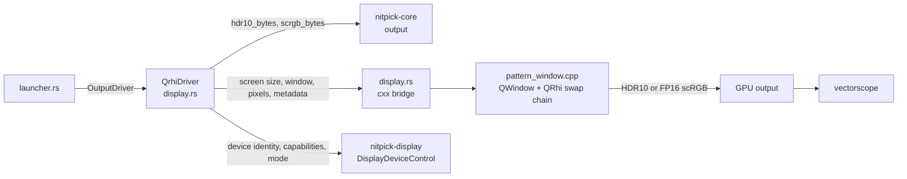

# QRhi output driver

## Overview

The QRhi driver shows test patterns in a borderless full-screen Qt window on a local screen. It sends the code values through an HDR swap chain to the GPU output. The measurement is of the signal on the wire, with a vectorscope or a waveform monitor. It implements `OutputDriver` (see [overview.md](overview.md)).

Mapping to `OutputDriver`:

| Trait call | Adapter (`display.rs`) |
|---|---|
| `displays` | Map Qt screens to native devices from `DisplayDeviceControl`; get window pixel geometry from Qt |
| `query` | Combine the refreshed native device report with QRhi path support and conversion limits; reject an FP16 path without a known luminance scale |
| `open` | `openPatternWindow(screen, fp16)`; `fp16` from the bit depth (see [Swap chain output](#swap-chain-output)) |
| `present` | `presentPattern(pixels, width, height, metadata)`; wait for successful submission of this frame |

The pattern window closes on Esc, Q, Space or a double click.

The pattern area is the swap chain without the safe-area margins of the window (`QWindow::safeAreaMargins`). The shader draws the pattern 1:1 from the top-left corner of this area. Pixels outside the area are black. The reference table uses the same size, calculated from the screen before the window opens:
- macOS: the `NSScreen` frame without `safeAreaInsets` (the camera housing), in backing pixels. On a screen with a camera housing, the top inset is the larger of `safeAreaInsets.top` and the menu bar height. macOS places a full-screen window below the menu bar, which is 1 point taller than the inset.
- Windows: the monitor rectangle. Linux: the screen geometry in device pixels. Qt gives no screen safe-area insets on these platforms.

The status line shows a warning if the window area and the table size differ. **Unverified:** that this macOS size always equals the full-screen window size. Only a MacBook Pro (M1 Max) built-in display with a visible menu bar was checked; external displays and a hidden menu bar were not.

Only this adapter requires the Qt GUI thread and event loop. It stays in `nitpick-app`; the core and browser driver do not import it. See [Host and dependency boundary](overview.md#host-and-dependency-boundary) for command-line use without Qt.

Physical display discovery and capability queries use [`nitpick-display`](../display_device.md). The C++ bridge keeps window, swap-chain and submission work. It does not maintain a second native capability enumerator. The host refreshes the device report before calling synchronous `query` and `open`; a changed or missing device invalidates the cached mapping.

The bridge queues the frame and returns to the Qt event loop. It reports the frame ID after its texture upload and a successful `endFrame`. This callback resolves the `present` future. `requestUpdate()` alone is not an acknowledgement. The bridge does not run a nested event loop. An unrecoverable error or a 10 s timeout from queueing the frame fails the future. Closing the window reports `Disconnected`. Cancellation removes the pending completion callback; late results are discarded by frame ID. This does not confirm physical scanout. The launcher then applies the [measurement delay](overview.md#measurement-delay).

## Signalling

The output path targets PQ / BT.2020 full range. All input encodings are accepted. The 10-bit path writes their code values directly; the 12-bit path has the conversion limits below. Thus:
- `pq-full` is the native case.
- `pq-narrow` codes reach the wire unchanged only if the GPU output is RGB full range.
  The display then shows black at code 64 (raised black). This is expected. Set the scope to narrow range.
- `hlg-narrow` is for scope use only. The swap chain cannot signal HLG, so the display interprets the codes as PQ.

For `pq-full`, `interpretation` is `Yes` for the signalled transfer and range. For both narrow encodings it is `No`, with a warning about PQ full-range interpretation. `input` is `Yes` for all three. These warnings keep the scope workflows available. They do not certify that the compositor preserves codes or luminance.

## Swap chain output

No swap chain API (DXGI, Vulkan, Metal) has a 12-bit integer format. Thus the bit depth selects the swap chain:

| Bit depth | Swap chain | Pixel conversion (`output` module) | Codes on the wire |
|---|---|---|---|
| 10-bit | HDR10: 10-bit unorm, PQ, BT.2020 | none: packed `R10G10B10A2` | exact, if the compositor and the driver do not change them |
| 12-bit, known 80 cd/m² scale | FP16 scRGB: linear, BT.709 primaries | code → PQ EOTF → BT.2020-to-BT.709 matrix → f16 | the compositor or the driver encodes them back to PQ / BT.2020 |

The scale is a property of the platform, not of the FP16 storage format. Windows scRGB uses 1.0 = 80 cd/m². The Linux path uses the scRGB convention of its extended-linear-sRGB Vulkan colour space; its compositor behaviour still needs a device test.

On macOS, Qt's linear HDR path uses 1.0 for the current SDR white. Its luminance varies with display settings and is not known to the driver. See [Qt's luminance behaviour](https://github.com/qt/qtbase/blob/6.12/src/gui/rhi/qrhi.cpp). Thus macOS reports `available = No` for 12-bit output, with the reason "absolute FP16 luminance scale unavailable". `open` also rejects it. Do not substitute 80, 100 or Qt's placeholder SDR-white value, or reduce the output to 10 bits. HDR10 10-bit output remains available when the swap chain supports it.

A fragment shader copies one texel per pixel with `texelFetch` (no filtering, no blending). Thus the swap chain gets the texture values unchanged.

For the supported 80 cd/m² path, convert the code triple $(R', G', B')$ at depth $n$:
1. Each code is a full-range PQ code on the wire: $L = \mathrm{EOTF}_{PQ}(D / (2^n - 1))$ in cd/m².
2. $L_{709} = M \cdot L_{2020}$. $M$ is calculated from the BT.709 and BT.2020 primaries and D65.
3. The value is $L_{709} / 80$, rounded to f16.
4. Deviation from a plain conversion: rounding each component separately is not sufficient. The matrix mixes the rounding error of the bright components into the dark ones. The conversion thus searches ±2 f16 steps per component. It takes the triple that a reference decoder (exact inverse matrix, PQ inverse EOTF, round, negative values clamped to 0) decodes closest to the codes.

Results of the reference decoder for this 80 cd/m² path:
- All 4096 12-bit grey codes decode exactly, also without the search.
- All full-range levels and all BT.709 bars of BT.2111 decode exactly.
- Saturated narrow-range bars do not decode exactly (36 levels over all formats at 2K). They have a component at 0 % (code 64 or 256). On the full-range wire this is a small positive luminance, and the f16 error of the bright components is larger than one code step there. A larger search does not solve this (±8 steps: 31 levels). The reference table marks these levels with `*`.

**Unverified:** the real compositor and driver use the same matrix and arithmetic as the reference decoder. A different matrix precision moves more levels.

The `*` marks apply only to this FP16 path. A browser reference table uses its own conversion and clipping limits. An unavailable path has no claim of exact output.

## HDR10 static metadata

The metadata values are in [HDR10 static metadata](../test_patterns.md#hdr10-static-metadata). QRhi has no metadata API. The window sets the metadata on the native swap chain before the first present:

| Platform | Call | Access to the native swap chain |
|---|---|---|
| Windows | `IDXGISwapChain4::SetHDRMetaData` | Qt private header `qrhid3d11_p.h` (`QD3D11SwapChain::swapChain`) |
| Linux | `vkSetHdrMetadataEXT` (device extension `VK_EXT_hdr_metadata`, requested if available) | Qt private header `qrhivulkan_p.h` (`QVkSwapChain::sc`) |
| macOS | `CAMetalLayer.EDRMetadata = [CAEDRMetadata HDR10MetadataWithDisplayInfo:…]` | Qt private header `qpa/qplatformwindow_p.h` (`QNativeInterface::Private::QCocoaWindow::contentLayer`). The `NSView` layer is a container; the `CAMetalLayer` is its content sublayer. |

Each pattern window has a new swap chain without metadata, so "off" needs no call.

Automatic light levels use $D / (2^n - 1)$ as full-range PQ for every input encoding, including HLG scope input. This describes the intended PQ signal of this driver. It is not an HLG luminance calculation or a measurement of compositor output.

**In question:**
- DXGI: the documentation gives `MaxMasteringLuminance` in whole cd/m² and `MinMasteringLuminance` in 0.0001 cd/m². nitpick follows the documentation. Some sample code uses 0.0001 cd/m² for both.
- macOS: `opticalOutputScale` is 100 (linear 1.0 = 100 cd/m², as in Chromium). Its effect on a PQ layer is not documented.
- The effect of the metadata on the display is not measured.

## Technical decisions

| Decision | Options | Selected | Reason |
|---|---|---|---|
| HDR output | QRhi on all platforms; direct D3D11 on Windows and QRhi elsewhere | QRhi on all platforms | One code path for Windows, Linux and macOS. Counter-intuitive: the draw call adds a shader on Windows. `texelFetch` keeps the values, so the shader does not change codes. |
| Shaders | `qsb` at build time; precompiled files in git | `qsb` at build time | Reproducible from the GLSL source. `build.rs` embeds the result in a generated header. |
| Swap chain | HDR10 for 10-bit; FP16 scRGB for 12-bit | as listed | No API has a 12-bit integer swap chain. FP16 is the only format with more than 10 bits. QRhi checks the format first, because it falls back to SDR without an error. |
| FP16 luminance scale | assume 80 on all platforms; calibrate each display; reject paths without a known scale | reject paths without a known scale | A guessed scale changes PQ luminance and codes. Calibration is outside the current scope. |
| Adapter (Windows) | default adapter; adapter of the monitor | adapter of the monitor | Prevents a cross-adapter copy on hybrid-GPU systems. QRhi gets the adapter LUID. |
| Metadata on Linux | Qt private API; none | Qt private API | QRhi exposes no `VkSwapchainKHR`. Cost: the binary must use the exact Qt version of its private headers. |

## Testing

Settings before a measurement:
1. Turn on HDR in the system display settings for the test display.
2. In the GPU control panel, set the output colour depth to 10 bpc or more (12 bpc for 12-bit). With 8 bpc, the driver dithers and the codes are not exact. On Windows the launcher shows the wire bit depth after "Show pattern".
3. Select the output format:
   - RGB full range: compare the input codes, subject to the FP16 limits above.
   - YCbCr narrow range: use `pq-full`. Compare with the Y'Cb'Cr' columns of the reference table.
4. Turn off Night light and other colour filters.
5. Set the [measurement delay](overview.md#measurement-delay) and wait for readiness before each reading.

Tests and pass criteria are in [Output verification](testing.md): [QRhi unit tests](testing.md#qrhi-output), [GPU readback](testing.md#qrhi-readback), and [physical output criteria](testing.md#pass-criteria). See [the measurement plan](../../plan/test_patterns.md) for pending device work.

**Not done:** hardware verification of code preservation, metadata effects and the measurement delay.

## Future enhancements

- Calibrated 12-bit output on platforms whose linear HDR scale follows the display white. This needs a measured scale and a policy for display-setting changes before the path can be enabled.
