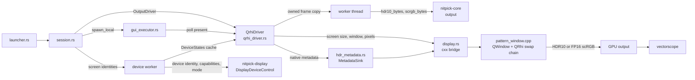
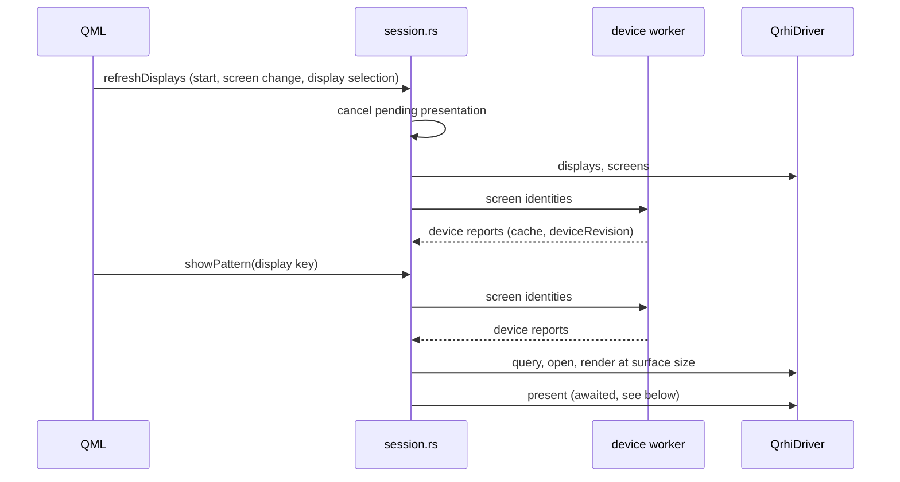

# QRhi output driver

## Overview

The QRhi driver shows test patterns in a borderless full-screen Qt window on a local screen. It sends the code values through an HDR swap chain to the GPU output. The measurement is of the signal on the wire, with a vectorscope or a waveform monitor. It implements `OutputDriver` (see [overview.md](overview.md)).

Mapping to `OutputDriver`:

| Trait call | Adapter (`qrhi_driver.rs`) |
|---|---|
| `displays` | List the Qt screens by native screen key (see [Screen to device mapping](#screen-to-device-mapping)); get the pattern area size from Qt |
| `query` | Combine the cached native device report with QRhi path support and conversion limits; report a remapped path, such as an FP16 path without a known luminance scale, as `Unknown` |
| `open` | `openPatternWindow(screen, fp16)`; `fp16` from the bit depth (see [Swap chain output](#swap-chain-output)) |
| `present` | Convert on a worker (see [Asynchronous presentation](#asynchronous-presentation)). Then send the [HDR10 static metadata](#hdr10-static-metadata) and `presentPattern(pixels, width, height)`; wait for successful submission of this frame |

The pattern window closes on Esc, Q, Space or a double click.

The pattern area is the swap chain without the safe-area margins of the window (`QWindow::safeAreaMargins`). The shader draws the pattern 1:1 from the top-left corner of this area. Pixels outside the area are black. The reference table uses the same size, calculated from the screen before the window opens:
- macOS: the `NSScreen` frame without `safeAreaInsets` (the camera housing), in backing pixels. On a screen with a camera housing, the top inset is the larger of `safeAreaInsets.top` and the menu bar height. macOS places a full-screen window below the menu bar, which is 1 point taller than the inset.
- Windows: the monitor rectangle. Linux: the screen geometry in device pixels. Qt gives no screen safe-area insets on these platforms.

`openPatternWindow` waits until the pattern area has the table size, for a maximum of 5 s. After this time it uses the current size. Reason: GNOME 50 on Wayland first shows the window at the work-area size and makes it full-screen later. There, the open took 0.3 to 0.5 s.

The status line shows a warning if the window area and the table size differ. **Unverified:** that this macOS size always equals the full-screen window size. Only a MacBook Pro (M1 Max) built-in display with a visible menu bar was checked; external displays and a hidden menu bar were not.

Only this adapter requires the Qt GUI thread and event loop. It stays in `nitpick-app`; the core and browser driver do not import it. See [Host and dependency boundary](overview.md#host-and-dependency-boundary) for command-line use without Qt.

Physical display discovery and capability queries use [`nitpick-display`](../display_device.md). The C++ bridge keeps window, swap-chain and submission work. It does not maintain a second native capability enumerator. The host refreshes the device report before calling synchronous `query` and `open`; a changed or missing device invalidates the cached mapping.

### Screen to device mapping

The bridge gives only the native identity of a Qt screen (`screenIdentity`). The `DisplayId` key of a screen is its native name in the first column below. Unlike the Qt screen index, it does not change when another screen is added or removed. The adapter maps the identity to a device and reads the device through `DisplayDeviceControl::query_device`:

| Platform | Screen identity (`DisplayId` key) | Device match |
|---|---|---|
| Windows | `MONITORINFOEXW::szDevice` of the screen's `HMONITOR` | The one active `DisplayConfig` path with this GDI source name. A source with two targets (clone mode) is ambiguous. |
| macOS | `NSScreenNumber` of the `NSScreen` | The active display with this `CGDirectDisplayID`. |
| Linux | `QScreen::name()` and `QGuiApplication::platformName()` | The rule in [Linux reports](../display_device.md#linux-reports). On `xcb`, the adapter reads the RandR output of the same name through a second X connection to `DISPLAY` (`x11` feature of `nitpick-display`); Qt does not give the EDID. Other Qt platforms have no mapping. |

A screen without one match has an unknown device report with the reason. Output continues with the path rules below and warnings. **Unverified:** the macOS mapping; it was not built or run on macOS. The Linux mapping on a real desktop; only injected device lists were tested.

### Host lifecycle

`session.rs` keeps the host lifecycle on the GUI thread. `launcher.rs` connects it to QML. The device reports are in a cache that the session and the driver share. `query` and `open` read the cache and do no native I/O.

Rules:
- Each refresh replaces all cached reports, so a removed or changed screen loses its old report. A refresh older than the applied one does nothing.
- The reference table uses the cached report of the selected display and the screen size from `displays`. Before the first report, the table shows the path limits with an unknown display state.
- A new "Show pattern", a display selection or a screen change drops the pending presentation before the driver is borrowed again. A screen change closes the window if its screen is gone. Statuses go through the Qt event queue in order. A status of an older request does not apply.
- `open` runs a nested event loop without user input (see above). If a screen change arrives in this loop, the refresh cannot borrow the driver; the launcher posts it again.

### Output report

The adapter combines the device report with these path rules:

| Field | Rule |
|---|---|
| 10-bit and 12-bit `available` | Windows: `Unknown` if the device reports HDR off, also for SDR WCG. Reason: Qt 6.12 D3D11 gives both HDR swap chain formats only for an output in the DXGI PQ colour space (`QDxgiHdrInfo::isHdrCapable`). Otherwise it uses an 8-bit SDR swap chain. macOS 12-bit: `Unknown` (see [Swap chain output](#swap-chain-output)). Linux 12-bit: `Unknown`, because the compositor scale is not tested. Otherwise `Yes`; the window checks swap chain support when it opens. |
| `exact` | Never `Yes`: no device report includes calibration, dithering or compositor changes. `No` if the display reports no HDR support, if HDR is off, or if the wire depth is below the pattern depth. 12-bit is always `No` because of the FP16 limits. |
| `hdr_metadata` | Windows and macOS: `Yes`. Linux: `Unknown`; the status line reports a missing `VK_EXT_hdr_metadata` after the pattern is shown. |
| `ModeSettings` | Only from `DeviceMode`. Advanced Color support, SDR WCG, a gamut or a GPU colour conversion does not set `hdr_on`. `pixel_ratio` is 1. |

The launcher applies `check_open` and `check_frame` before the window opens. Thus a rejected path fails before pixel conversion. A remapped path, such as Windows with HDR off or macOS 12-bit, has `available = Unknown`: the window shows the pattern and the status line shows the warning. `exact` is `No` for these paths.

The window checks the swap chain format with `QRhiSwapChain::isFormatSupported`. If QRhi does not accept the format, the window still opens. `PatternSurface::fallback` gives the swap chain that QRhi uses instead, and the status line shows it as a warning. Qt 6.12 behaviour:
- D3D11: an 8-bit SDR swap chain (sRGB, BT.709). The codes are shown as SDR values.
- Vulkan: the first surface format of the compositor.
- Metal: the requested format. Without EDR headroom, macOS clips at SDR white.

If `SetHDRMetaData` fails on Windows, the status line shows that the metadata was not sent. The pattern stays on the screen.

The bridge queues the frame and returns to the Qt event loop. It reports the frame ID after its texture upload and a successful `endFrame`. This callback resolves the `present` future. `requestUpdate()` alone is not an acknowledgement. The bridge does not run a nested event loop. This does not confirm physical scanout. The launcher then applies the [measurement delay](overview.md#measurement-delay).

`submission.rs` keeps the frame state on the Qt GUI thread. The window keeps one pixel buffer; the render reports its events by frame ID:

| Event | Result |
|---|---|
| Render uploads the queued frame, `endFrame` succeeds | Success |
| `beginFrame` gives an error or device loss | `Platform` error for the queued frame; it does not upload later |
| `beginFrame` gives an out-of-date swap chain after one resize | The window retries at the next update |
| Texture or pipeline creation fails, or `endFrame` fails | `Platform` error for the uploaded frame; the previous pattern stays |
| 10 s from queueing without an upload | `Timeout`; the frame does not upload later |
| The window closes or is replaced | `Disconnected` for the pending completion |
| A new frame before the render | The new frame replaces the old pixels; only the new frame uploads |

Cancellation removes the completion. A cancelled frame that is queued can still upload, because the window can show it until a replacement. Late events of other frame IDs do nothing. The timeout timer of a cancelled frame stays in Qt until it expires or the window closes; it then does nothing.

### Asynchronous presentation

`QrhiDriver::present` follows [Asynchronous presentation](overview.md#asynchronous-presentation):
1. On the GUI thread: check the surface, the depth, the image size and `check_frame`. A failed check spawns no worker.
2. A worker thread gets a copy of the image, the format and the metadata request. It makes the swap chain bytes and resolves the metadata. The result goes back through a oneshot channel, which wakes the task.
3. On the GUI thread: send the metadata, then queue the frame through `submission.rs`. No await occurs between these two calls.
4. The `submission.rs` completion sends the result through a second oneshot channel, which wakes the task. The future returns the status line: surface, device mode, metadata result and warnings.

Dropping the future drops both receivers and the submission registration. It does not wait for the worker. A worker that has not started skips the conversion; a running worker discards its result. A queued frame can still upload, as in the table above.

`gui_executor.rs` runs the future on the GUI thread. `async-task` keeps the task. A wake, also from a worker thread, posts the next poll through `CxxQtThread::queue` of the launcher. The first poll is also posted, so "Show pattern" returns before the task runs. Counter-intuitive behaviour:
- Dropping the `LocalTask` handle drops the future at once. `async-task` alone drops a cancelled future at the next event loop pass, after the launcher borrows the driver again.
- If the event loop rejects a post from a worker thread (at exit, after the launcher is destroyed), the task step is leaked. `async-task` panics if a local task step drops on another thread.

The session keeps the driver in `Rc<RefCell<…>>`. The task holds the driver borrow from `open` until `present` completes. A new request drops the earlier task before it borrows the driver, so the earlier `Disconnected` does not reach the status line. See [Host lifecycle](#host-lifecycle). `query` and `open` stay synchronous. `open` still runs a nested event loop without user input for up to 5 s, see above.

**Unverified:** that Qt timers and controls stay active during the device read, conversion and submission in the real Qt event loop. The unit tests of `qrhi_driver.rs` and `session.rs` use a simulated event loop with controlled workers.

## Signalling

The output path targets PQ / BT.2020 full range. All input encodings are accepted. The 10-bit path writes their code values directly; the 12-bit path has the conversion limits below. Thus:
- `pq-full` is the native case.
- `pq-narrow` codes reach the wire unchanged only if the GPU output is RGB full range.
  The display then shows black at code 64 (raised black). This is expected. Set the scope to narrow range.
- `hlg-narrow` is for scope use only. The swap chain cannot signal HLG, so the display interprets the codes as PQ.

For `pq-full`, `interpretation` is `Yes` for the signalled transfer and range. For both narrow encodings it is `No`, with a warning about PQ full-range interpretation. `input` is `Yes` for all three. These warnings keep the scope workflows available. They do not certify that the compositor preserves codes or luminance.

## Swap chain output

No swap chain API (DXGI, Vulkan, Metal) has a 12-bit integer format. Thus the bit depth selects the swap chain:

| Bit depth | Swap chain | Pixel conversion (`output` module) | Codes on the wire |
|---|---|---|---|
| 10-bit | HDR10: 10-bit unorm, PQ, BT.2020 | none: packed `R10G10B10A2` | exact, if the compositor and the driver do not change them |
| 12-bit, known 80 cd/m² scale | FP16 scRGB: linear, BT.709 primaries | code → PQ EOTF → BT.2020-to-BT.709 matrix → f16 | the compositor or the driver encodes them back to PQ / BT.2020 |

The scale is a property of the platform, not of the FP16 storage format. Windows scRGB uses 1.0 = 80 cd/m². The Linux path uses the scRGB convention of its extended-linear-sRGB Vulkan colour space; its compositor behaviour still needs a device test. GNOME 50 on Wayland gives no extended-linear-sRGB colour space (checked with NVIDIA 595 and with RADV in Mesa 26.0.8). Thus the 12-bit path uses the Vulkan fallback there, with a warning.

On Linux, the display state comes from the [screen to device mapping](#screen-to-device-mapping). The adapter does not use QRhi's `hdrInfo()`: the Qt 6.12 Vulkan backend reads the display only on Windows; on Linux it gives fixed default values (0 to 1000 cd/m²). A successful HDR10 open does not show that HDR is on: GNOME 50 on Wayland gives an HDR10 swap chain also for an SDR display with HDR off. **Unverified:** how the compositor converts the HDR10 signal for an SDR display.

On macOS, Qt's linear HDR path uses 1.0 for the current SDR white. Its luminance varies with display settings and is not known to the driver. See [Qt's luminance behaviour](https://github.com/qt/qtbase/blob/6.12/src/gui/rhi/qrhi.cpp). Thus macOS reports `available = Unknown` and `exact = No` for 12-bit output, with the reason "absolute FP16 luminance scale unavailable". The window shows the pattern with the 80 cd/m² conversion, so the luminance is wrong by the ratio of SDR white to 80 cd/m². Use it only for a visual check. Do not claim an absolute scale with 80, 100 or Qt's placeholder SDR-white value, or reduce the output to 10 bits. HDR10 10-bit output remains available when the swap chain supports it.

A fragment shader copies one texel per pixel with `texelFetch` (no filtering, no blending). Thus the swap chain gets the texture values unchanged.

For the supported 80 cd/m² path, convert the code triple $(R', G', B')$ at depth $n$:
1. Each code is a full-range PQ code on the wire: $L = \mathrm{EOTF}_{PQ}(D / (2^n - 1))$ in cd/m².
2. $L_{709} = M \cdot L_{2020}$. $M$ is calculated from the BT.709 and BT.2020 primaries and D65.
3. The value is $L_{709} / 80$, rounded to f16.
4. Deviation from a plain conversion: rounding each component separately is not sufficient. The matrix mixes the rounding error of the bright components into the dark ones. The conversion thus searches ±2 f16 steps per component. It takes the triple that a reference decoder (exact inverse matrix, PQ inverse EOTF, round, negative values clamped to 0) decodes closest to the codes: smallest largest-component code error, then smallest sum of step offsets. On an equal score, the offset $(\Delta R, \Delta G, \Delta B)$ that is first in lexicographic order wins.

Results of the reference decoder for this 80 cd/m² path:
- All 4096 12-bit grey codes decode exactly, also without the search.
- All full-range levels and all BT.709 bars of BT.2111 decode exactly.
- Saturated narrow-range bars do not decode exactly (36 levels over all formats at 2K). They have a component at 0 % (code 64 or 256). On the full-range wire this is a small positive luminance, and the f16 error of the bright components is larger than one code step there. A larger search does not solve this (±8 steps: 31 levels). The reference table marks these levels with `*`.

**Unverified:** the real compositor and driver use the same matrix and arithmetic as the reference decoder. A different matrix precision moves more levels.

The `*` marks apply only to this FP16 path. A browser reference table uses its own conversion and clipping limits. An unavailable path has no claim of exact output.

## HDR10 static metadata

The metadata values are in [HDR10 static metadata](../test_patterns.md#hdr10-static-metadata). QRhi has no metadata API. The adapter sets the metadata on the native swap chain before it presents the frame:

| Platform | Native structure | Set | Remove | Access to the native swap chain |
|---|---|---|---|---|
| Windows | `DXGI_HDR_METADATA_HDR10` | `IDXGISwapChain4::SetHDRMetaData` | `SetHDRMetaData(DXGI_HDR_METADATA_TYPE_NONE)` | Qt private header `qrhid3d11_p.h` (`QD3D11SwapChain::swapChain`) |
| Linux | `VkHdrMetadataEXT` | `vkSetHdrMetadataEXT` (device extension `VK_EXT_hdr_metadata`, requested if available) | None | Qt private header `qrhivulkan_p.h` (`QVkSwapChain::sc`) |
| macOS | SEI payloads and `opticalOutputScale` | `CAMetalLayer.EDRMetadata = [CAEDRMetadata HDR10MetadataWithDisplayInfo:…]` | `EDRMetadata = nil` | Qt private header `qpa/qplatformwindow_p.h` (`QNativeInterface::Private::QCocoaWindow::contentLayer`). The `NSView` layer is a container; the `CAMetalLayer` is its content sublayer. |

`hdr_metadata.rs` resolves the request and packs the native structure in Rust. The C++ bridge copies the fields into the native call; it does no unit conversion. The packing goes through the `MetadataSink` trait; unit tests inject a recording sink. Rules:
- All backends get the values after rounding to the ST 2086 and CTA-861.3 fields. Vulkan gets these values as `f32` in natural units.
- DXGI `MaxMasteringLuminance` is in whole cd/m², rounded half up. The other DXGI luminance fields keep their ST 2086 and CTA-861.3 units.
- A new swap chain has no metadata. Metadata off on a swap chain without metadata makes no call.
- A frame with metadata always sends it, also if the values did not change. A frame with metadata off after a frame with metadata removes it.
- A failed call does not stop the frame; the status line reports it. After a failed set, earlier metadata can stay on the swap chain. Vulkan has no remove call, so the status line reports that the earlier metadata stays until the window closes.

Automatic light levels use $D / (2^n - 1)$ as full-range PQ for every input encoding, including HLG scope input. This describes the intended PQ signal of this driver. It is not an HLG luminance calculation or a measurement of compositor output.

**In question:**
- DXGI: the documentation gives `MaxMasteringLuminance` in whole cd/m² and `MinMasteringLuminance` in 0.0001 cd/m². nitpick follows the documentation. Some sample code uses 0.0001 cd/m² for both.
- macOS: `opticalOutputScale` is 100 (linear 1.0 = 100 cd/m², as in Chromium). Its effect on a PQ layer is not documented.
- The effect of the metadata on the display is not measured.

## Technical decisions

| Decision | Options | Selected | Reason |
|---|---|---|---|
| HDR output | QRhi on all platforms; direct D3D11 on Windows and QRhi elsewhere | QRhi on all platforms | One code path for Windows, Linux and macOS. Counter-intuitive: the draw call adds a shader on Windows. `texelFetch` keeps the values, so the shader does not change codes. |
| Shaders | `qsb` at build time; precompiled files in git | `qsb` at build time | Reproducible from the GLSL source. `build.rs` embeds the result in a generated header. |
| Swap chain | HDR10 for 10-bit; FP16 scRGB for 12-bit | as listed | No API has a 12-bit integer swap chain. FP16 is the only format with more than 10 bits. The window checks the format first, because QRhi falls back without an error. |
| FP16 luminance scale | assume 80 on all platforms; calibrate each display; reject paths without a known scale; warn on paths without a known scale | warn on paths without a known scale | A guessed scale changes PQ luminance and codes, so `exact` is `No`. The pattern stays usable for a visual check. Calibration is outside the current scope. |
| Remapped output (HDR off, QRhi format fallback) | fail; show the pattern with a warning | show the pattern with a warning | The OS or the compositor remaps the output, but the pattern stays usable for a visual check. `exact` and the warnings prevent a false claim of exact output. |
| Adapter (Windows) | default adapter; adapter of the monitor | adapter of the monitor | Prevents a cross-adapter copy on hybrid-GPU systems. QRhi gets the adapter LUID. |
| Metadata on Linux | Qt private API; none | Qt private API | QRhi exposes no `VkSwapchainKHR`. Cost: the binary must use the exact Qt version of its private headers. |
| GUI-thread executor | `qmetaobject` `execute_async`; a C++ bridge that posts with `QMetaObject::invokeMethod`; `async-task` with `CxxQtThread::queue` | `async-task` with `CxxQtThread::queue` | `qmetaobject` is a different Qt binding. `CxxQtThread::queue` is the existing cxx-qt path to the GUI thread and accepts jobs from any thread. `async-task` gives the task state and wakers; the glue code is only the post and the drop handle. |
| Wake channels | custom wakers in `submission.rs`; `futures-channel` oneshot | `futures-channel` oneshot | The receiver wakes the task on send. A dropped receiver tells the worker that the result is not needed. |
| `DisplayId` key | Qt screen index; native screen name | native screen name | The index changes when another screen is added or removed. The native name is the input of the device mapping. |
| Device report timing | query on the GUI thread; refresh on a worker into a shared cache | worker into a shared cache | Native queries can block. `query` and `open` stay synchronous, as the trait requires. The cache is outside the driver borrow, so the reference table can read it while a presentation holds the driver. |
| Lifecycle location | in the `QObject`; a separate Rust type | separate type (`session.rs`) | Tests run it with a simulated event loop, a fake window and held workers, without Qt. |
| X11 EDID source | Qt private `QXcbScreen`; `xcb-randr` in C++; `x11rb` in Rust | `x11rb` | Pure Rust: no extra C library, and the code compiles on every OS. Cost: a second X connection, which follows only `DISPLAY`. |

## Testing

Settings before a measurement:
1. Turn on HDR in the system display settings for the test display.
2. In the GPU control panel, set the output colour depth to 10 bpc or more (12 bpc for 12-bit). With 8 bpc, the driver dithers and the codes are not exact. On Windows the launcher shows the wire bit depth after "Show pattern".
3. Select the output format:
   - RGB full range: compare the input codes, subject to the FP16 limits above.
   - YCbCr narrow range: use `pq-full`. Compare with the Y'Cb'Cr' columns of the reference table.
4. Turn off Night light and other colour filters.
5. Set the [measurement delay](overview.md#measurement-delay) and wait for readiness before each reading.

Tests and pass criteria are in [Output verification](testing.md): [QRhi unit tests](testing.md#qrhi-output), [GPU readback](testing.md#qrhi-readback), and [physical output criteria](testing.md#pass-criteria). See [the measurement plan](../../plan/test_patterns.md) for pending device work.

**Not done:** hardware verification of code preservation, metadata effects and the measurement delay.

## Future enhancements

- Calibrated 12-bit output on platforms whose linear HDR scale follows the display white. This needs a measured scale and a policy for display-setting changes before the path can claim absolute luminance.
