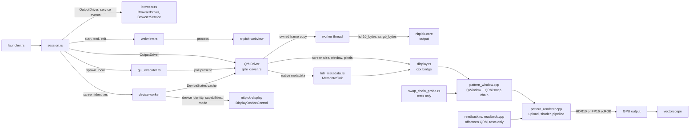
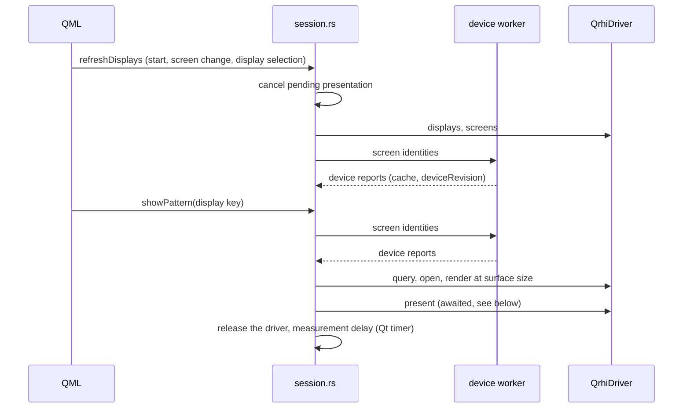
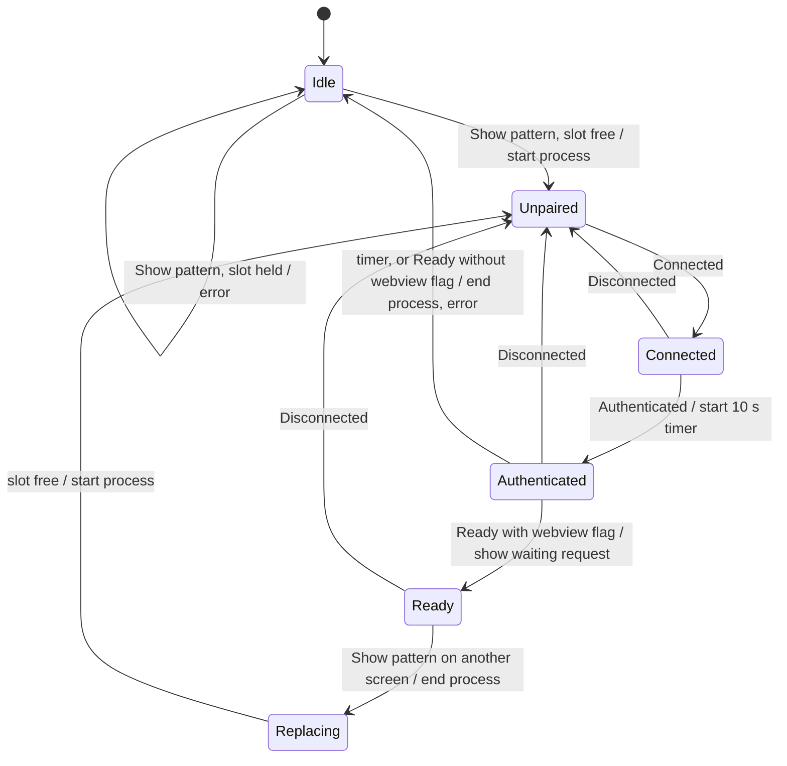

# QRhi output driver

## Overview

The QRhi driver shows test patterns in a borderless full-screen Qt window on a local screen. It sends the code values through an HDR swap chain to the GPU output. The measurement is of the signal on the wire, with a vectorscope or a waveform monitor. It implements `OutputDriver` (see [overview.md](overview.md)).

`pattern_renderer.cpp` holds the draw path. The pattern window draws it into the swap chain; the [QRhi readback](testing.md#qrhi-readback) check draws it into an offscreen texture.

Mapping to `OutputDriver`:

| Trait call | Adapter (`qrhi_driver.rs`) |
|---|---|
| `displays` | List the Qt screens by native screen key (see [Screen to device mapping](#screen-to-device-mapping)); get the pattern area size from Qt |
| `query` | Combine the cached native device report with QRhi path support and conversion limits; report a remapped path, such as an FP16 path without a known luminance scale, as `Unknown` |
| `open` | `openPatternWindow(screen, fp16, backend)`; `fp16` from the bit depth (see [Swap chain output](#swap-chain-output)); `backend` is the `Backend` of the driver |
| `present` | Convert on a worker (see [Asynchronous presentation](#asynchronous-presentation)). Then send the [HDR10 static metadata](#hdr10-static-metadata) and `presentPattern(pixels, width, height)`; wait for successful submission of this frame |

The pattern window closes on Esc, Q, Space or a double click.

The pattern area is the swap chain without the safe-area margins of the window (`QWindow::safeAreaMargins`). The shader draws the pattern 1:1 from the top-left corner of this area. Pixels outside the area are black. The reference table uses the same size, calculated from the screen before the window opens:
- macOS: the `NSScreen` frame without `safeAreaInsets` (the camera housing), in backing pixels. On a screen with a camera housing, the top inset is the larger of `safeAreaInsets.top` and the menu bar height. macOS places a full-screen window below the menu bar, which is 1 point taller than the inset.
- Windows: the monitor rectangle. Linux: the screen geometry in device pixels. Qt gives no screen safe-area insets on these platforms.

`openPatternWindow` waits until the pattern area has the table size, for a maximum of 5 s. After this time it uses the current size. Reason: GNOME 50 on Wayland first shows the window at the work-area size and makes it full-screen later. There, the open took 0.3 to 0.5 s.

The status line shows a warning if the window area and the table size differ. **Unverified:** that this macOS size always equals the full-screen window size. Only a MacBook Pro (M1 Max) built-in display with a visible menu bar was checked; external displays and a hidden menu bar were not.

Only this adapter requires the Qt GUI thread and event loop. It stays in `nitpick-app`; the core and browser driver do not import it. See [Host and dependency boundary](overview.md#host-and-dependency-boundary) for command-line use without Qt.

Physical display discovery and capability queries use [`nitpick-display`](../display_device.md). The C++ bridge keeps window, swap-chain and submission work. It does not maintain a second native capability enumerator. The host refreshes the device report before calling synchronous `query` and `open`; a changed or missing device invalidates the cached mapping.

### Screen to device mapping

The bridge gives only the native identity of a Qt screen (`screenIdentity`). The `DisplayId` key of a screen is its native name in the first column below. Unlike the Qt screen index, it does not change when another screen is added or removed. The adapter maps the identity to a device and reads the device through `DisplayDeviceControl::query_device`:

| Platform | Screen identity (`DisplayId` key) | Device match |
|---|---|---|
| Windows | `MONITORINFOEXW::szDevice` of the screen's `HMONITOR` | The one active `DisplayConfig` path with this GDI source name. A source with two targets (clone mode) is ambiguous. |
| macOS | `NSScreenNumber` of the `NSScreen` | The active display with this `CGDirectDisplayID`. |
| Linux | `QScreen::name()` and `QGuiApplication::platformName()` | The rule in [Linux reports](../display_device.md#linux-reports). On `xcb`, the adapter reads the RandR output of the same name through a second X connection to `DISPLAY` (`x11` feature of `nitpick-display`); Qt does not give the EDID. Other Qt platforms have no mapping. |

A screen without one match has an unknown device report with the reason. Output continues with the path rules below and warnings. **Unverified:** the macOS mapping; it was not built or run on macOS. The Linux mapping on a real desktop; only injected device lists were tested.

### Host lifecycle

`session.rs` keeps the host lifecycle on the GUI thread. `launcher.rs` connects it to QML. The device reports are in a cache that the session and the driver share. `query` and `open` read the cache and do no native I/O.

Rules:
- Each refresh replaces all cached reports, so a removed or changed screen loses its old report. A refresh older than the applied one does nothing.
- The reference table uses the cached report of the selected display and the screen size from `displays`. Before the first report, the table shows the path limits with an unknown display state.
- A new "Show pattern", a display selection or a screen change drops the pending presentation before the driver is borrowed again. A screen change closes the window if its screen is gone. Statuses go through the Qt event queue in order. A status of an older request does not apply.
- `open` runs a nested event loop without user input (see above). If a screen change arrives in this loop, the refresh cannot borrow the driver; the launcher posts it again.

Measurement delay (contract: [Measurement delay](overview.md#measurement-delay)):
- The presentation task waits for the delay after `present` succeeds. It releases the driver borrow first. Dropping the task drops the timer, so the cancellation rules above also cancel the delay.
- A closed pattern window (Esc) cancels the delay. `submission.rs` counts window closes. The task reads the count after `open`, because `open` closes an earlier window. A close after that count cancels the delay, also if it arrives before the task resumes after the acknowledgement.
- The timer is a single-shot `Qt::PreciseTimer`. A coarse Qt timer can fire up to 5 % early. Tests replace the timer with a controlled clock.
- The launcher saves the delay in the `measurementDelayMs` key of `launcher.json` in the OS configuration directory (`dirs::config_dir()/nitpick`). A missing or invalid value gives the default. The file is written to a temporary file and renamed. QSettings was not used, because a JSON file can be tested without a Qt application or a registry.

### Browser output in the launcher

The launcher also hosts the [browser driver](browser.md). The "Output" selection selects the driver: "Local screen (QRhi window)", "Browser (local or remote)" or "Browser (local webview)" (see [Local webview in the launcher](#local-webview-in-the-launcher)). The display list shows only the displays of the selected driver; for the local webview, the `QRhi` screens. A change of the selection is a display change, see [Host lifecycle](#host-lifecycle). The browser path uses the same presentation steps and measurement delay, without the device read. The depth list names the "16-bit PNG" for the browser.

Service (`browser.rs`):
- The service starts at the first selection of the browser output. It stays on until the launcher ends, also when the user selects the other output. After a failed start, the next selection tries again. The status line and the browser panel show the reason.
- Without "Allow remote displays on this network", the service binds `127.0.0.1`. With it, the service binds the interface address that the user selects. The list has the addresses of the network interfaces: IPv4 first, then IPv6, without loopback and without IPv6 link-local addresses (a URL with a zone index does not work in browsers). The launcher reads the list at the first selection and at "Restart service".
- Remote displays are off at each launcher start. The launcher saves the port in `browserPort` (0: the OS selects a port) and the last remote address in `browserAddress` of `launcher.json`. The pairing code is random for each connection.
- A change of the remote setting or the address, and "Restart service", start the service again. A restart ends the client session and the pending browser presentation ("Cancelled: the browser service restarted"), and closes the surface.
- The old service stops on a helper thread, because the stop waits up to 1 s for open connections. Counter-intuitive: a restart on the same address and a fixed port waits for this stop on the GUI thread. Without this wait, each second restart on a fixed port failed to bind on Windows (os error 10048). With a connected page, the wait was 3 ms or less.
- The browser panel shows the URL, the pairing code while a connection waits for authentication, and the client state.

Service events:
- A `gui_executor.rs` task forwards the service events as launcher events. The launcher gives each event back to the session in a separate Qt event-loop job, because the session belongs to the `QObject` and a task cannot borrow it. Each event has the start count of its service; an event of an earlier service does nothing.
- `Ready`: the display list and the reference table read the client state again.
- `ViewportChanged` of the display of the open surface and of the last request: the session ends the presentation or the delay and keeps the request. This applies also after readiness. At the next `Ready` of the display, the session shows the request again at the new size. A new request, a display change, a disconnect or a restart drops the kept request.
- `Disconnected`: the session ends the presentation or the delay and closes the surface. The client goes out of the display list.
- `Stopped`: as a restart; the panel shows the error.

The status of an ended presentation is the error that the driver gives for the change: "Error: display disconnected" or "Error: platform error: the browser viewport changed; open the surface again". Thus the status does not depend on whether the driver result or the service event comes first. An ended delay gives "Cancelled: the browser disconnected" or "Cancelled: the browser viewport changed".

The session keeps two browser drivers on the same client state, as the [test host](#test-host) does: one opens and presents, the other answers `displays` and the reference table while a presentation borrows the first. The reference table uses the `query` of the client, so it has the browser limits and the "clipped" marks of [Code to PNG sample](browser.md#code-to-png-sample).

### Local webview in the launcher

The output "Browser (local webview)" starts the optional [`nitpick-webview`](browser.md#usage) process on the selected `QRhi` screen. It uses the service of [Browser output in the launcher](#browser-output-in-the-launcher) and presents through the browser driver. `webview.rs` starts the process; `session.rs` keeps its state. The reference table is of the webview client after its first valid `hello`.

The process runs in the states `Unpaired`, `Connected`, `Authenticated` and `Ready`. From each of them, "Show pattern" on another screen gives `Replacing` (the diagram shows it from `Ready` only). Exception: in `Unpaired` with the slot held by another session, it gives an error and the process stays. A process exit, a removed screen, a service restart or stop, and the launcher end give `Idle`. "Slot" is the one session slot of the service. The launcher follows it from the `Connected` and `Disconnected` events.

Rules:
- "Show pattern" with the webview on the selected screen: after its first valid `hello`, the request goes to its client at once. Before that, the request waits ("Waiting for the local webview"); a new request replaces it.
- The launcher starts a process only if no session holds the slot. Thus an existing client is not replaced; the status shows "another browser holds the session". A webview on another screen ends first; the new process starts after the `Disconnected` of the old session. Reason: the old page holds the slot until its WebSocket closes, and a page that connects before that gets `409` and shows "Connect again".
- The launcher assigns the first session after the start to the webview. Its first `Ready` client must have the `webview` flag; otherwise another browser took the slot, and the launcher ends the webview. **Deviation from an exact process binding:** any page can set the flag, so this check finds a mistake, not an attacker. The pairing code controls access, as for each browser.
- After a wrong code, the page shows "Connect again". The process and the waiting request stay.
- The `hello` timeout runs from `Authenticated` for 10 s (`HELLO_TIMEOUT_MS` in `webview.rs`) on the Qt timer of the [measurement delay](#host-lifecycle). On timeout, the launcher ends the process.
- A display change cancels a waiting request; the process stays if its screen stays. The launcher ends the process if its screen is gone, at a service restart or stop (a new service can have another URL), and when the session drops at the launcher end. The selection of another output does not end it, as for the [browser surface](#browser-output-in-the-launcher).
- Process errors go to the status line only while a request waits, with the generation of that request. Later errors of the client are the browser errors of [Browser output in the launcher](#browser-output-in-the-launcher).

Process:
- The executable is `nitpick-webview` in the directory of the launcher executable. If it is missing, the status names the path.
- Arguments: `--url=<url>` and `--at=<x>,<y>`, each in one argument (see [Usage](browser.md#usage) for a negative point).
- The `--at` point is the centre of the screen in the units of the Qt platform plugin: on Windows the `rcMonitor` of the `HMONITOR` (native pixels), elsewhere `QPlatformScreen::geometry()`. Counter-intuitive: `QScreen::geometry()` is not used. Qt 6.12 keeps the native origin of a screen and divides only its size by the high-DPI factor (`QHighDpi::fromNativeScreenGeometry`), so a point from its size can be on another monitor. **Unverified:** that the Qt platform units on macOS and Linux are the desktop units of the shell, also with `QT_SCALE_FACTOR` or a GDK scale.
- Windows: the launcher starts the process with `CREATE_NO_WINDOW`, because it is a console program. It calls `AllowSetForegroundWindow` for the process, so that its window can take the keyboard focus.
- The launcher reads the error output of the process. The exit status and the first line that starts with `error` (else the last line) go into the status.
- Ending the process is a kill (`TerminateProcess` on Windows, `SIGKILL` elsewhere), not a window close. On Windows, no WebView2 process stayed after a kill (see [Running launcher checks](#running-launcher-checks)). **Unverified:** that the WebKit processes end after a kill on macOS and Linux.

### Output report

The adapter combines the device report with these path rules:

| Field | Rule |
|---|---|
| 10-bit and 12-bit `available` | Windows: `Unknown` if the device reports HDR off, also for SDR WCG. Reason: Qt 6.12 D3D11 gives both HDR swap chain formats only for an output in the DXGI PQ colour space (`QDxgiHdrInfo::isHdrCapable`). Otherwise it uses an 8-bit SDR swap chain. macOS 12-bit: `Unknown` (see [Swap chain output](#swap-chain-output)). Linux 12-bit: `Unknown`, because the compositor scale is not tested. Otherwise `Yes`; the window checks swap chain support when it opens. |
| `exact` | Never `Yes`: no device report includes calibration, dithering or compositor changes. `No` if the display reports no HDR support, if HDR is off, or if the wire depth is below the pattern depth. 12-bit is always `No` because of the FP16 limits. |
| `hdr_metadata` | Windows and macOS: `Yes`. Linux: `Unknown`; the status line reports a missing `VK_EXT_hdr_metadata` after the pattern is shown. |
| `ModeSettings` | Only from `DeviceMode`. Advanced Color support, SDR WCG, a gamut or a GPU colour conversion does not set `hdr_on`. `pixel_ratio` is 1. |

The launcher applies `check_open` and `check_frame` before the window opens. Thus a rejected path fails before pixel conversion. A remapped path, such as Windows with HDR off or macOS 12-bit, has `available = Unknown`: the window shows the pattern and the status line shows the warning. `exact` is `No` for these paths.

The window checks the swap chain format with `QRhiSwapChain::isFormatSupported`. If QRhi does not accept the format, the window still opens. `PatternSurface::fallback` gives the swap chain that QRhi uses instead, and the status line shows it as a warning. Qt 6.12 behaviour:
- D3D11: an 8-bit SDR swap chain (sRGB, BT.709). The codes are shown as SDR values.
- Vulkan: the first surface format of the compositor.
- Metal: the requested format. Without EDR headroom, macOS clips at SDR white.

After `createOrResize`, the window reads the native format and colour space of the swap chain. The surface description, and thus the status line, names both. A native swap chain other than the one in the table below is also a fallback with a warning. Reason: Qt 6.12 D3D11 also falls back to an 8-bit swap chain if the creation of an accepted HDR format fails; `isFormatSupported` does not show this.

| Backend | Source of the record | 10-bit | 12-bit |
|---|---|---|---|
| D3D11 | `IDXGISwapChain1::GetDesc1`; the colour space is set again, see below | `DXGI_FORMAT_R10G10B10A2_UNORM`, `DXGI_COLOR_SPACE_RGB_FULL_G2084_NONE_P2020` | `DXGI_FORMAT_R16G16B16A16_FLOAT`, `DXGI_COLOR_SPACE_RGB_FULL_G10_NONE_P709` |
| Vulkan | `QVkSwapChain::colorFormat` and `colorSpace` (Qt private header) | `VK_FORMAT_A2B10G10R10_UNORM_PACK32`, `VK_COLOR_SPACE_HDR10_ST2084_EXT` | `VK_FORMAT_R16G16B16A16_SFLOAT`, `VK_COLOR_SPACE_EXTENDED_SRGB_LINEAR_EXT` |
| Metal | `CAMetalLayer.pixelFormat` and `colorspace` | `MTLPixelFormatRGB10A2Unorm`, `kCGColorSpaceITUR_2100_PQ` | `MTLPixelFormatRGBA16Float`, `kCGColorSpaceExtendedLinearSRGB` |

The Vulkan HDR10 format has red in the low 10 bits, as `DXGI_FORMAT_R10G10B10A2_UNORM` and the packed CPU output.

**Deviation from Qt:** DXGI has no call that reads the colour space of a swap chain. The window calls `IDXGISwapChain3::SetColorSpace1` again with the colour space of the actual DXGI format: PQ BT.2020 for `R10G10B10A2_UNORM`, linear BT.709 for `R16G16B16A16_FLOAT`, gamma 2.2 BT.709 otherwise. Thus the recorded tag is the tag of the swap chain. Qt 6.12 sets the HDR colour space also on its 8-bit fallback after a failed HDR creation; the second call replaces it with the SDR colour space that the fallback warning states.

**Unverified:** the Metal record; it was not built or run on macOS. The Vulkan record on Linux.

If `SetHDRMetaData` fails on Windows, the status line shows that the metadata was not sent. The pattern stays on the screen.

The bridge queues the frame and returns to the Qt event loop. It reports the frame ID after its texture upload and a successful `endFrame`. This callback resolves the `present` future. A queued frame alone is not an acknowledgement. The render runs from a timer of the window, see [Render trigger](#render-trigger). The bridge does not run a nested event loop. This does not confirm physical scanout. The launcher then applies the [measurement delay](overview.md#measurement-delay).

`submission.rs` keeps the frame state on the Qt GUI thread. The window keeps one pixel buffer; the render reports its events by frame ID:

| Event | Result |
|---|---|
| Render uploads the queued frame, `endFrame` succeeds | Success |
| `beginFrame` gives an error or device loss | `Platform` error for the queued frame; it does not upload later. After a device loss, Qt 6.12 gives device loss for each later `beginFrame`, so each frame fails until a new `open`; the window does not create a new `QRhi`. |
| `beginFrame` gives an out-of-date swap chain after one resize | The window retries after 5 ms |
| Texture or pipeline creation fails, or `endFrame` fails | `Platform` error for the uploaded frame; the previous pattern stays |
| 10 s from queueing without an upload | `Timeout`; the frame does not upload later |
| The window closes or is replaced | `Disconnected` for the pending completion. A close during the conversion, before the frame is queued, also gives `Disconnected`: the driver compares the close count with its value after `open`. |
| A new frame before the render | The new frame replaces the old pixels; only the new frame uploads |

Cancellation removes the completion. A cancelled frame that is queued can still upload, because the window can show it until a replacement. Late events of other frame IDs do nothing. The timeout timer of a cancelled frame stays in Qt until it expires or the window closes; it then does nothing.

### Render trigger

The pattern window renders from a single-shot timer that it owns: 0 ms after a queued frame or the end of a test hold, 5 ms after an out-of-date swap chain. An earlier pending render is kept. **Deviation from the Qt examples:** the window does not use `QWindow::requestUpdate` and does not handle `UpdateRequest`. A static pattern needs no vsync pacing. The present still uses swap interval 1. The reason is in the comment of `PatternWindow` in `cpp/pattern_window.cpp`.

Qt 6.12.0 behaviour on Windows (source: `QWindowsWindow::requestUpdate` and `qdxgivsyncservice.cpp` in qtbase):
- `QD3D11SwapChain::createOrResize` registers the window in `QDxgiVSyncService` unless its swap interval is 0. The service finds the DXGI output of the window on the adapters of the live `QRhi` objects and starts one vblank thread for each monitor.
- For a registered window with an output, `requestUpdate` stops the timer fallback of `QPlatformWindow` and waits only for a callback of the vblank thread.
- The vblank thread calls `IDXGIOutput::WaitForVBlank` in a loop. If the call fails or returns within 1 ms, the thread sleeps for one refresh interval and does not call back. Qt has no fallback for this case.
- `QT_D3D_NO_VBLANK_THREAD=1` turns the service off, so `requestUpdate` uses its timer.

Measured on Windows 11 (build 26200), NVIDIA GeForce RTX 5090 (driver 32.0.16.1692), one screen (Atomos NINJA V, 3840×2160, HDR off, 8 bpc wire):

| Check | Result |
|---|---|
| `WaitForVBlank` on this output, in the pattern window process and in a separate process, with and without the launcher open | `S_OK` after less than 0.05 ms at every call |
| `requestUpdate` with the vblank thread on | No `UpdateRequest` in 10 s. `supportsWindow` was `true`; the vblank thread ran but did not call back. |
| Test host and launcher with `requestUpdate` | Each frame timed out ("driver acknowledgement timed out"). The launcher failed also with its Qt Quick window open. |
| Test host and launcher with the timer | Each frame acknowledged. Launcher: "Ready after delay", also with the Qt Quick window minimized. |

**Unverified:** why `WaitForVBlank` does not block on this output: the recorder, the driver or the HDR-off state. The earlier [running launcher checks](#running-launcher-checks) passed with `requestUpdate` on a 3840×2160 screen with HDR on. The HDR state of the earlier test-host timeouts is not recorded. The timer path with HDR on, with the Qt Quick window on another screen, and on macOS and Linux.

### Asynchronous presentation

`QrhiDriver::present` follows [Asynchronous presentation](overview.md#asynchronous-presentation):
1. On the GUI thread: check the surface, the depth, the image size and `check_frame`. A failed check spawns no worker.
2. A worker thread gets a copy of the image, the format and the metadata request. It makes the swap chain bytes and resolves the metadata. The result goes back through a oneshot channel, which wakes the task.
3. On the GUI thread: send the metadata, then queue the frame through `submission.rs`. No await occurs between these two calls.
4. The `submission.rs` completion sends the result through a second oneshot channel, which wakes the task. The future returns the status line: surface, device mode, metadata result and warnings.

Dropping the future drops both receivers and the submission registration. It does not wait for the worker. A worker that has not started skips the conversion; a running worker discards its result. A queued frame can still upload, as in the table above.

`gui_executor.rs` runs the future on the GUI thread. `async-task` keeps the task. A wake, also from a worker thread, posts the next poll through `CxxQtThread::queue` of the launcher. The first poll is also posted, so "Show pattern" returns before the task runs. Counter-intuitive behaviour:
- Dropping the `LocalTask` handle drops the future at once. `async-task` alone drops a cancelled future at the next event loop pass, after the launcher borrows the driver again.
- If the event loop rejects a post from a worker thread (at exit, after the launcher is destroyed), the task step is leaked. `async-task` panics if a local task step drops on another thread.

The session keeps the driver in `Rc<RefCell<…>>`. The task holds the driver borrow from `open` until `present` completes. A new request drops the earlier task before it borrows the driver, so the earlier `Disconnected` does not reach the status line. See [Host lifecycle](#host-lifecycle). `query` and `open` stay synchronous. `open` still runs a nested event loop without user input for up to 5 s, see above.

The unit tests of `qrhi_driver.rs` and `session.rs` use a simulated event loop with controlled workers. The real Qt event loop was checked on Windows only, see [Running launcher checks](#running-launcher-checks). **Unverified:** that Qt timers and controls stay active during the device read, conversion and submission on macOS and Linux.

### Test host

`nitpick --test-host` runs the [test-host protocol](testing.md#host-boundary) without QML. `test_host.rs` makes a `QGuiApplication` and three `QrhiDriver` values on the shared device cache. The first opens and presents. The second answers `displays` and `query` while a presentation borrows the first. The third lists the screen identities for `refresh`. The state machine runs as one `gui_executor.rs` task. The test host has no `QObject` for `CxxQtThread::queue`, so it posts task steps with `QMetaObject::invokeMethod` on the application object (`cpp/test_host.cpp`). After `stopped`, it ends the event loop. The `submission.rs` close count gives a pattern window that closes outside the host, as in the launcher. The capture adapter comes from `pattern_capture.rs`: on Windows the [WGC adapter](testing.md#windows-graphics-capture-adapter) on the `HWND` of the open pattern window (`patternWindowHandle` in `cpp/pattern_window.cpp`), elsewhere none.

The options after `--test-host` are `--artifacts <directory>` and `--device-state <directory>`. The host rejects other arguments with exit status 2, also Qt options such as `-platform`; use the Qt environment variables (for example `QT_QPA_PLATFORM`). The [device requests](testing.md#device-requests) use `WorkerDevices` with the native backend of `nitpick-display`. `device_map` reads the device state again, as `refresh` does, and gives the device of the cached report of the screen (`DeviceStates::device`): the [screen to device mapping](#screen-to-device-mapping). The device worker is a second backend instance on its own thread; the device read of the cache uses its own instance on each read. With `--artifacts`, the environment of each artifact comes from the open pattern window (`patternWindowRenderer` in `cpp/pattern_window.cpp`); see [Capture interface and artifacts](testing.md#capture-interface-and-artifacts) for the fields.

Counter-intuitive: `nitpick-app` is a library and a binary. The build script links the generated C++ into every target, and that C++ calls the Rust side of the bridges. An integration test gets these Rust symbols only from a library.

## Signalling

The output path targets PQ / BT.2020 full range. All input encodings are accepted. The 10-bit path writes their code values directly; the 12-bit path has the conversion limits below. Thus:
- `pq-full` is the native case.
- `pq-narrow` codes reach the wire unchanged only if the GPU output is RGB full range.
  The display then shows black at code 64 (raised black). This is expected. Set the scope to narrow range.
- `hlg-narrow` is for scope use only. The swap chain cannot signal HLG, so the display interprets the codes as PQ.

For `pq-full`, `interpretation` is `Yes` for the signalled transfer and range. For both narrow encodings it is `No`, with a warning about PQ full-range interpretation. `input` is `Yes` for all three. These warnings keep the scope workflows available. They do not certify that the compositor preserves codes or luminance.

## Swap chain output

No swap chain API (DXGI, Vulkan, Metal) has a 12-bit integer format. Thus the bit depth selects the swap chain:

| Bit depth | Swap chain | Pixel conversion (`output` module) | Codes on the wire |
|---|---|---|---|
| 10-bit | HDR10: 10-bit unorm, PQ, BT.2020 | none: packed `R10G10B10A2` | exact, if the compositor and the driver do not change them |
| 12-bit, known 80 cd/m² scale | FP16 scRGB: linear, BT.709 primaries | code → PQ EOTF → BT.2020-to-BT.709 matrix → f16 | the compositor or the driver encodes them back to PQ / BT.2020 |

The scale is a property of the platform, not of the FP16 storage format. Windows scRGB uses 1.0 = 80 cd/m². The Linux path uses the scRGB convention of its extended-linear-sRGB Vulkan colour space; its compositor behaviour still needs a device test. GNOME 50 on Wayland gives no extended-linear-sRGB colour space (checked with NVIDIA 595 and with RADV in Mesa 26.0.8). Thus the 12-bit path uses the Vulkan fallback there, with a warning.

On Linux, the display state comes from the [screen to device mapping](#screen-to-device-mapping). The adapter does not use QRhi's `hdrInfo()`: the Qt 6.12 Vulkan backend reads the display only on Windows; on Linux it gives fixed default values (0 to 1000 cd/m²). A successful HDR10 open does not show that HDR is on: GNOME 50 on Wayland gives an HDR10 swap chain also for an SDR display with HDR off. **Unverified:** how the compositor converts the HDR10 signal for an SDR display.

On macOS, Qt's linear HDR path uses 1.0 for the current SDR white. Its luminance varies with display settings and is not known to the driver. See [Qt's luminance behaviour](https://github.com/qt/qtbase/blob/6.12/src/gui/rhi/qrhi.cpp). Thus macOS reports `available = Unknown` and `exact = No` for 12-bit output, with the reason "absolute FP16 luminance scale unavailable". The window shows the pattern with the 80 cd/m² conversion, so the luminance is wrong by the ratio of SDR white to 80 cd/m². Use it only for a visual check. Do not claim an absolute scale with 80, 100 or Qt's placeholder SDR-white value, or reduce the output to 10 bits. HDR10 10-bit output remains available when the swap chain supports it.

A fragment shader copies one texel per pixel with `texelFetch` (no filtering, no blending). Thus the swap chain gets the texture values unchanged. The [QRhi readback](testing.md#qrhi-readback) check confirms this for an offscreen texture of the swap chain format, and the [swap-chain checks](testing.md#swap-chain-checks) for the swap-chain image itself, on D3D11 and Vulkan on Windows. **Unverified:** Metal, and Vulkan on Linux.

For the supported 80 cd/m² path, convert the code triple $(R', G', B')$ at depth $n$:
1. Each code is a full-range PQ code on the wire: $L = \mathrm{EOTF}_{PQ}(D / (2^n - 1))$ in cd/m².
2. $L_{709} = M \cdot L_{2020}$. $M$ is calculated from the BT.709 and BT.2020 primaries and D65.
3. The value is $L_{709} / 80$, rounded to f16.
4. Deviation from a plain conversion: rounding each component separately is not sufficient. The matrix mixes the rounding error of the bright components into the dark ones. The conversion thus searches ±2 f16 steps per component. It takes the triple that a reference decoder (exact inverse matrix, PQ inverse EOTF, round, negative values clamped to 0) decodes closest to the codes: smallest largest-component code error, then smallest sum of step offsets. On an equal score, the offset $(\Delta R, \Delta G, \Delta B)$ that is first in lexicographic order wins.

Results of the reference decoder for this 80 cd/m² path:
- All 4096 12-bit grey codes decode exactly, also without the search.
- All full-range levels and all BT.709 bars of BT.2111 decode exactly.
- Saturated narrow-range bars do not decode exactly (36 levels over all formats at 2K). They have a component at 0 % (code 64 or 256). On the full-range wire this is a small positive luminance, and the f16 error of the bright components is larger than one code step there. A larger search does not solve this (±8 steps: 31 levels). The reference table marks these levels with `*`.

**Unverified:** the real compositor and driver use the same matrix and arithmetic as the reference decoder. A different matrix precision moves more levels.

The `*` marks apply only to this FP16 path. A browser reference table uses its own conversion and clipping limits. An unavailable path has no claim of exact output.

## HDR10 static metadata

The metadata values are in [HDR10 static metadata](../test_patterns.md#hdr10-static-metadata). QRhi has no metadata API. The adapter sets the metadata on the native swap chain before it presents the frame:

| Platform | Native structure | Set | Remove | Access to the native swap chain |
|---|---|---|---|---|
| Windows | `DXGI_HDR_METADATA_HDR10` | `IDXGISwapChain4::SetHDRMetaData` | `SetHDRMetaData(DXGI_HDR_METADATA_TYPE_NONE)` | Qt private header `qrhid3d11_p.h` (`QD3D11SwapChain::swapChain`) |
| Linux | `VkHdrMetadataEXT` | `vkSetHdrMetadataEXT` (device extension `VK_EXT_hdr_metadata`, requested if available) | None | Qt private header `qrhivulkan_p.h` (`QVkSwapChain::sc`) |
| macOS | SEI payloads and `opticalOutputScale` | `CAMetalLayer.EDRMetadata = [CAEDRMetadata HDR10MetadataWithDisplayInfo:…]` | `EDRMetadata = nil` | Qt private header `qpa/qplatformwindow_p.h` (`QNativeInterface::Private::QCocoaWindow::contentLayer`). The `NSView` layer is a container; the `CAMetalLayer` is its content sublayer. |

`hdr_metadata.rs` resolves the request and packs the native structure in Rust. The C++ bridge copies the fields into the native call; it does no unit conversion. The packing goes through the `MetadataSink` trait; unit tests inject a recording sink. Rules:
- All backends get the values after rounding to the ST 2086 and CTA-861.3 fields. Vulkan gets these values as `f32` in natural units.
- DXGI `MaxMasteringLuminance` is in whole cd/m², rounded half up. The other DXGI luminance fields keep their ST 2086 and CTA-861.3 units.
- A new swap chain has no metadata. Metadata off on a swap chain without metadata makes no call.
- A frame with metadata always sends it, also if the values did not change. A frame with metadata off after a frame with metadata removes it.
- A failed call does not stop the frame; the status line reports it. After a failed set, earlier metadata can stay on the swap chain. Vulkan has no remove call, so the status line reports that the earlier metadata stays until the window closes.

Automatic light levels use $D / (2^n - 1)$ as full-range PQ for every input encoding, including HLG scope input. This describes the intended PQ signal of this driver. It is not an HLG luminance calculation or a measurement of compositor output.

**In question:**
- DXGI: the documentation gives `MaxMasteringLuminance` in whole cd/m² and `MinMasteringLuminance` in 0.0001 cd/m². nitpick follows the documentation. Some sample code uses 0.0001 cd/m² for both.
- macOS: `opticalOutputScale` is 100 (linear 1.0 = 100 cd/m², as in Chromium). Its effect on a PQ layer is not documented.
- The effect of the metadata on the display is not measured.

## Technical decisions

| Decision | Options | Selected | Reason |
|---|---|---|---|
| HDR output | QRhi on all platforms; direct D3D11 on Windows and QRhi elsewhere | QRhi on all platforms | One code path for Windows, Linux and macOS. Counter-intuitive: the draw call adds a shader on Windows. `texelFetch` keeps the values, so the shader does not change codes. |
| Shaders | `qsb` at build time; precompiled files in git | `qsb` at build time | Reproducible from the GLSL source. `build.rs` embeds the result in a generated header. |
| Swap chain | HDR10 for 10-bit; FP16 scRGB for 12-bit | as listed | No API has a 12-bit integer swap chain. FP16 is the only format with more than 10 bits. The window checks the format first, because QRhi falls back without an error. |
| FP16 luminance scale | assume 80 on all platforms; calibrate each display; reject paths without a known scale; warn on paths without a known scale | warn on paths without a known scale | A guessed scale changes PQ luminance and codes, so `exact` is `No`. The pattern stays usable for a visual check. Calibration is outside the current scope. |
| Remapped output (HDR off, QRhi format fallback) | fail; show the pattern with a warning | show the pattern with a warning | The OS or the compositor remaps the output, but the pattern stays usable for a visual check. `exact` and the warnings prevent a false claim of exact output. |
| Adapter (Windows) | default adapter; adapter of the monitor | adapter of the monitor | Prevents a cross-adapter copy on hybrid-GPU systems. QRhi gets the adapter LUID. Only D3D11 does this; the Windows Vulkan window of the swap-chain tests uses the device that QRhi selects. |
| Render trigger | `QWindow::requestUpdate`; a timer of the window | a timer of the window | On Windows, Qt 6.12 can withhold `UpdateRequest` for a D3D11 window without a limit, see [Render trigger](#render-trigger). A static pattern needs no vsync pacing. |
| Window backend | fixed per OS in the C++ window; `Backend` of the driver passed to `open` | `Backend` of the driver | One value selects the swap chain and the native metadata structure. The swap-chain tests open the same window with Vulkan on Windows. The launcher and the test host use `Backend::current()`: D3D11 on Windows, Metal on macOS, Vulkan elsewhere. |
| Metadata on Linux | Qt private API; none | Qt private API | QRhi exposes no `VkSwapchainKHR`. Cost: the binary must use the exact Qt version of its private headers. |
| GUI-thread executor | `qmetaobject` `execute_async`; a C++ bridge that posts with `QMetaObject::invokeMethod`; `async-task` with `CxxQtThread::queue` | `async-task` with `CxxQtThread::queue` | `qmetaobject` is a different Qt binding. `CxxQtThread::queue` is the existing cxx-qt path to the GUI thread and accepts jobs from any thread. `async-task` gives the task state and wakers; the glue code is only the post and the drop handle. |
| Wake channels | custom wakers in `submission.rs`; `futures-channel` oneshot | `futures-channel` oneshot | The receiver wakes the task on send. A dropped receiver tells the worker that the result is not needed. |
| `DisplayId` key | Qt screen index; native screen name | native screen name | The index changes when another screen is added or removed. The native name is the input of the device mapping. |
| Device report timing | query on the GUI thread; refresh on a worker into a shared cache | worker into a shared cache | Native queries can block. `query` and `open` stay synchronous, as the trait requires. The cache is outside the driver borrow, so the reference table can read it while a presentation holds the driver. |
| Lifecycle location | in the `QObject`; a separate Rust type | separate type (`session.rs`) | Tests run it with a simulated event loop, a fake window and held workers, without Qt. |
| Browser service start | at launcher start; at the first selection of the browser output | first selection | No listening socket until the user wants browser output. |
| Remote displays | saved setting; off at each launcher start | off at each start | A listener on a network interface needs an explicit user action. The address is saved, so that the action is one click. |
| Service events to the session | handle in the forward task; post each event to the `QObject` | post to the `QObject` | The session belongs to the `QObject`. The handling can drop the presentation task and start a new one. |
| Webview monitor point | `QScreen::geometry()`; native screen geometry | native: Windows `rcMonitor`, elsewhere `QPlatformScreen::geometry()` | The shell selects the monitor in the desktop units of the OS. See [Local webview in the launcher](#local-webview-in-the-launcher). |
| Webview session binding | a per-start token in the page URL; the first session after the start, checked by the `webview` flag | first session with the flag check | The service has one slot, so no other page can join while the webview holds it. A token needs a protocol change and still does not stop a page with the URL. |
| Webview end | close the window; kill the process | kill | A close needs a window message or a signal per OS. The shell ends without state to save. |
| Webview on another screen | start at once; start after the old session leaves the slot | after the old session | A page that connects while the slot is held gets `409`. |
| X11 EDID source | Qt private `QXcbScreen`; `xcb-randr` in C++; `x11rb` in Rust | `x11rb` | Pure Rust: no extra C library, and the code compiles on every OS. Cost: a second X connection, which follows only `DISPLAY`. |

## Testing

Settings before a measurement:
1. Turn on HDR in the system display settings for the test display.
2. In the GPU control panel, set the output colour depth to 10 bpc or more (12 bpc for 12-bit). With 8 bpc, the driver dithers and the codes are not exact. On Windows the launcher shows the wire bit depth after "Show pattern".
3. Select the output format:
   - RGB full range: compare the input codes, subject to the FP16 limits above.
   - YCbCr narrow range: use `pq-full`. Compare with the Y'Cb'Cr' columns of the reference table.
4. Turn off Night light and other colour filters.
5. Set the [measurement delay](overview.md#measurement-delay) and wait for readiness before each reading.

Tests and pass criteria are in [Output verification](testing.md): [QRhi unit tests](testing.md#qrhi-output), [GPU readback](testing.md#qrhi-readback), and [physical output criteria](testing.md#pass-criteria). See [the measurement plan](../../plan/test_patterns.md) for pending device work.

**Not done:** hardware verification of code preservation, metadata effects and the sufficiency of the measurement delay.

### Running launcher checks

These checks run the real launcher in the Qt event loop. They are manual. A script controls the launcher through Windows UI Automation and reads the status line every 5 ms. Method:
- Event loop: a second thread sends `WM_NULL` to the launcher window with `SendMessageTimeout` every 10 ms and records the round-trip time. The Qt GUI thread dispatches this message, its Windows timers and user input in the same message loop. During the conversion, the script also toggles a check box through UI Automation and reads its state back.
- Delay: set the delay in the spin box, show the pattern and measure the time from "Waiting for measurement delay" to "Ready after delay". During the delay, send Esc to the pattern window, click "Show pattern" again or change the display.
- Display changes: select the other display in the list, or add and remove a screen with `SetDisplayConfig` (extend topology, then the saved one-screen topology). Each change occurs while the presentation or the delay is pending. After the cancellation, the status line must not change for 6 s.
- Persistence: set the delay, close and start the launcher, then read the spin box and `launcher.json`.

Results on Windows 11 (build 26200), Qt 6.12.0, D3D11, debug build. Test display: one 3840×2160 HDR screen; a second screen was added for the display changes.

| Check | Result |
|---|---|
| Event loop during conversion and submission (12-bit, 1.4 to 1.5 s) | Largest `WM_NULL` round trip 6 ms. The check box toggle took 14 ms. |
| Event loop during the device read, `open` and render (0.08 to 0.1 s together) | Largest `WM_NULL` round trip 72 ms. `open` and the render are synchronous on the GUI thread. The device read was too short to measure separately. |
| Delay 3000 ms and 500 ms | "Ready after delay" 2.999 to 3.001 s and 0.500 to 0.501 s after "Waiting" |
| Delay 0 ms | No "Waiting" status |
| Esc during the delay | "Cancelled: the pattern window closed" after 24 to 26 ms; no later status |
| A second "Show pattern" 1 s into a 3000 ms delay | One "Ready after delay", 3.0 s after the second "Waiting" |
| Display selection, screen added or screen removed during the presentation or the delay | "Cancelled: display changed"; no later status |
| The screen of the pattern window removed during the delay | "Cancelled: display changed"; the pattern window closes |
| Delay persistence | After a restart, the launcher shows the saved value |

Counter-intuitive: a Windows topology change blocks the Qt GUI thread for 0.7 to 1.2 s while Qt updates its screens. A "Show pattern" request in this time runs after the refresh, so the screen change does not cancel it.

**Unverified:** these checks on macOS and Linux. A screen change during the nested event loop of `open`, which makes the launcher post the refresh again; on Windows, `open` was too short for this.

Browser output checks use the same script and `WM_NULL` probe. Playwright 1.64.1 drives Edge 157.0.4341.60 (channel `msedge`, headless and headed runs) as the page. The page types the code that the launcher shows. Playwright changes the viewport size and holds a frame response with a route. Results on Windows 11 (build 26200), debug build; all checks gave the same result headless and headed:

| Check | Result |
|---|---|
| Browser output selected | URL `http://127.0.0.1:<port>/`, client state "Waiting for a browser." |
| Pairing | The code shows until authentication. Then "Edge at 127.0.0.1" is in the display list. |
| Reference table of the client | Size 1280×720, "Output: 16-bit PNG, cICP", the browser warnings and "clipped" marks (BT.2111 PQ narrow range) |
| Delay 1500 ms | "Ready after delay" 1.504 s after "Waiting". The status has the SDR preview and full-screen layout warnings, "Pixel-exact layout" and the PNG clipping. Note: Playwright starts Chromium with `--force-color-profile=srgb`, so the page reports `dynamic-range: standard`. |
| Viewport 1280×720 to 1024×600 during a 3000 ms delay | "Cancelled: the browser viewport changed", then a frame at 1024×600 and "Ready after delay" 3.0 s after its "Waiting". Largest `WM_NULL` round trip 5.0 ms. |
| Viewport change while the page holds the frame response | "Error: platform error: the browser viewport changed; open the surface again", then a frame at 1200×700. Largest round trip 0.4 ms. |
| Page closed during the delay | "Cancelled: the browser disconnected"; no later status in 4 s |
| Remote displays on, address 100.113.1.100 (the Ethernet address of the test computer) | URL with this address. A page on the same computer through this URL is "Edge at 100.113.1.100" and gets its frame. The old loopback URL refuses connections. |
| Remote displays off | A loopback URL again; the remote session ends |
| "Restart service" on fixed port 8765, three times without and three times with a connected page | Each restart binds. Largest round trip 3.3 ms. |
| QRhi output after these checks | "Ready after delay"; Esc during the delay gives "Cancelled: the pattern window closed" |

**Unverified:** a page on another device. The remote check used a page on the same computer, so it did not test the network path or a firewall. Full screen through the launcher, and these checks on macOS and Linux.

[Local webview](#local-webview-in-the-launcher) checks use the same UI Automation script. It selects the output with the keyboard and clicks "Show pattern". It types the pairing code with `SendKeys` into the foreground window, without an activation of its own. Results on Windows 11 (build 26200), debug build, WebView2 157, one SDR monitor at 2560×1600 and 100 % scale (`--list-monitors`: `\\.\DISPLAY1 0,0 2560x1600 scale 1`), delay 3000 ms:

| Check | Result |
|---|---|
| "Show pattern" without a session | The process started after 56 to 72 ms with `--url=http://127.0.0.1:<port>/ --at=1280,800`. The status was "Starting the local webview on `\\.\DISPLAY1`". |
| Console window | None. The new visible windows were the Tauri window and the Tao event window of the process. The process has a `conhost.exe` child without a window. |
| Keyboard focus | The webview window was the foreground window 117 to 283 ms after the click, in three runs. |
| Pairing | The typed code authenticated the page. "Submitting pattern" 0.17 s after the code, then "Ready after delay" with a 2560×1600 frame, "Edge webview" and the full-screen layout warning. |
| "Show pattern" again | The same process; "Ready after delay" for frame 2 |
| Process killed after readiness | Browser panel "The browser disconnected: client closed."; no status change |
| Process killed (`Stop-Process`) while it waits for pairing | "Error: the local webview stopped: exit status -1" at once |
| A WebSocket session of another client holds the slot | "Error: another browser holds the session; close it before the local webview starts"; no process |
| Launcher closed with the webview open | The process and its 2 child processes ended in less than 4 s. |
| Launcher process killed (`taskkill /F`) | The webview process stayed open. |

Not run: the `hello` timeout (the real page sends `hello` at once), screen changes (no change of the display settings of a developer machine), two monitors and mixed scales. The unit tests cover the first two.

## Future enhancements

- Calibrated 12-bit output on platforms whose linear HDR scale follows the display white. This needs a measured scale and a policy for display-setting changes before the path can claim absolute luminance.
