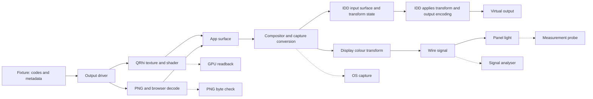

# Output verification

## Overview

This design tests each output path in [Output drivers](overview.md): QRhi HDR10, QRhi FP16, and browser PNG at both input depths. It covers Windows, macOS and Linux. It also defines tests for display calibration and physical output.

**Status:** design only. The core has conversion tests in `crates/nitpick-core/src/output_tests.rs`. The [shared fixtures](#shared-fixtures) and their reader exist; no production code is tested against them yet. The common driver interface, browser driver, test host, capture adapters and display model are not implemented. No device results are claimed here. The [output driver plan](../../plan/output_driver.md) lists the driver changes needed before those tests.

Unit tests check calculations, bytes and state transitions without a GPU or display. GPU, compositor, driver and probe tests are integration tests. Keep their results separate. A unit test cannot certify Windows calibration, browser HDR output or panel light.

Estimate implementation effort after a capture qualification run and an IDD build/signing trial. The capture colour contract and runner setup can dominate the work; no fixed delivery estimate is assumed.

### Test boundaries



This is a model of the test boundaries. It does not require every compositor to use one internal surface or one fixed scanout path.

| Boundary | Check | Does not prove |
|---|---|---|
| CPU output | packed texture bytes, PNG samples, colour tags, metadata and errors | GPU execution |
| QRhi readback | upload, shader, pixel positions and render-target format | compositor or wire values |
| OS capture | app or browser output after capture conversion, at the reported colour space | final display calibration, wire encoding or panel light |
| Software display model | predicted signal for an explicit source, transform and wire mode | that the OS loaded or applied that state |
| Instrumented console IDD | surfaces and transform state delivered by Windows; the IDD's own transformed output | a physical GPU's display engine or its LUT precision |
| HDMI/DisplayPort analyser | wire samples, range, depth and InfoFrames | panel light |
| Colorimeter or spectroradiometer | display light from the complete physical chain | exact wire codes |

### Validated Windows constraints

The following rules come from the linked Microsoft documents. Device behaviour still needs the tests below.

- [WGC supports an FP16 capture pipeline](https://learn.microsoft.com/en-us/windows/uwp/audio-video-camera/screen-capture). Use FP16 from frame pool to stored samples. An 8-bit screenshot can clip or tone map HDR. WGC does not return the original swap-chain colour tag with each frame; record that tag at submission and check its effect with known patches.
- Hardware MHC2 calibration belongs to the [display transform pipeline](https://learn.microsoft.com/en-us/windows/win32/wcs/display-calibration-mhc). A desktop capture is not evidence that this transform reached scanout. **Unverified:** the exact capture boundary for each Windows build and presentation path. Do not claim that all ICC effects are absent from all captures: an app or browser can apply colour management before capture, and profile display metadata can change rendering.
- An [IddCx 1.10 console driver](https://learn.microsoft.com/en-us/windows-hardware/drivers/display/iddcx1.10-updates) receives surfaces and must apply the supplied colour transform. Its acquired surface is before that application. These interfaces start with the Windows 11 22H2 September Update. A chosen driver can require a later OS. Check runtime function availability as well as the OS version.
- The [IDD transform](https://learn.microsoft.com/en-us/windows-hardware/drivers/ddi/iddcx/ns-iddcx-iddcx_gammaramp_3x4_colorspace_transform) has enable flags, an XYZ affine matrix, a scalar and a 4096-entry RGB LUT. It is not necessarily a byte copy of the profile. The OS can resample the LUT and combine other adjustments. Remote IDDs do not receive the same console transform and HDR metadata contract.
- An HDR capture card checks the cable signal. It does not replace a probe. A general video capture card can also rescale, subsample or tone map; qualify its raw capture path before using it as a signal reference.

## Technical decisions

| Decision | Options | Selected and reason |
|---|---|---|
| Required gate | OS screenshots for all checks; tests at separate boundaries | Separate boundaries. Most regressions can be found without a display. |
| Expected values | call production conversion or Little CMS; independent reference | Checked-in vectors from a separate f64 reference. Shared conversion code can hide the same error twice. |
| QRhi check | upload-texture dump; draw readback | Read back after the draw. An upload dump misses shader and render-target errors. |
| Capture interface | Windows-only scripts; common result with OS adapters | Common result. Each adapter must report its format and colour contract. |
| Error limit | exact bytes everywhere; perceptual error everywhere | Exact transport checks plus numeric and perceptual checks at later boundaries. |
| Profile handling | custom ICC/MHC2 parser; Little CMS through `lcms2` | Little CMS for profile reading, MHC2 extraction and conventional ICC transforms. Use the library's existing profile support. |
| Device operations | native queries and setters in each output driver; separate device interface | [`DisplayDeviceControl`](../display_device.md) with native implementations in `nitpick-display`. Hosts and tests share capability enumeration, profile assignment, readback and restoration. |
| Display model | ICC transform alone; explicit HDR model with library support | Explicit HDR model. Nitpick controls units, stage order, transfer functions and clipping; see [Colour library boundary](#colour-library-boundary). |
| IDD dependency | required for unit tests; optional lab tool | Optional lab tool. Signing and HDR hardware must not block normal CI. |
| Browser automation | screenshots as an HDR reference; protocol tests and qualified OS capture | Protocol tests on all hosts; HDR checks only on a qualified engine and OS. |

## Fixtures and test interface

### Shared fixtures

Fixtures and expected data are in `tests/fixtures/output/`. The reference generator and its locked Python dependencies are in `tests/reference/`. Rust tests read the checked-in vectors through the `nitpick-fixtures` crate; normal CI does not need Python. The generator does not call nitpick's conversion functions, evaluate pixels through Little CMS, or use the reference table as its sole source.

**Deviation from plain f64 arithmetic:** the generator calculates at higher precision and stores the nearest f64 value. Range mapping, primary matrices and integer quantization use exact rationals. Transfer functions use `mpmath` at 50 significant digits. Thus exact halves in quantization are detected; for example, 12-bit narrow code 840 gives PNG sample $65535 \cdot 584 / 3504 = 10922.5$, stored as 10923. A production f64 calculation can round such a value down.

Each case has a stable ID, input depth and encoding, image size, palette of code triples, layout, metadata request, required capabilities and expected results for each boundary. A layout is either rectangles painted in order over a background entry, or one palette index per pixel. Invalid input cases state the expected error.

The files hold data only, for machine reading: no descriptions, labels, provenance records or manifest. The generator source documents each case. Sources and rounding rules for all cases:
- Transfer: SMPTE ST 2084 PQ. Quantization: ITU-R BT.2100 Table 9. Primary matrices: SMPTE RP 177 with BT.709, BT.2020 and P3-D65 (SMPTE EG 432-1) primaries and D65. Light levels: CTA-861.3. scRGB, packing and PNG mapping: [Swap chain output](qt.md#swap-chain-output) and [Code to PNG sample](browser.md#code-to-png-sample).
- Codes and PNG samples round half up: $\lfloor x + 1/2 \rfloor$. Real values are the binary64 values nearest to the high-precision results.

| File | Content |
|---|---|
| `scalar.json` | every scalar code as columns: QRhi signal, luminance, grey scRGB and single-channel `R10G10B10A2` words; browser samples, clip state and PQ luminance for each encoding |
| `codes.json`, `luminance.json`, `gamut.json`, `mixed.json`, `geometry.json` | patch and image cases |
| `state.json` | two marker frames per depth and event sequences with expected outcomes |
| `invalid.json` | invalid inputs and their error kinds |

Expected results per palette entry:
- `qrhi`: the codes as full-range PQ for every encoding: signal, linear BT.2020 cd/m², ideal scRGB before f16 rounding and, at 10 bits, the packed word. The FP16 neighbour search is not in the fixtures.
- `browser`: 16-bit samples and clip state under [Code to PNG sample](browser.md#code-to-png-sample); PQ luminance and scRGB of the stored samples; none for HLG.

Each case also has MaxCLL and MaxFALL for both drivers, and the resolved metadata if it has a request. A browser HLG case gives the error `unsupported` for automatic light levels. State sequences use the error kind `any` where this design does not fix an `OutputError` variant (stale surface after resize, device loss).

The BT.2111 levels are transcribed from BT.2111-3 (05/2025) Tables 2–4, both depths, and are not derived from the 10-bit values. The ramp is covered by the scalar tables. P3-D65 red has a small negative BT.2020 blue component; the generator clips it to 0 before encoding and sets `container_clip`.

Regenerate and check from the repository root. Reproducible generation gives no difference to the committed files:

```sh
uv run --project tests/reference python tests/reference/generate.py  # write
git diff --exit-code tests/fixtures/output                            # compare with the committed files
uv run --project tests/reference pytest tests/reference              # generator tests
cargo nextest run -p nitpick-fixtures                                 # Rust reader tests
```

`.gitattributes` keeps the fixture bytes free of line-ending conversion, so the comparison also passes on Windows.

Profile fixtures also store the known matrix, LUT and luminance values in their manifest. These values are defined before profile serialization. Compare library extraction against that manifest, so parsed data cannot become its own expected result.

| Fixture group | Values and purpose |
|---|---|
| Codes | Every scalar code at 10 and 12 bits; black, peak and one step on each side of nominal range endpoints; separate R, G and B ramps to find channel swaps |
| Luminance | Neutral PQ patches near black and at 1, 80, 100, 203, 1000, 4000 and 10000 cd/m²; derive expectations from the quantized input codes |
| Gamut | BT.709, P3-D65 and BT.2020 primaries and secondaries; include negative and greater-than-one scRGB components |
| Mixed channels | Bright saturated patches with a small nonzero channel; include all BT.2111 levels and the FP16 levels marked `*` |
| Geometry | Asymmetric corner colours, one-pixel lines, checkerboard, odd widths and a border marker; find flips, scaling, crop and row-pitch errors |
| State | Two different frames with unique markers; metadata on/off/changed; close, disconnect, resize and device loss |
| Profiles | Conventional ICC profiles for native assignment tests; identity, matrix-only, LUT-only and combined MHC2 transforms for Windows calibration; malformed profiles; identical display metadata across transform comparisons |

Specify coloured luminance without ambiguity. For a P3-D65 primary at measured luminance $Y$, form its XYZ value from chromaticity $(x,y)$:

$$
XYZ = Y\,[x/y,\ 1,\ (1-x-y)/y]^T.
$$

Convert XYZ to BT.2020 linear RGB, then encode the requested input codes. A red component set to 100 in an RGB luminance vector does not in general give a patch with $Y=100$ cd/m². Keep both the intended colour and the value after code quantization in the fixture.

### Host boundary

Add a test-only control interface over standard input and output, with one JSON object per line. This avoids a Windows named-pipe dependency. A QRhi test host runs the real adapter on the Qt GUI thread. The browser host uses the planned command-line host without Qt. Both share fixture IDs and event formats.

Proposed requests are `query`, `open`, `show`, `capture` and `close`. `show` selects a fixture and supplies a monotonically increasing frame ID. Events include `submitted`, `ready`, `captured`, `error` and a surface-generation change. These names describe a proposed test protocol, not existing CLI flags.

For device tests, add device enumeration and query, profile preparation, assignment and restoration through `DisplayDeviceControl`. Keep these separate from output requests. Save the prepared recovery record before assignment. A profile change invalidates the current measurement and capture generation under [the device lifecycle](../display_device.md#identity-and-execution).

Keep capture outside `OutputDriver`. A capture adapter returns raw planes plus a descriptor: width, height, row pitch, plane layout, channel order, bit depth, alpha, transfer, primaries, white point, range, luminance scale, timestamps and source identity. Preserve raw API metadata too. Unknown fields stay unknown. FP16 storage alone does not establish scRGB or 80 cd/m².

For each capture, save the fixture and frame IDs, surface generation, submitted format, OS/build, GPU/driver, Qt/backend or browser/engine version, display ID and EDID hash, HDR state, scale/zoom, profile hash, metadata, measurement delay and capture configuration. Save unmodified samples and a machine-readable result. Previews are separate and labelled as tone mapped.

### Timing and frame identity

`present` and the [measurement delay](overview.md#measurement-delay) retain their existing meanings. Neither proves that capture contains the new frame.

Show a small binary frame marker outside the sample rectangles. Require a capture timestamp after submission, the current marker and three successive matching frames within the numeric limit. Use a bounded capture deadline of 30 s for the initial harness. A static source that emits fewer frames can be prompted with a separate heartbeat pixel; keep the frame marker and patches fixed. Record the accepted frame timestamps.

Crop to valid content bounds. Exclude the cursor, capture border, window chrome, marker and patch edges. For flat patches use an inset sample rectangle and report maximum and median error. Test one-pixel geometry separately without an inset. Never resize the capture to make it fit. Reject a resize, stale frame, missing colour contract or changed display state instead of comparing it to the old expected image.

## Unit tests

All supported input formats run in ordinary CI on Windows, macOS and Linux. Unsupported physical paths still have CPU conversion tests. Put Rust unit tests in separate `<file>_tests.rs` files.

### QRhi output

The conversion rules stay in [QRhi signalling and conversion](qt.md#signalling). The tests below use those rules, including their deliberate deviations from normal signal interpretation.

| Test | Assertion |
|---|---|
| `qrhi_hdr10_pack` | Independent asymmetric RGB values produce the expected little-endian `R10G10B10A2` words and opaque alpha. Check all scalar codes in each channel and row boundaries. |
| `qrhi_scope_encoding` | `pq-full`, `pq-narrow` and `hlg-narrow` with the same codes produce the same QRhi bytes at a given depth. Narrow and HLG interpretation warnings remain present. Do not apply an HLG EOTF to this output. |
| `qrhi_fp16_reference` | PQ decode, primary conversion and the 80 cd/m² scale match independent vectors. Check signed components, finite values, channel order and opaque alpha. |
| `qrhi_fp16_search` | **Deviation from plain FP16 rounding:** test the documented ±2-neighbour search separately. Chosen values stay in the search range and do not worsen the reference code error. Fixed difficult vectors check the selected bits and tie behaviour. |
| `qrhi_fp16_limits` | Keep the exhaustive 4096-grey test. Check individual BT.2111 expectations, including residual errors for marked levels. Do not use only a total failure count or the production inverse as the expected result. |
| `qrhi_capabilities` | Reject unavailable formats before conversion. macOS 12-bit returns `Unsupported` with the stated scale reason. A supported 10-bit path remains available. Unsupported HDR swap chains must not fall back to SDR silently. |
| `qrhi_metadata` | Check native metadata structures at the bridge boundary with an injected sink. Verify units, field order, explicit values, automatic values, disabled state and state replacement. No successful API call is treated as wire metadata proof. |

### Browser output

Use [Code to PNG sample](browser.md#code-to-png-sample) as the contract. Test all three encodings at both depths.

| Test | Assertion |
|---|---|
| `browser_png_samples` | Decode with an independent PNG reader. Check 16-bit RGB sample values, network byte order, dimensions and channel order for every scalar input code. Inverse range mapping recovers every code in the nominal range. |
| `browser_png_endpoints` | Narrow black and peak map to the full PNG endpoints. Below-black and above-peak inputs clip and receive the expected warning and reference mark. Check the codes adjacent to each endpoint. |
| `browser_png_colour` | Parse chunks independently. Check the specified cICP tuple for each encoding, placement before image data and CRC. No competing colour tag may change interpretation. HLG remains tagged HLG. |
| `browser_png_metadata` | Check `mDCV` and `cLLI` widths, order and units against the [PNG specification](https://www.w3.org/TR/png-3/). PNG `cLLI` uses two 32-bit values in 0.0001 cd/m² units. Do not reuse the two 16-bit CTA SEI fields. Check omission when disabled. |
| `browser_light_levels` | Automatic PQ values use the stored PNG samples after clipping and rounding. HLG automatic values return `Unsupported`; explicit values remain valid. A uniform 10-bit code-940 frame distinguishes the two interpretations: QRhi full-range PQ gives about 4654.397 cd/m²; the browser maps narrow-range 940 to PNG sample 65535 and gives 10000 cd/m². |
| `browser_capabilities` | Unknown code precision, metadata effect and interpretation stay unknown. Media queries and user-agent rules follow the browser contract; they do not certify measured luminance. Test HDR-off warnings and unknown wire depth. |
| `browser_session` | With a mock transport, test leading-zero and fixed authentication codes, failed attempts, timeout, one-client reservation, `hello` ordering, token checks, token revocation and reconnect. Check the existing protocol limits and error codes in [Interface](browser.md#interface). |
| `browser_present` | `open` uses cached state. Match `applied` to frame ID and dimensions. Stale IDs, timeout, disconnect, resize and close cannot mark a replacement frame ready. |

### Shared host contract

Use a mock driver, controlled clock and controlled worker completions. Check each capability state (`Yes`, `No`, `Unknown`), warning and `OutputError` against [Interface](overview.md#interface). Reject `available = No`, `input = No` and unsupported metadata. Accepted input with `interpretation = No` remains selectable with a warning.

Readiness must follow acknowledgement plus the selected delay. Zero adds no delay. Errors start no timer. New frames, closure, display changes and disconnect cancel old work and timers. An old callback cannot complete a new request. Drop pending futures and check that callback and timer registrations are released. Run the contract with the command-line executor and the Qt executor; Qt timers and controls must continue to run during conversion, presentation and the delay.

Reject negative delays and verify that the Qt setting survives a restart. With HDR off, Windows QRhi and the browser return `hdr_on = Some(false)` and the host shows that state. Check that interpretation warnings and FP16 or clipping marks reach both status output and the reference table.

### Reference metric

Test the independent reference with analytical black/white cases, primary-matrix vectors and the worked example in [ITU-R BT.2124](https://www.itu.int/dms_pubrec/itu-r/rec/bt/R-REC-BT.2124-0-201901-I!!PDF-E.pdf). Match the published example within its printed precision. Do not fit the implementation to one rounded result.

Convert both signals to display-referred linear BT.2020 RGB in cd/m². Apply the BT.2124 LMS matrix, PQ nonlinearity and ICtCp matrix. Then use:

$$
\Delta E_{ITP}=720\sqrt{(\Delta I)^2+\tfrac14(\Delta C_T)^2+(\Delta C_P)^2}.
$$

Keep negative RGB values through the primary conversion. Some valid wide-gamut colours have negative components. If the later LMS values fall outside the metric's supported domain, report an invalid metric and retain the component errors; do not silently clip to obtain a pass. HLG needs an explicit display peak, system gamma and viewing model before an absolute metric is valid.

## GPU and compositor tests

### QRhi readback

Use the production upload, shader and pipeline on D3D11, Metal and Vulkan. First draw to a supported offscreen target with the selected format. Compare its raw readback against the CPU output. Then, where supported, read back the actual swap-chain image with `QRhiSwapChain::UsedAsTransferSource` after the draw and before presentation completes. Use the [QRhi asynchronous readback API](https://doc.qt.io/qt-6/qrhiresourceupdatebatch.html#readBackTexture).

An offscreen pass checks the draw path. It does not prove the actual swap-chain format or tag. Record native format and colour-space setup separately. Fail a claimed swap-chain test if it only read the upload texture. Normalize row pitch and image origin from the API descriptor, without colour conversion. Exact stored values and geometry are required for this copy shader. A format conversion needs a separate test with its stated rounding bound.

Exercise `beginFrame`/`endFrame` failures, out-of-date surfaces, device loss, close during upload, delayed render events and two rapid replacements. Success must refer to this frame's successful submission. No early success after `requestUpdate()` is allowed.

### Browser integration

Run a real server with an authenticated mock client on a host without a window system. Render with the real core, fetch and independently decode the PNG, send `applied`, and check delay and shutdown. Build by package and check that the command-line dependency graph contains no Qt, Tauri or `nitpick-app` dependency.

Run the real page in each supported browser engine and optional webview. Check authenticated fetch, blob URL lifetime, decode, natural size, layout size, `applied` and cancellation during fetch or decode. Test device pixel ratios 1 and 2, fractional scale, zoom, resize and full-screen changes. A screenshot can check geometry; a normal WebDriver or browser screenshot is not an HDR numeric reference.

For HDR pixels, capture the displayed page with the same qualified OS adapter used for QRhi. Compare only after the image decode acknowledgement and the current frame marker. Retain the encoded PNG so a failure can be located before or after browser decode. Do not assume two browser engines have the same HDR or metadata behaviour.

### Platform capture adapters

| Platform | Selected capture | Requirements and limit |
|---|---|---|
| Windows | WGC window capture through `IGraphicsCaptureItemInterop::CreateForWindow`, FP16 frame pool | Interactive desktop, supported capture API and active HDR test display. Keep negative and greater-than-one samples. Check `ContentSize` and timestamps. Capture permission or policy failure is an unavailable result. |
| macOS | ScreenCaptureKit with an explicit HDR stream configuration, macOS 15 or later | Start qualification on an HDR-capable Apple silicon Mac. Get Screen Recording permission. Record pixel-buffer attachments, range and preset. Use a supported high-precision RGB format when possible; a YCbCr format needs explicit conversion and interior patch sampling. |
| Linux Wayland | ScreenCast portal and PipeWire; compositor-specific adapter if needed | Pin compositor, portal backend and versions. Negotiate high-precision samples and obtain the transfer, primaries, range and luminance scale. Missing colour information makes absolute HDR comparison unavailable. |
| Linux X11 | Existing screenshot path for geometry only | Do not use an unqualified X11 screenshot as the HDR reference. Use QRhi readback and external measurement for colour. |
| Remote browser, including iPad | Host-side PNG checks and client state; local capture only if qualified on that device | A capture of the server desktop does not test the remote display. Use a probe for remote display light. |

On Windows, Desktop Duplication is an optional second adapter. [DuplicateOutput1](https://learn.microsoft.com/en-us/windows/win32/api/dxgi1_5/nf-dxgi1_5-idxgioutput5-duplicateoutput1) permits format negotiation; the older method converts fullscreen surfaces to BGRA. Inspect the returned format and mode. Do not presume DDA always returns the same FP16 scRGB values as WGC. It captures an output, so crop and rotation must be explicit.

Apple provides [HDR capture presets](https://developer.apple.com/videos/play/wwdc2024/10088/) and distinguishes local-display from canonical-display rendering. Either can involve capture conversion. Pin the chosen preset and verify its colour contract with known patches. **Unverified:** preservation of nitpick's absolute PQ luminance through each preset and display state. The 80 cd/m² Windows scale must not be applied to generic macOS EDR values. The planned macOS rejection of QRhi 12-bit output remains in force.

The Linux [ScreenCast portal](https://flatpak.github.io/xdg-desktop-portal/docs/doc-org.freedesktop.portal.ScreenCast.html) supplies PipeWire streams, not a universal HDR colour contract. The [Wayland image capture protocol](https://gitlab.freedesktop.org/wayland/wayland-protocols/-/blob/main/staging/ext-image-copy-capture/ext-image-copy-capture-v1.xml) specifies buffer constraints; the [colour-management protocol](https://gitlab.freedesktop.org/wayland/wayland-protocols/-/blob/main/staging/color-management/color-management-v1.xml) defines image descriptions. Support for one does not establish the other on a captured stream. **Unverified:** the selected compositor's capture stage and its mapping of Vulkan extended-linear-sRGB to absolute luminance.

### Capture reference and qualification

For a qualified Windows HDR scRGB capture, use column vectors. Let $M_{a\to b}$ convert linear RGB primaries, and let $E_{PQ}$ decode PQ to cd/m². The ideal QRhi HDR10 expectation is:

$$
c_{709}=\frac{1}{80}M_{2020\to709}\,E_{PQ}\!\left(\frac{D}{2^n-1}\right).
$$

For QRhi FP16, the expectation includes the stored FP16 values after the neighbour search. Report both the error from those submitted values and the error from the ideal colour. For browser PQ, replace the normalized codes with the decoded PNG samples. Browser HLG requires its own documented rendering model. Compare neutral values against the actual quantized input, not the nominal label of the patch.

Qualify each adapter with black, neutral values above SDR white, coloured values outside BT.709 and geometry markers. Add a separate tagged sRGB control surface. On Windows HDR, changing SDR white should affect this control as specified by [Advanced Color](https://learn.microsoft.com/en-us/windows/win32/direct3darticles/high-dynamic-range), while explicit absolute HDR patches should retain their intended scale. Nitpick's PQ-labelled scope inputs are not SDR control surfaces.

Test capture with identity and nonidentity calibration profiles whose other metadata is identical. Record whether captured values change. Compare IDD or physical output too before assigning a calibration boundary. Capture can change composition or disable direct scanout; record this limit and repeat the wire check without capture running.

## Display transform model

### Colour library boundary

Use the Rust `lcms2` binding for profile handling. Its [MHC2 tag API](https://docs.rs/lcms2/6.2.0/lcms2/enum.Tag.html#variant.MHC2) exposes the calibration data. Little CMS added MHC2 reading and writing in 2.16 and fixed MHC2 handling in 2.18; see the [library changelog](https://github.com/mm2/Little-CMS/blob/master/ChangeLog). Pin the Rust binding and the native engine separately. Select an engine with those fixes, then qualify that exact build with the profile fixtures.

| Responsibility | Owner |
|---|---|
| ICC profile reading, writing and standard tag access | Little CMS through a small Rust profile adapter |
| Conventional ICC profile-to-profile conversion | Little CMS, with explicit input/output formats, rendering intent, adaptation and black-point compensation settings |
| MHC2 matrix, LUT and luminance extraction | Profile adapter, using Little CMS tag access and validation against known fixtures |
| Matrix and tone-curve evaluation | Little CMS stages are available as building blocks; nitpick controls their order and domain |
| PQ/HLG transfer logic, absolute luminance, scRGB scale, clipping and quantization | Explicit nitpick HDR model |
| FP16 neighbour search, output packing and $\Delta E_{ITP}$ | Separate nitpick calculations |
| Expected values for verification | Independent f64 reference, as defined in [Shared fixtures](#shared-fixtures) |

Implement the profile adapter and display model as test support without GUI or Windows dependencies. The adapter owns the native library dependency. It returns owned Rust matrix, curve and metadata values; library handles and borrowed tag storage stay inside the adapter. The HDR model consumes these values or an IDD state record. Its interface requires the source colour space, wire colour space and luminance scales.

OS profile installation and association belong to [`nitpick-display`](../display_device.md#crate-boundary). The test runner uses `DisplayDeviceControl` for these operations. The Little CMS adapter does not change a display's active profile.

A conventional ICC `Transform` does not apply the Windows MHC2 display contract automatically. Extract the calibration data and assemble the explicit model below. Keep conventional ICC rendering intent, D50 profile-connection-space adaptation and black-point compensation separate from this model.

Little CMS accepts double-precision matrix coefficients, but its [floating-point pipeline](https://github.com/mm2/Little-CMS/blob/master/src/cmslut.c) stores values between stages as f32. **Precision limit:** an f64 matrix or pixel buffer does not make that pipeline an f64 reference. Any use of library stages must preserve the model's signed values, scale and interpolation rules within a stated error bound. Test it against the independent reference. Do not replace the reference with a library transform or an optimized LUT approximation.

### MHC2 profile adapter

Use Little CMS to read the profile and its MHC2 tag. The [MHC2 layout](https://learn.microsoft.com/en-us/windows/win32/wcs/display-calibration-mhc#new-mhc2-tag-for-icc-profiles) defines the byte fixtures and their expected values. ICC fields are big-endian. The ICC tag-table offset is relative to the file start; MHC2 internal offsets are relative to the tag start. Include offset and size bounds in malformed-input checks.

The tag header is 36 bytes. It contains the LUT count, minimum and peak luminance, matrix offset and three LUT offsets. Matrix storage is 12 signed 15.16 values in row order. The profile's fourth matrix column is ignored; use its left 3×3 XYZ adjustment. Each LUT has an `sf32` header and signed 15.16 samples. Null transform fields select identity as specified by Microsoft. This is separate from the IDD callback layout, whose fourth column is an active offset.

Adapter tests cover truncated headers, wrong signatures, negative fixed-point values, wrong relative bases, offset/size overflow, arrays outside the tag, identity fields and counts above 4096. Check exact extracted values against the fixture manifest. The initial model accepts identity or 2–4096 LUT samples; a one-sample LUT returns `Unsupported` because its interpolation is not defined by this design. This is a model restriction, not a claim that Windows rejects it. Include two-entry identity LUTs, unequal channel curves, interior knots and values at each endpoint.

**Unverified:** the selected library build handles every required identity and malformed-profile fixture. A missing or unreadable tag must not silently become identity. A valid profile that the library cannot read is a qualification failure. Resolve it in the adapter or library before enabling that case.

Test conventional ICC transforms separately with known identity, transfer-curve and primary-conversion fixtures. Record all transform options and use independent expected values for those simple cases. A successful ICC transform is not evidence that Windows loaded its MHC2 calibration.

Use complete valid display ICC profiles for installation tests, including required luminance and chromaticity tags. A valid standalone MHC2 byte block does not prove that Windows will accept the profile.

### Model order and domain

For a source in a known colour space, perform source transfer decode and scale conversion first. With column vectors:

$$
XYZ=M_{src\to XYZ}\,RGB_{src,linear},\qquad
RGB_{wire,linear}=M_{XYZ\to wire}\,A_{MHC2}\,XYZ.
$$

Then encode the wire transfer function and apply the profile LUT in that encoded domain. HDR10 uses the PQ inverse EOTF in absolute units. SDR needs an explicit target transfer and reference white. The target primaries describe wire encoding, not the measured panel primaries. Do not insert an ICC D50 adaptation into the MHC2 matrix path without a separate documented requirement.

For the test model, interpolate uniformly spaced LUT entries linearly. Clamp LUT input to its domain and clamp output to the normalized wire range. For PQ, define nonpositive luminance as code zero and luminance above 10000 cd/m² as peak before LUT lookup. Round to nearest integer at the selected wire depth. Keep float results before quantization too. **Model limit:** these clipping, interpolation and rounding rules are explicit ideal choices; they do not establish GPU internal precision, clipping order or dithering. First validate in-domain patches, then characterize boundary cases separately.

Do not treat the full OS display path as only this model. Tone mapping, other colour adjustments, output range conversion, RGB-to-YCbCr conversion, subsampling and dithering can be present. Model these only when their parameters are known. Otherwise limit the comparison to the defined boundary.

Tests check identity, a known XYZ gain, an asymmetric cross-channel matrix, channel-specific LUTs and a combined case whose result changes if the order is reversed. Check LUT knots, midpoints and endpoints. Use an independent vector calculation for each expected value. A model pass certifies these calculations only.

### Instrumented Windows IDD

Use a console IDD for this optional lab test. [VirtualDrivers/Virtual-Display-Driver](https://github.com/VirtualDrivers/Virtual-Display-Driver) is a candidate with documented HDR and custom EDID support. Pin and audit a revision before making it a fixture. Its project-level HDR claim does not prove that every required callback is applied correctly. ParsecVDD or any other uninstrumented driver is usable for capture only after runtime qualification; it supplies no evidence of the received transform.

Record these inputs before processing them:

- The acquired surface format and bytes, frame number, timestamps, `SurfaceColorSpace`, SDR white and valid-field flags from `IDDCX_METADATA2`.
- The committed mode and `WireFormatInfo.ColorSpace`, EDID and supported bit depths.
- Every gamma callback type, enable flag, matrix, `ScalarMultiplier` and LUT, plus a transform-generation number.
- Default HDR metadata and per-frame selection of new, previous or default metadata.

Use `IddCxSwapChainReleaseAndAcquireBuffer2` and copy each surface before its ownership expires. Associate every processed frame with the exact transform generation used. A callback change during processing must not mix two states. Capture the IDD's own transformed result before its encoder as a separate artifact. A CPU recomputation alone is not a test of the driver's transform code.

For the callback model, apply the enabled scalar to all matrix elements, including the affine column. Honour disabled matrix and LUT flags. Use the surface colour space for source decode and the committed wire colour space for output encode. Do not scale the HDR desktop a second time with SDR white; that value is needed for SDR content such as a separately supplied cursor. These rules follow the [gamma callback](https://learn.microsoft.com/en-us/windows-hardware/drivers/ddi/iddcx/nc-iddcx-evt_idd_cx_monitor_set_gamma_ramp) and the [transform structure](https://learn.microsoft.com/en-us/windows-hardware/drivers/ddi/iddcx/ns-iddcx-iddcx_gammaramp_3x4_colorspace_transform).

Replay synthetic callback sequences in unit tests. Cover disabled stages, non-unit scalar, nonzero affine terms, transform replacement and reset, and new/previous/default HDR metadata selection. Test an invalid previous-metadata reference before any metadata exists. These state tests need no installed driver.

Use `DisplayDeviceControl` to assign identity, matrix-only, LUT-only and combined profiles on the IDD device. Compare effective matrix action and sampled curves against the parsed profile, allowing the measured callback representation and LUT resampling. Do not require identical byte arrays. Hold display metadata and other colour controls fixed. Test HDR and SDR WCG separately; record the actual source and wire spaces instead of assuming either is scRGB or native panel RGB. An unexpected composed transform is a failed or unqualified case, not a reason to silently change the reference.

A pass shows what Windows delivered to that IDD and what that IDD computed. It does not validate a physical GPU's display pipeline. The full callback path, profile loading and SDR WCG behaviour remain **unverified** until this experiment runs.

### Other operating systems

Do not install MHC2 fixtures as a portable calibration test. macOS ColorSync and compositor-managed ICC transforms need their own measured contracts. There is no selected public macOS equivalent of the IDD transform dump in this design. Use capture for its qualified boundary and a probe or external signal analyser for later stages.

On Linux, an optional lab adapter can record compositor colour state and DRM atomic properties. The [DRM/KMS API](https://docs.kernel.org/gpu/drm-kms.html) exposes optional degamma LUT, CTM, gamma LUT and HDR metadata properties. Their presence does not show that a compositor uses them; it can use shaders instead. A KMS writeback connector is useful only after its location relative to colour processing is established for the driver. Do not equate it to physical scanout without that check.

## Acceptance and execution

### Pass criteria

| Boundary | Required criterion |
|---|---|
| CPU packing and PNG | Exact bytes or decoded samples, tags and metadata fields. PNG compressed bytes need not be identical. |
| QRhi copy draw | Exact stored samples after documented memory-layout normalization. Geometry is exact. |
| Capture and model floats | Per-case absolute/component bounds derived from quantization, plus the selected perceptual bound where defined. Reject NaN, infinity, stale content and unexpected clipping. |
| Perceptual comparison | Start qualification with maximum patch $\Delta E_{ITP}\leq1$. This is a proposed quality target, not a universal FP16 tolerance. |
| Wire | Within ±1 code at the actual wire depth for qualified unmarked levels. Marked FP16 levels use recorded per-case limits; report every exception. Verify range and subsampling before comparison. |
| Light | Compare patches below the display peak to their quantized reference. Use a stated luminance/chromaticity uncertainty budget for the probe, repeatability and display target. Above-peak tone mapping is characterized separately. |

FP16 spacing changes with magnitude. Derive a per-case numerical bound from representable neighbours and the conversion matrices. Include nitpick's deliberate neighbour search once, before capture error. Freeze limits in fixtures after review; do not widen them automatically when a test fails. If quantization alone exceeds the perceptual target, report that limit explicitly. It is not an ordinary colour pass.

Each check returns `pass`, `fail` or `unavailable` with a reason. A documented expected precision limit is attached to that check, not used to suppress other failures. An optional lab lane can be unavailable. A required runner losing HDR, its capture contract or its device must fail qualification. Never count skipped HDR checks as HDR coverage.

### Run matrix

| Run | Environment | Required work |
|---|---|---|
| Every change | Windows, Linux, macOS ordinary CI | Core and driver unit tests, reference fixtures, mock host/session tests; browser protocol integration once implemented |
| Graphics change | GPU runner per OS and QRhi backend | Copy draw/readback, real swap-chain setup, geometry, metadata sink and event-loop tests |
| HDR change or release | Qualified HDR desktop and browser engines | OS capture where its contract is known; both depths where available; all encodings with their actual driver interpretation |
| Calibration change | Dedicated Windows IDD runner | Profile load, callback state, raw and transformed surfaces, restore checks |
| Release | Physical reference display, analyser where a cable exists, calibrated probe | Wire samples and metadata; repeat light measurements for each released output path, including a remote browser |

Headless CPU CI needs no virtual display. A GPU readback test can use a software device for arithmetic coverage, but that result does not qualify HDR presentation. HDR lanes require an actual working Advanced Color/EDR/HDR configuration. A VM is eligible only if its GPU and display stack pass the same checks. An advertised virtual EDID alone is insufficient.

Performance requirements are bounded waits, responsive event loops and bounded frame/artifact queues. Record conversion, encode, acknowledgement, capture and settle times separately. The initial design has no frame-rate target for static patterns. Timeouts and memory growth fail even if the last pixels are correct.

### Usage and restoration

Current core checks, from the repository root:

```text
cargo fmt --all --check
cargo clippy -p nitpick-core --all-targets -- -D warnings
cargo nextest run -p nitpick-core
```

The new harness commands are not implemented. Its runner will query and validate the selected display before showing patches. It must use the existing driver and host lifecycle, rather than add a second colour path just for tests.

When the profile adapter is added, its build needs the native Little CMS engine as well as the Rust binding. Use a pinned bundled build or pinned native package on each OS. A Cargo lockfile alone does not pin a system library. Record both versions and the library build settings in test results; rerun the adapter fixtures after either dependency changes.

For physical QRhi setup, use [QRhi measurement settings](qt.md#testing). For iPad setup, use [Browser measurement settings](browser.md#testing). Record brightness, ambient-light controls, Night light/Night Shift/True Tone, accessibility filters, profile association, SDR white, output depth/range, display mode and background patch level. Hold them fixed. Use large interior patches for probes; record patch area and average picture level because local dimming and automatic brightness can change results.

Use the [device change lifecycle](../display_device.md#interface) for ICC assignment, readback and restoration. Preserve its prepared recovery record before the first mutation. Run native calls on the host's device worker, including recovery after a timeout or cancellation. Verify restoration before the run passes. Other display settings are recorded and held fixed; automatic mode and vendor-control setters are outside the current device scope.

Set up driver signing manually on a dedicated test machine or a suitable VM. The test harness must not change boot security. If a test-signed driver needs `bcdedit /set testsigning on`, do this during runner provisioning and reboot before qualification. Check the platform's signing requirements there. A driver installation or OS update requires qualification again.

For light measurements, use ArgyllCMS `spotread` or the probe vendor's interface. Record probe model, calibration/correction, measurement mode, repeatability and ambient conditions. Take repeated readings after the host delay and increase the delay if light is still changing. A saved screenshot is never the reference for these readings.

## Future enhancements

- Automated provisioning and signing of a maintained IDD fork. The current design uses a separately provisioned lab driver.
- Qualified macOS and Linux display-transform dumps beyond their selected capture adapters.
- A calibrated macOS FP16 luminance path, if the output design later supports it.
- More capture cards, probes and remote-device capture adapters behind the same result contract.

These additions do not change the current unit-test gates or enable output paths that the driver design rejects.
