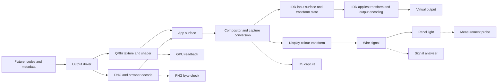

# Output verification

## Overview

This design tests each output path in [Output drivers](overview.md): QRhi HDR10, QRhi FP16, and browser PNG at both input depths. It covers Windows, macOS and Linux. It also defines tests for display calibration and physical output.

**Status:** partly implemented. The core has conversion tests in `crates/nitpick-core/src/output_tests.rs`. The [shared fixtures](#shared-fixtures), the [profile fixtures](#profile-fixtures) and their reader exist. Only the command-line process tests in [browser integration](#browser-integration) compare production output with them. The real client page runs in browser engines on Windows only. The common driver interface, the QRhi and browser drivers and the command-line host exist with their unit tests. The [profile adapter](#mhc2-profile-adapter) in `nitpick-profile` and its [conventional ICC transforms](#conventional-icc-transforms) pass the profile fixtures on Windows only. The [test-host protocol](#host-boundary) runs in both hosts, on Windows only. The [capture interface and artifacts](#capture-interface-and-artifacts), the frame marker, frame acceptance and region selection of [Timing and frame identity](#timing-and-frame-identity) exist with synthetic-capture tests. The [reference metric](#reference-metric) and the per-case limits of [Pass criteria](#pass-criteria) exist in `nitpick-compare` with unit tests; no runner uses them yet. The offscreen draw of [QRhi readback](#qrhi-readback) passes on D3D11 and on Vulkan, on Windows only; the swap-chain readback is not implemented. No host has a capture adapter or an artifact directory. Capture adapters and the display model are not implemented. No device results are claimed here. The [output driver plan](../../plan/output_driver.md) lists the driver changes needed before those tests.

Unit tests check calculations, bytes and state transitions without a GPU or display. GPU, compositor, driver and probe tests are integration tests. Keep their results separate. A unit test cannot certify Windows calibration, browser HDR output or panel light.

Estimate implementation effort after a capture qualification run and an IDD build/signing trial. The capture colour contract and runner setup can dominate the work; no fixed delivery estimate is assumed.

### Test boundaries



This is a model of the test boundaries. It does not require every compositor to use one internal surface or one fixed scanout path.

| Boundary | Check | Does not prove |
|---|---|---|
| CPU output | packed texture bytes, PNG samples, colour tags, metadata and errors | GPU execution |
| QRhi readback | upload, shader, pixel positions and render-target format | compositor or wire values |
| OS capture | app or browser output after capture conversion, at the reported colour space | final display calibration, wire encoding or panel light |
| Software display model | predicted signal for an explicit source, transform and wire mode | that the OS loaded or applied that state |
| Instrumented console IDD | surfaces and transform state delivered by Windows; the IDD's own transformed output | a physical GPU's display engine or its LUT precision |
| HDMI/DisplayPort analyser | wire samples, range, depth and InfoFrames | panel light |
| Colorimeter or spectroradiometer | display light from the complete physical chain | exact wire codes |

### Validated Windows constraints

The following rules come from the linked Microsoft documents. Device behaviour still needs the tests below.

- [WGC supports an FP16 capture pipeline](https://learn.microsoft.com/en-us/windows/uwp/audio-video-camera/screen-capture). Use FP16 from frame pool to stored samples. An 8-bit screenshot can clip or tone map HDR. WGC does not return the original swap-chain colour tag with each frame; record that tag at submission and check its effect with known patches.
- Hardware MHC2 calibration belongs to the [display transform pipeline](https://learn.microsoft.com/en-us/windows/win32/wcs/display-calibration-mhc). A desktop capture is not evidence that this transform reached scanout. **Unverified:** the exact capture boundary for each Windows build and presentation path. Do not claim that all ICC effects are absent from all captures: an app or browser can apply colour management before capture, and profile display metadata can change rendering.
- An [IddCx 1.10 console driver](https://learn.microsoft.com/en-us/windows-hardware/drivers/display/iddcx1.10-updates) receives surfaces and must apply the supplied colour transform. Its acquired surface is before that application. These interfaces start with the Windows 11 22H2 September Update. A chosen driver can require a later OS. Check runtime function availability as well as the OS version.
- The [IDD transform](https://learn.microsoft.com/en-us/windows-hardware/drivers/ddi/iddcx/ns-iddcx-iddcx_gammaramp_3x4_colorspace_transform) has enable flags, an XYZ affine matrix, a scalar and a 4096-entry RGB LUT. It is not necessarily a byte copy of the profile. The OS can resample the LUT and combine other adjustments. Remote IDDs do not receive the same console transform and HDR metadata contract.
- An HDR capture card checks the cable signal. It does not replace a probe. A general video capture card can also rescale, subsample or tone map; qualify its raw capture path before using it as a signal reference.

## Technical decisions

| Decision | Options | Selected and reason |
|---|---|---|
| Required gate | OS screenshots for all checks; tests at separate boundaries | Separate boundaries. Most regressions can be found without a display. |
| Expected values | call production conversion or Little CMS; independent reference | Checked-in vectors from a separate f64 reference. Shared conversion code can hide the same error twice. |
| QRhi check | upload-texture dump; draw readback | Read back after the draw. An upload dump misses shader and render-target errors. |
| QRhi readback draw path | a copy of the draw code in the test; one renderer for the window and the readback, in the application library | One renderer. A copy can differ from the window. Cost: the application binary contains the offscreen readback code, which only tests use. |
| Capture interface | Windows-only scripts; common result with OS adapters | Common result. Each adapter must report its format and colour contract. |
| Error limit | exact bytes everywhere; perceptual error everywhere | Exact transport checks plus numeric and perceptual checks at later boundaries. |
| Profile handling | custom ICC/MHC2 parser; Little CMS through a Rust binding | Little CMS for profile reading, MHC2 extraction and conventional ICC transforms. Use the library's existing profile support. The adapter also checks and decodes the raw `MHC2` tag, because the Little CMS reader does not check bounds; see [MHC2 profile adapter](#mhc2-profile-adapter). |
| Device operations | native queries and setters in each output driver; separate device interface | [`DisplayDeviceControl`](../display_device.md) with native implementations in `nitpick-display`. Hosts and tests share capability enumeration, profile assignment, readback and restoration. |
| Comparison code | module of `nitpick-test-host`; separate crate | The crate `nitpick-compare`, without a `nitpick-core` dependency. The reference cannot then share the conversion code that it checks. |
| Comparison limits | derived at run time from the submitted values; frozen in the fixtures | Frozen in the fixtures by the generator. A run cannot change them, and a regression of the submitted values cannot widen them. |
| Display model | ICC transform alone; explicit HDR model with library support | Explicit HDR model. Nitpick controls units, stage order, transfer functions and clipping; see [Colour library boundary](#colour-library-boundary). |
| IDD dependency | required for unit tests; optional lab tool | Optional lab tool. Signing and HDR hardware must not block normal CI. |
| Browser automation | screenshots as an HDR reference; protocol tests and qualified OS capture | Protocol tests on all hosts; HDR checks only on a qualified engine and OS. |
| Pending frame at a disconnect or a display change | report a cancellation; report the driver error; accept both | The driver error. The state fixtures expect an error, and the result does not depend on the order in which the host sees the driver result and the change. |
| Capture call | one synchronous frame per request; a session that delivers a frame stream | A session. The bounded wait, the three matching frames and the heartbeat need several frames, and the Qt GUI thread must not wait. |
| Frame identity | the frame ID in the marker; the `show` sequence number in the marker | The sequence number modulo 256. Consecutive `show` requests then always have different markers; frame IDs can skip values. |
| Marker threshold | fixed code thresholds; reference cells in the marker | Reference cells. The capture colour contract can be unknown; the read needs only an increasing conversion. |

## Fixtures and test interface

### Shared fixtures

Fixtures and expected data are in `tests/fixtures/output/`. The reference generator and its locked Python dependencies are in `tests/reference/`. Rust tests read the checked-in vectors through the `nitpick-fixtures` crate; normal CI does not need Python. The generator does not call nitpick's conversion functions, evaluate pixels through Little CMS, or use the reference table as its sole source.

**Deviation from plain f64 arithmetic:** the generator calculates at higher precision and stores the nearest f64 value. Range mapping, primary matrices and integer quantization use exact rationals. Transfer functions use `mpmath` at 50 significant digits. Thus exact halves in quantization are detected; for example, 12-bit narrow code 840 gives PNG sample $65535 \cdot 584 / 3504 = 10922.5$, stored as 10923. A production f64 calculation can round such a value down.

Each case has a stable ID, input depth and encoding, image size, palette of code triples, layout, metadata request, required capabilities and expected results for each boundary. A layout is either rectangles painted in order over a background entry, or one palette index per pixel. Invalid input cases state the expected error.

The output fixture files hold data only, for machine reading: no descriptions, labels, provenance records or manifest. The generator source documents each case. Sources and rounding rules for all cases:
- Transfer: SMPTE ST 2084 PQ. Quantization: ITU-R BT.2100 Table 9. Primary matrices: SMPTE RP 177 with BT.709, BT.2020 and P3-D65 (SMPTE EG 432-1) primaries and D65. Light levels: CTA-861.3. scRGB, packing and PNG mapping: [Swap chain output](qt.md#swap-chain-output) and [Code to PNG sample](browser.md#code-to-png-sample).
- Codes and PNG samples round half up: $\lfloor x + 1/2 \rfloor$. Real values are the binary64 values nearest to the high-precision results.

| File | Content |
|---|---|
| `scalar.json` | every scalar code as columns: QRhi signal, luminance, grey scRGB and single-channel `R10G10B10A2` words; browser samples, clip state and PQ luminance for each encoding |
| `codes.json`, `luminance.json`, `gamut.json`, `mixed.json`, `geometry.json` | patch and image cases |
| `state.json` | two marker frames per depth and event sequences with expected outcomes |
| `invalid.json` | invalid inputs and their error kinds |

Expected results per palette entry:
- `qrhi`: the codes as full-range PQ for every encoding: signal, linear BT.2020 cd/m², ideal scRGB before f16 rounding, at 10 bits the packed word, and `scrgb_bound` (see [Pass criteria](#pass-criteria)). The result of the FP16 neighbour search is not in the fixtures; its range is in `scrgb_bound`.
- `browser`: 16-bit samples and clip state under [Code to PNG sample](browser.md#code-to-png-sample); PQ luminance, scRGB and `scrgb_bound` of the stored samples; none for HLG.

Each case also has MaxCLL and MaxFALL for both drivers, and the resolved metadata if it has a request. A browser HLG case gives the error `unsupported` for automatic light levels. State sequences use the error kind `any` where this design does not fix an `OutputError` variant (stale surface after resize, device loss).

The BT.2111 levels are transcribed from BT.2111-3 (05/2025) Tables 2–4, both depths, and are not derived from the 10-bit values. The ramp is covered by the scalar tables. P3-D65 red has a small negative BT.2020 blue component; the generator clips it to 0 before encoding and sets `container_clip`.

Regenerate and check from the repository root. Reproducible generation gives no difference to the committed files:

```sh
uv run --project tests/reference python tests/reference/generate.py  # write
git diff --exit-code tests/fixtures                                   # compare with the committed files
uv run --project tests/reference pytest tests/reference              # generator and profile tests
cargo nextest run -p nitpick-fixtures                                 # Rust reader tests
```

`.gitattributes` keeps the fixture bytes free of line-ending conversion, so the comparison also passes on Windows. The same command writes the [profile fixtures](#profile-fixtures).

| Fixture group | Values and purpose |
|---|---|
| Codes | Every scalar code at 10 and 12 bits; black, peak and one step on each side of nominal range endpoints; separate R, G and B ramps to find channel swaps |
| Luminance | Neutral PQ patches near black and at 1, 80, 100, 203, 1000, 4000 and 10000 cd/m²; derive expectations from the quantized input codes |
| Gamut | BT.709, P3-D65 and BT.2020 primaries and secondaries; include negative and greater-than-one scRGB components |
| Mixed channels | Bright saturated patches with a small nonzero channel; include all BT.2111 levels and the FP16 levels marked `*` |
| Geometry | Asymmetric corner colours, one-pixel lines, checkerboard, odd widths and a border marker; find flips, scaling, crop and row-pitch errors |
| State | Two different frames with unique markers; metadata on/off/changed; close, disconnect, resize and device loss |
| Profiles | See [Profile fixtures](#profile-fixtures) |

Specify coloured luminance without ambiguity. For a P3-D65 primary at measured luminance $Y$, form its XYZ value from chromaticity $(x,y)$:

$$
XYZ = Y\,[x/y,\ 1,\ (1-x-y)/y]^T.
$$

Convert XYZ to BT.2020 linear RGB, then encode the requested input codes. A red component set to 100 in an RGB luminance vector does not in general give a patch with $Y=100$ cd/m². Keep both the intended colour and the value after code quantization in the fixture.

### Profile fixtures

The ICC profiles and `manifest.json` are in `tests/fixtures/profile/`. The generator in `tests/reference/` (`icc.py`, `profiles.py`, `transforms.py`) writes them together with the output fixtures. It serializes the bytes itself; it does not use Little CMS or nitpick code. The `profile` module of the `nitpick-fixtures` crate reads the manifest and checks each file against the manifest size and SHA-256. The manifest holds only data with a programmatic use: case ID, file, use, hash, expected values, expected adapter errors and the [conventional transform cases](#conventional-icc-transforms). The generator source documents each case.

Every matrix, curve and luminance value is an exact rational, defined before serialization. The manifest stores two forms of each stored value:
- `intended`: the binary64 value nearest to the rational.
- `encoded`: the signed 15.16 integer in the profile, $n = \lfloor 65536\,v + 1/2 \rfloor$.

**Deviation from common rounding:** exact halves go up for both signs. Thus $-1.5 \cdot 2^{-16}$ is stored as $-1$, not $-2$. Little CMS writes with the same rule. MHC2Gen in [dantmnf/MHC2](https://github.com/dantmnf/MHC2) uses .NET `Math.Round`, which rounds halves to even. The `mhc2_signed` case has half steps of both signs. Compare extracted values with `encoded`, so parsed data cannot become its own expected result.

All valid profiles are complete ICC v4.3 display profiles (`mntr`, RGB, XYZ PCS). They contain `desc`, `cprt`, `wtpt`, `chad`, `rXYZ`, `gXYZ`, `bXYZ`, and `para` curves in `rTRC`, `gTRC` and `bTRC`. `wtpt` is the D50 PCS illuminant, `chad` is the Bradford matrix from the display white to D50, and the colorants are adapted to D50. The display white is D65, except in `display_d50`. The header has a fixed date and an MD5 profile ID. The vendor, platform and creator fields are zero.

| Use | Profiles | Content |
|---|---|---|
| `ordinary` | `ordinary_srgb`, `ordinary_p3_gamma22` | No `lumi` and no `MHC2`. BT.709 primaries with the sRGB curve; P3-D65 primaries with gamma 2.2. For assignment tests on all operating systems. An MHC2 read must return `missing_tag`. |
| `mhc2` | `mhc2_identity`, `mhc2_matrix`, `mhc2_lut`, `mhc2_combined`, `mhc2_swap_rg` | Windows calibration set. All tags except `desc` and `MHC2` are byte-identical: BT.709 primaries, sRGB curve and `lumi`. The MHC2 luminance values are also equal. |
| `adapter` | all other cases | Profile adapter cases only. Do not install them. |

The `mhc2` set uses the BT.709 primaries and the sRGB curve of the Windows SDR wire basis. Thus the SDR gamut mapping of the OS is identity, and only the MHC2 transform changes the output. The MHC2 transforms of the set are:
- `mhc2_identity`: identity matrix and two-entry identity LUTs $[0, 1]$.
- `mhc2_matrix`: an asymmetric XYZ matrix with unequal row sums; identity LUTs.
- `mhc2_lut`: identity matrix; 256-entry LUTs with unequal channel curves. Red ends at 0.96; green starts at 0.02.
- `mhc2_combined`: the matrix of `mhc2_matrix` and the LUTs of `mhc2_lut`.
- `mhc2_swap_rg`: red/green exchange. The intended RGB action $P$ in the BT.709/D65 basis gives $A = M P M^{-1}$, with $M$ the RGB-to-XYZ matrix at D65 and no D50 adaptation. $A$ agrees with the public [SwapRedGreen.icm](https://github.com/dantmnf/MHC2/tree/master/profiles) sample to six decimals. The manifest stores $P$.

Each luminance field has a different value, so a test can find a swapped field:

| Value | cd/m² |
|---|---|
| MHC2 minimum luminance | 0.05 |
| MHC2 peak luminance | 1000 |
| ICC `lumi` full-frame luminance | 400 |
| Frame metadata: mastering minimum and maximum | 0.005, 4000 |
| Frame metadata: MaxCLL, MaxFALL | 800, 200 |

`frame_metadata` is the HDR10 metadata request for frames shown during calibration checks. It uses BT.2020 primaries and D65.

Adapter cases. "Values" means the manifest gives the expected MHC2 values. A case with an error kind gives that kind instead of values:

| Case | Content | Expected |
|---|---|---|
| `mhc2_signed` | Negative matrix and LUT values, half steps of both signs, nonzero fourth matrix column, 3 LUT entries | values |
| `mhc2_zero_matrix_offset` | Matrix offset 0 | identity matrix |
| `mhc2_zero_lut_count` | LUT count 0 and LUT offsets 0 | identity LUTs |
| `mhc2_metadata_only` | Matrix offset 0 and LUT count 0 | identity |
| `mhc2_lut_4096` | 4096 entries; LUT values at both endpoints | values |
| `mhc2_relocated` | `MHC2` data is first in the file but not first in the tag table. Elements are in the order blue, red, matrix, green, each after 8 filler bytes `A5`. | the values of `mhc2_combined` |
| `mhc2_lut_count_1` | One LUT entry | `unsupported` |
| `mhc2_truncated_header` | Tag size 32, less than the 36-byte header | `malformed_tag` |
| `mhc2_wrong_type_signature` | Type signature `MHC1` | `malformed_tag` |
| `mhc2_wrong_lut_signature` | Green LUT signature `curv` | `malformed_tag` |
| `mhc2_file_relative_offsets` | Element offsets relative to the file start | `malformed_tag` |
| `mhc2_matrix_offset_wrap` | Tag start plus matrix offset wraps in 32 bits to file offset 128 | `malformed_tag` |
| `mhc2_lut_offset_wrap` | Red LUT offset plus 8 wraps in 32 bits to tag offset 4 | `malformed_tag` |
| `mhc2_matrix_outside_tag`, `mhc2_lut_outside_tag` | An array ends 4 bytes after the tag; the file continues | `malformed_tag` |
| `mhc2_lut_count_4097` | 4097 entries, with arrays of that length inside the tag | `malformed_tag` |
| `icc_truncated` | `mhc2_identity` cut to 100 bytes | `invalid_profile` |
| `vcgt_srgb` | `ordinary_srgb` plus a `vcgt` table with unequal, non-identity channels. Do not install it: an OS loads `vcgt` into the video card gamma ramp. | `missing_tag` |
| `display_d50` | BT.709 primaries, gamma 2.2 and the D50 PCS illuminant as display white. Its `chad` is identity, so its native XYZ is its PCS XYZ. | `missing_tag` |

Each `malformed_tag` case except `mhc2_lut_count_4097` has one defect in a valid base tag (asymmetric matrix, two-entry LUTs). In the `*_wrap` and `*_outside_tag` cases the arrays are inside the file, so a reader that ignores the tag size reads other bytes and does not fail.

The generator tests parse the bytes with a separate reader and compare them with the manifest. They check the profile ID, the equal tags of the `mhc2` set, the defect of each case and reproducible bytes. They also open each valid profile with the Little CMS build in Pillow 13.0.0 (Little CMS 2.19) and compare `wtpt`, the colorants and `lumi`.

A one-time check on Windows 11 build 26200: `IsColorProfileValid` accepted every profile except `icc_truncated`, which `OpenColorProfileW` rejected. `vcgt_srgb` and `display_d50` did not exist at that time. That call does not read `MHC2`. **Unverified:** that Windows accepts the `mhc2` set as MHC profiles and applies their calibration.

### Host boundary

A test-only control interface uses standard input and output, with one JSON object per line. This avoids a Windows named-pipe dependency. The crate `nitpick-test-host` has the protocol types (`protocol.rs`), the fixture frames (`fixture.rs`) and the host state machine (`controller.rs`). It has no executor, GUI or server dependency. Each host polls the state machine with its own executor:

| Host | Start | Driver and executor |
|---|---|---|
| Browser | `nitpick-cli --test-host` with the options of [browser usage](browser.md#usage); `--delay` is the default delay of `show` | `BrowserDriver` on the Tokio current-thread runtime of the command-line host |
| QRhi | `nitpick --test-host` (first argument) | `QrhiDriver` on the Qt GUI thread through `gui_executor.rs`, without QML; see [Test host](qt.md#test-host) |

The first event is `hello` with the protocol version (1) and the driver ID. The last event is `stopped`. The end of standard input is the same as `quit`. The exit status is 0 after `quit`, 1 if the driver side stopped with an error, and 2 if the fixtures or the host cannot start.

Requests (field `request`):

| Request | Fields | Reply |
|---|---|---|
| `displays` | | `displays` |
| `refresh` | | `displays` after the host reads the display state again. QRhi: the device read of the launcher, on a worker. Browser: at once. |
| `query` | `display`: `DisplayId` text | `query`: each `Support` as `state` and `reason`, and the mode |
| `open` | `display`, `depth` (10 or 12) | `surface` with `state: open` |
| `show` | `frame`, `fixture`; optional `delay_ms`, `metadata` and `marker` (default `false`) | `submitted` after the driver acknowledgement, then `ready` after the delay |
| `capture` | `frame`; optional `heartbeat_ms` and `deadline_ms` (default 30000) | `captured` when the capture session ends; with an `artifact` name, `saved` or `error` with kind `artifact` follows later |
| `close` | | `surface` with `state: closed` |
| `quit` | | `stopped` |

Other events are `display` (a driver-side change: `connected`, `authenticated`, `ready`, `changed` or `disconnected`), `listening` and `pairing_code` (browser host), `cancelled` with a `cause`, `saved` with the frame and the artifact name, and `error` with a `kind` and, where one applies, the frame. The Rust types in `protocol.rs` define all fields. The tests parse the lines with these types.

Rules:
- Invalid JSON, an unknown request, a missing or unknown field or an invalid depth gives `error` with kind `malformed`. It changes no state.
- `show` takes a case ID of the [shared fixtures](#shared-fixtures). Its frame ID must be greater than the frame ID of every earlier `show`, also of a rejected one; otherwise the kind is `frame_order`. An absent `metadata` uses the request of the fixture, `null` sends no metadata, and an object is a request in the fixture form.
- The host checks the frame order, the fixture, the metadata and the surface before it cancels the pending frame. A rejected `show` keeps the pending frame.
- **Deviation from the fixture:** the host puts the fixture at the top-left corner of the surface and fills the remaining area with the nominal black code of the fixture format. Thus automatic light levels include the black area. They equal the fixture values only on a surface of the fixture size. A fixture larger than the surface gives `fixture_too_large`.
- Each `open` starts a new surface generation. The host calls `query` before `open`, as the launcher does. A new `open` first reports the earlier generation as `closed` with cause `opened`. `submitted` gives the generation of its frame.
- A display change of the surface (browser: a viewport change) makes the surface `stale`. Then `show` fails with `stale_surface` until the next `open`. A disconnect, or a pattern window that closes outside the host (for example by Esc), makes the surface `closed`.
- A disconnect or a display change during a presentation gives `error` with the driver error for that change: kind `disconnected`, or kind `platform` with the driver text. The host gives the same event if it handles the driver result first or the change first; see the decision table above. A new `show`, `open`, `close` or `quit` gives `cancelled`.
- A disconnect or a display change during the measurement delay gives `cancelled`.
- With `marker`, the host draws the [frame marker](#timing-and-frame-identity) below the fixture. A surface without room for it gives `fixture_too_large`.
- `capture` applies only to the frame of the last `submitted` on the open surface; another frame gives `stale_frame`. A frame without `marker` gives `no_marker`. A second `capture` during a capture session gives `capture_pending`; the first session continues. A `heartbeat_ms` or `deadline_ms` of 0 gives `malformed`. The result is in [Capture interface and artifacts](#capture-interface-and-artifacts). Neither host has a capture adapter: `captured` gives `result: unavailable` and the reason.
- A capture session continues through `ready`. A new `show`, `open`, `close`, display change, disconnect, external close and `quit` end it before they end the pending frame: `captured` with `result: cancelled` and the `cause` of the frame. A rejected request does not end it.
- The host sends `stopped` only after each queued artifact has its `saved` or `error` event.

For device tests, add device enumeration and query, profile preparation, assignment and restoration through `DisplayDeviceControl`. Keep these separate from output requests. Save the prepared recovery record before assignment. A profile change invalidates the current measurement and capture generation under [the device lifecycle](../display_device.md#identity-and-execution).

### Capture interface and artifacts

Capture is outside `OutputDriver`. The `capture` module of `nitpick-test-host` has the interface; the `artifact` module writes and reads the results. Neither depends on an OS capture API.

The `CaptureAdapter` trait has two calls:
- `now`: the current time in the time base of its frame timestamps, or none. The host reads it before each presentation; it is the submission time of [frame acceptance](#timing-and-frame-identity).
- `start`: gets the display, frame and generation of the acknowledged frame. It returns a capture session, or the reason why no capture is available (for example permission or API failure). The session is a stream of `Capture` values in arrival order; an item can be the reason of a session failure. Dropping the stream ends the session. The adapter must not block the host thread.

A `Capture` has:
- The raw planes, with the row padding of the API.
- A descriptor: width, height, planes, content rectangle, cursor, alpha meaning, colour, timestamps and source identity. The content rectangle is the part of the image that shows the source (without window chrome, a capture border or unused texture area); none is the whole image. The cursor is hidden (the adapter told the API not to draw it), shown in a rectangle, or unknown.
- Raw API metadata as a JSON object, and binary API metadata as named blobs. A blob name has 1 to 64 characters of `a`–`z`, `0`–`9`, `_` and `-`, because it is a part of a file name.
- The adapter configuration, as a JSON object.
- An optional preview PNG, tone mapped by the adapter or the OS. It is never a sample source.

Each colour field (transfer, primaries, white point, range, YCbCr matrix, luminance scale) is `null` if the API does not give it. Nothing fills an unknown field. FP16 storage alone does not establish scRGB or 80 cd/m². The luminance scale gives the cd/m² of a linear value 1.0 after the transfer decode, or `relative`. A timestamp keeps the raw ticks, the tick rate and its time base (QPC, `mach_absolute_time` or `CLOCK_MONOTONIC`); compare only timestamps of one time base.

Plane layout. A plane is rows of blocks. A block is 1 to 16 bytes, read as one integer in the byte order of the plane. Each channel is a bit field of that integer: shift, width and kind (unsigned integer up to 32 bits, or binary16 or binary32 float). This one model covers interleaved bytes (BGRA8, RGBA FP16), packed words (`R10G10B10A2`), samples in the high bits of a 16-bit word (P010) and big-endian components. **Deviation from per-component byte order:** a big-endian block of 16-bit components has its first component in the highest bits. A plane has subsampling 1 or 2 in each direction; only `Cb` and `Cr` can be subsampled. A sample read of a subsampled channel gives the block that holds the pixel; there is no chroma siting or interpolation. A binary16 sample is widened to binary32 without other change.

Validation rejects a descriptor that does not describe its planes. It does not change the descriptor. Rules:
- Width and height above 0. One data plane for each descriptor plane.
- Fields inside the block, not overlapping, not of zero width. Integer fields at most 32 bits; float fields 16 or 32 bits.
- The row pitch at least the row size. The data length from $p\,(h-1) + r$ to $p\,h$, with $p$ the row pitch, $r$ the row size and $h$ the plane rows: the last row can end without its padding.
- The channels are R, G, B, or Y, Cb, Cr, each set with an optional A. Each channel in one field only.
- All colour channels have the same kind and width; A can differ. **Restriction:** formats with unequal colour widths, for example RGB565, are rejected.
- An alpha meaning only with an A field. A range only for integer samples. A YCbCr matrix only for YCbCr.
- Custom chromaticities finite, with $x \ge 0$, $y > 0$ and $x + y \le 1$. An absolute luminance scale finite and above 0. **Deviation:** PQ with a relative scale or an absolute scale other than 10000 cd/m² is rejected, because ST 2084 fixes the scale.
- A tick rate above 0. Valid blob names.
- A content rectangle not empty and inside the image. A shown cursor rectangle not empty; it can extend past the image.

`captured` gives one result:

| Result | Condition | `artifact` |
|---|---|---|
| `unavailable` | No adapter, the adapter returned a reason, the session failed or ended, or an accepted frame in a host without an artifact directory | none |
| `fail` | The adapter gave no submission time, an invalid descriptor (the reason is the first defect), a rejected frame, the deadline, a heartbeat failure, or the artifact queue is full | the artifact name if queued |
| `pass` | An accepted frame, and the artifact is queued | the artifact name |
| `cancelled` | A request or a driver change ended the session; `cause` gives which | none |

**Deviation:** a `fail` with a frame saves that frame too, so its raw data can be examined: the invalid or rejected frame, or at the deadline the last frame that was not a repeat. `pass` checks the descriptor and frame acceptance; comparisons are separate checks.

Each artifact records the check result, the capture, an acceptance record and a run record:
- Acceptance: the submission time, the marker value and position, the frame times of the matching run (fewer than three after a `fail`), the number of received frames, the deadline and the heartbeat interval.
- Run: driver, display ID, surface generation and size, the mode of the query before `open` (HDR state, gamut, scale and luminance values), frame ID, fixture ID, submitted format, submitted metadata (`null`: none), measurement delay and the host environment. The environment fields (OS and build, GPU and driver, Qt and backend or browser and engine, EDID hash, profile hash) are `null` where the host does not read them.

An `ArtifactWriter` writes on its own thread. At most a set number of artifacts are queued or in progress; an artifact counts until the host takes its result. A full queue gives `fail`, so memory does not grow without a limit. The host reports each result in submission order as `saved` or `error` with kind `artifact`. The writer starts only in an empty root directory, so names from an earlier run cannot repeat.

The host checks each frame on its own thread (the Qt GUI thread for the QRhi host): descriptor validation, the marker read and the comparison with the previous frame. The comparison reads each sample of the fixture area, so its time increases with the fixture area. **Unverified:** that this time is acceptable on the GUI thread for full-screen fixtures; no adapter delivers real frames yet.

Artifact directory `<root>/<nnnnnn>-frame-<frame>`, with `nnnnnn` the submission number from 1. The writer writes the files to `.<name>.partial` and then renames it, so another process sees only complete artifacts:

| File | Content |
|---|---|
| `result.json` | version (1), check, run record, acceptance record, descriptor, file names and sizes, raw JSON metadata, configuration |
| `plane-<i>.bin` | the bytes of plane $i$, unchanged |
| `raw-<name>.bin` | a raw metadata blob |
| `preview-tone-mapped.png` | the preview, if any |

The reader rejects another version, unknown JSON fields, other file names and other file sizes.

### Timing and frame identity

`present` and the [measurement delay](overview.md#measurement-delay) retain their existing meanings. Neither proves that capture contains the new frame.

Show a small binary frame marker outside the sample rectangles. Require a capture timestamp after submission, the current marker and three successive matching frames within the numeric limit. Use a bounded capture deadline of 30 s for the initial harness. A static source that emits fewer frames can be prompted with a separate heartbeat pixel; keep the frame marker and patches fixed. Record the accepted frame timestamps.

Crop to valid content bounds. Exclude the cursor, capture border, window chrome, marker and patch edges. For flat patches use an inset sample rectangle and report maximum and median error. Test one-pixel geometry separately without an inset. Never resize the capture to make it fit. Reject a resize, stale frame, missing colour contract or changed display state instead of comparing it to the old expected image.

The modules `marker`, `gate` and `region` of `nitpick-test-host` implement these rules as follows.

**Frame marker.** One row of 11 cells of 4×4 surface pixels, at the bottom-left corner of the surface, below the fixture. Its row is even, so that cells start on 2×2 chroma blocks if the surface starts on one. Left to right: a set reference cell, a clear reference cell, 8 value bits (most significant first) and the heartbeat cell. The value is the number of `show` requests that started a presentation, modulo 256. A set cell has the code at half of the nominal signal range (`code_from_signal(0.5)`); a clear cell has nominal black. This marker is separate from the markers inside the state fixtures.

The read takes the mean of $R + G + B$ (or of $Y$) over each cell without its 1-pixel edge. With $s$ and $c$ the set and clear references, a cell gives $t = (v - c)/(s - c)$. It is a 1 for $t \ge 0.75$ and a 0 for $t \le 0.25$. Other values, $s \le c$, a cell outside the capture and a non-finite sample make the marker unreadable.

**Deviations:**
- The marker is opt-in (`show` with `marker`), because it changes the frame: automatic light levels include it. The set level is far below peak, so it changes `MaxCLL` only for a fixture that is darker than that level. `MaxFALL` changes for each marked frame.
- The submission time is the adapter time before the presentation starts, not the acknowledgement. A frame of the new content can be composed before the acknowledgement arrives. The marker rejects old content after this time.

**Frame acceptance.** The gate checks each frame in this order. A *rejected* frame ends the session with `fail`. A *stale* frame does not count and restarts the matching run. A *repeat* does not count and does not restart the run.

| Check | Result if it fails |
|---|---|
| Valid descriptor | rejected |
| The source equals the source of the first frame | rejected |
| A frame timestamp exists, in the time base of the submission time | rejected |
| The frame time is after the submission time | stale |
| The frame time is after the last frame | repeat |
| The content rectangle has the surface size | rejected (a resize) |
| The cursor is not unknown | rejected |
| A shown cursor does not cover the read cells of the marker | stale |
| The marker reads the current value | stale |

A frame that passes continues the matching run if its fixture area matches the previous frame of the run, else it starts a new run. Matching compares the stored colour samples outside the cursor rectangles of both frames: the largest difference must not be above 0 sample units. A non-finite sample or other colour channels never match. Three frames in one run accept the capture. Outside the fixture area, the black fill and the heartbeat cell can change.

The gate does not need the colour contract. A missing colour contract must make a later comparison unavailable; no comparison exists yet.

**Deadline and heartbeat.** The deadline timer starts with the session; at the deadline the capture fails with the number of received frames and the last reason. With `heartbeat_ms`, the host presents the acknowledged frame again after each interval, with the heartbeat cell changed. It uses the same surface, format and metadata request. It sends no `submitted` event and does not change the readiness. With automatic light levels the driver computes them again for each heartbeat presentation, so `MaxFALL` can change; whether a capture with metadata checks must avoid this is an open question. A failed heartbeat presentation fails the capture. **Unverified:** that a heartbeat presentation makes WGC, ScreenCaptureKit or PipeWire deliver a new frame on each platform.

**Region selection.** Surface pixel $(0, 0)$ is at the origin of the content rectangle; the fixture is at the top-left corner of the surface. The sample pixels of a palette entry are the fixture pixels whose neighbours within the inset (also diagonally) are in the fixture and have the same entry, outside the excluded rectangles (the cursor). Flat patches use an inset of 1 pixel, which skips 2×2 chroma blocks shared with a neighbour patch. One-pixel geometry uses an inset of 0, which samples every fixture pixel. The check of the samples is in [Pass criteria](#pass-criteria).

## Unit tests

All supported input formats run in ordinary CI on Windows, macOS and Linux. Unsupported physical paths still have CPU conversion tests. Put Rust unit tests in separate `<file>_tests.rs` files.

### QRhi output

The conversion rules stay in [QRhi signalling and conversion](qt.md#signalling). The tests below use those rules, including their deliberate deviations from normal signal interpretation. FP16 expected values come from a 60-digit evaluation of the ST 2084 constants, the BT.709 and BT.2020 primaries and D65. The tests do not use the production conversion or decoder to make expected values.

| Test | Assertion |
|---|---|
| `qrhi_hdr10_pack` | Independent asymmetric RGB values produce the expected little-endian `R10G10B10A2` words and opaque alpha. Check all scalar codes in each channel and row boundaries. |
| `qrhi_scope_encoding` | `pq-full`, `pq-narrow` and `hlg-narrow` with the same codes produce the same QRhi bytes at a given depth. Narrow and HLG interpretation warnings remain present. Do not apply an HLG EOTF to this output. |
| `qrhi_fp16_reference` | PQ decode, primary conversion and the 80 cd/m² scale match independent vectors. Check signed components, finite values, channel order and opaque alpha. |
| `qrhi_fp16_search` | **Deviation from plain FP16 rounding:** test the documented ±2-neighbour search separately. Chosen values stay in the search range and do not worsen the reference code error. Fixed difficult vectors check the selected bits and tie behaviour. |
| `qrhi_fp16_limits` | Keep the exhaustive 4096-grey test. Check individual BT.2111 expectations, including residual errors for marked levels. Do not use only a total failure count or the production inverse as the expected result. |
| `qrhi_capabilities` | Reject unavailable formats before conversion. macOS 12-bit and Windows with HDR off give `available = Unknown` and `exact = No` with the stated reason. A supported 10-bit path remains available. A QRhi swap chain fallback gives a warning; it must not be silent. |
| `qrhi_submission` | With controlled render events, success needs the upload and a successful `endFrame` of the same frame ID. Test `beginFrame` and `endFrame` failures, timeout, close, cancellation and two rapid replacements. A late event of an old frame ID must not upload or complete a newer frame. |
| `qrhi_present` | With a fake window, controlled workers and a simulated event loop: conversion runs off the GUI thread and each poll returns at once. Event-loop jobs run during conversion and submission. Dropping the future does not wait for a worker and releases the completion. Late worker results and events of old frame IDs do not complete a new frame. Invalid frames fail before conversion. |
| `qrhi_metadata` | Check native metadata structures at the bridge boundary with an injected sink. Verify units, field order, explicit values, automatic values, disabled state and state replacement. No successful API call is treated as wire metadata proof. |

### Browser output

Use [Code to PNG sample](browser.md#code-to-png-sample) as the contract. Test all three encodings at both depths.

| Test | Assertion |
|---|---|
| `browser_png_samples` | Decode with an independent PNG reader. Check 16-bit RGB sample values, network byte order, dimensions and channel order for every scalar input code. Inverse range mapping recovers every code in the nominal range. |
| `browser_png_endpoints` | Narrow black and peak map to the full PNG endpoints. Below-black and above-peak inputs clip and receive the expected warning and reference mark. Check the codes adjacent to each endpoint. |
| `browser_png_colour` | Parse chunks independently. Check the specified cICP tuple for each encoding, placement before image data and CRC. No competing colour tag may change interpretation. HLG remains tagged HLG. |
| `browser_png_metadata` | Check `mDCV` and `cLLI` widths, order and units against the [PNG specification](https://www.w3.org/TR/png-3/). PNG `cLLI` uses two 32-bit values in 0.0001 cd/m² units. Do not reuse the two 16-bit CTA SEI fields. Check omission when disabled. |
| `browser_light_levels` | Automatic PQ values use the stored PNG samples after clipping and rounding. HLG automatic values return `Unsupported`; explicit values remain valid. A uniform 10-bit code-940 frame distinguishes the two interpretations: QRhi full-range PQ gives about 4654.397 cd/m²; the browser maps narrow-range 940 to PNG sample 65535 and gives 10000 cd/m². |
| `browser_capabilities` | Unknown code precision, metadata effect and interpretation stay unknown. Media queries and user-agent rules follow the browser contract; they do not certify measured luminance. Test HDR-off warnings and unknown wire depth. |
| `browser_session` | With a mock transport, test leading-zero and fixed authentication codes, failed attempts, timeout, one-client reservation, `hello` ordering, token checks, token revocation and reconnect. Check the existing protocol limits and error codes in [Interface](browser.md#interface). |
| `browser_present` | `open` uses cached state. Match `applied` to frame ID and dimensions. Stale IDs, timeout, disconnect, resize and close cannot mark a replacement frame ready. |

### Shared host contract

Use a mock driver, controlled clock and controlled worker completions. Check each capability state (`Yes`, `No`, `Unknown`), warning and `OutputError` against [Interface](overview.md#interface). Reject `available = No`, `input = No` and unsupported metadata. Accepted input with `interpretation = No` remains selectable with a warning.

Readiness must follow acknowledgement plus the selected delay. Zero adds no delay. Errors start no timer. New frames, closure, display changes and disconnect cancel old work and timers. An old callback cannot complete a new request. Drop pending futures and check that callback and timer registrations are released. Run the contract with the command-line executor and the Qt executor; Qt timers and controls must continue to run during conversion, presentation and the delay.

`nitpick-test-host` has this contract over the [test-host protocol](#host-boundary) (`contract.rs`, feature `contract`). It uses a mock driver, a controlled clock, controlled presentation results, a controlled device read, a controlled surface close and a controlled capture adapter. The capture scenarios (`contract/capture.rs`) replay frames of the presented images (`replay.rs`): stale, earlier-marker, repeated and differing frames before three matching frames, the deadline, a resize, a session failure, the heartbeat, and the end of a session by each request and driver change. `gate_tests.rs`, `marker_tests.rs` and `region_tests.rs` check the rules of [Timing and frame identity](#timing-and-frame-identity) without a host, also with FP16 and YCbCr samples. The contract runs on the Tokio current-thread executor of the command-line host (`controller_tests.rs`) and on `gui_executor.rs` with a simulated event loop (`nitpick-app`, `test_host_tests.rs`). The command-line host unit tests and the `session.rs` tests cover the interactive hosts.

Process tests drive the real hosts through the protocol:
- `nitpick-cli`, `tests/test_host.rs`: the real service and the mock page of the [browser process tests](browser.md#testing). They check `query`, `open`, the PNG samples of the placed fixture against the reference sample table, replacement, a late `applied`, the delay, `capture`, `close`, malformed input, the frame order, a disconnect during presentation in three rounds, and a viewport change with a new generation.
- `nitpick-app`, `tests/test_host.rs`: with the Qt `offscreen` platform, the protocol on the real Qt event loop. That platform has no screen with a native identity, so no window opens. An ignored test opens full-screen windows on the first screen: 10-bit replacement and delay, a frame with the marker, a 12-bit fixture on a 10-bit surface, a 12-bit surface, `capture` and `close`. Run it with `cargo nextest run -p nitpick-app --test test_host --run-ignored only`.

Results: all pass on Windows 11 build 26200 with Qt 6.12.0. The ignored screen test ran on one 3840×2160 HDR screen with an 8 bpc wire. **Not verified:** macOS and Linux; a pattern window closed by Esc in the real Qt event loop (only the contract checks it, with a controlled close).

Reject negative delays and verify that the Qt setting survives a restart. With HDR off, Windows QRhi and the browser return `hdr_on = Some(false)` and the host shows that state. Check that interpretation warnings and FP16 or clipping marks reach both status output and the reference table.

### Reference metric

The crate `nitpick-compare` has the metric (`itp.rs`) and its own transfer functions and primary matrices (`colour.rs`). It does not depend on `nitpick-core`.

Convert both signals to display-referred linear BT.2020 RGB in cd/m² (`Nits2020`): from full-range PQ signals, scRGB (BT.709, 1.0 = 80 cd/m²), XYZ in cd/m², or HLG signals with an `HlgDisplay`. Apply the BT.2124 LMS matrix, PQ nonlinearity and ICtCp matrix. Then use:

$$
\Delta E_{ITP}=720\sqrt{(\Delta I)^2+\tfrac14(\Delta C_T)^2+(\Delta C_P)^2}.
$$

Rules:
- Keep negative RGB values through the primary and LMS conversions. Some valid wide-gamut colours have negative components.
- An LMS component below 0 has no PQ value. The metric is then invalid (`NegativeLms`), and the check retains the component errors. Nothing is clipped to obtain a pass.
- Each step rejects a non-finite value.
- **Deviation from ST 2084:** the PQ inverse EOTF of the metric continues above 10000 cd/m² without clipping. A capture overshoot keeps its size, and binary64 matrix rounding at peak white does not make the metric invalid.
- HLG needs an explicit display. `HlgDisplay` holds the peak $L_W$, the black level $L_B$ and the system gamma $\gamma$ of the BT.2100 reference EOTF, with the black lift $\beta = \sqrt{3 (L_B / L_W)^{1/\gamma}}$. It has no default. BT.2124 Annex 2 uses $L_W = 1000$ cd/m², $\gamma = 1.2$ and $L_B = 0$; which display a browser HLG comparison uses is an open question in the [output driver plan](../../plan/output_driver.md).

Tests (`colour_tests.rs`, `itp_tests.rs`) compare at the printed precision only. They do not fit the implementation to one rounded result:
- PQ against the scalar fixture tables.
- Primary vectors: BT.709 to BT.2020 against BT.2087 (4 decimals), XYZ to BT.2020 against BT.2124 Annex 2 (15 decimals), and the scRGB and BT.2020 values of every fixture entry.
- Analytical cases: neutral colours have $C_T = C_P = 0$ and $I$ equal to the PQ signal, so one grey code step is $720 / (2^n - 1)$. Black against peak white is $720\,(1 - c_1^{m_2})$.
- HLG: peak, the scene grey 1/12, the BT.2408 reference white (signal 0.75 is 203 cd/m² at 1000 cd/m²), and the black lift that gives $L_B$.
- Domain: negative LMS, signals outside 0 to 1, non-finite values.

**Errors in the worked example of [ITU-R BT.2124](https://www.itu.int/dms_pubrec/itu-r/rec/bt/R-REC-BT.2124-0-201901-I!!PDF-E.pdf)-0 Annex 4.** The example truncates some printed values and rounds others. It applies the EOTF to the normalized codes truncated to 4 decimals: red is 8.753 cd/m², not 8.758 as from 296/1023. The printed $I$ of the expected colour, 0.3554, does not follow from the steps: the exact codes, the truncated codes and the printed linear values all give 0.3557. Thus the published $\Delta E_{ITP} = 2.363$ is step 5 on the printed ITP values; the steps give 2.282. The test checks each step from the printed values of the step before and pins these differences. A one-time check with the colour-science 0.4.7 Python package also gave $I = 0.35572$ for the exact codes.

## GPU and compositor tests

### QRhi readback

Use the production upload, shader and pipeline on D3D11, Metal and Vulkan. First draw to a supported offscreen target with the selected format. Compare its raw readback against the CPU output. Then, where supported, read back the actual swap-chain image with `QRhiSwapChain::UsedAsTransferSource` after the draw and before presentation completes. Use the [QRhi asynchronous readback API](https://doc.qt.io/qt-6/qrhiresourceupdatebatch.html#readBackTexture).

An offscreen pass checks the draw path. It does not prove the actual swap-chain format or tag. Record native format and colour-space setup separately. Fail a claimed swap-chain test if it only read the upload texture. Normalize row pitch and image origin as stated below, without colour conversion. Exact stored values and geometry are required for this copy shader. A format conversion needs a separate test with its stated rounding bound.

**Offscreen pass.** The pattern window and the offscreen check use the same `PatternRenderer` (`cpp/pattern_renderer.cpp`): texture upload, copy shader, pipeline and pass. `nitpick_app::readback` (`cpp/readback.cpp`) creates a `QRhi` without a window. It draws into a texture of the requested swap chain format (`RGB10A2` for HDR10, `RGBA16F` for FP16 scRGB) in one offscreen frame and reads that texture back. **Unverified:** that each native swap chain uses the same format and channel order; record it separately, as stated above. `QRhi` documents that the readback is complete when `endOffscreenFrame` returns.

Normalization (`normalize` in `readback.rs`):
- **Deviation from a documented layout:** `QRhiReadbackResult` gives only the format, the pixel size and the bytes. The Qt documentation states no row pitch. The row pitch is the byte count divided by the height. It must hold one tightly packed row; the padding is removed. All runs below gave tightly packed rows.
- Rows run bottom to top only if `QRhi::isYUpInFramebuffer` is true. Qt documents this as true for OpenGL only, which nitpick does not use.

The test `tests/qrhi_readback.rs` of `nitpick-app` compares each readback byte for byte with the expected target. Expected target: the production CPU output (`swap_chain_bytes`) at the pattern position, and the opaque black of the shader elsewhere (`R10G10B10A2` word `0xC0000000`, or binary16 $(0, 0, 0, 1)$). Each case is drawn twice: once filling the target, and once at origin $(3, 2)$ in a target 5 pixels wider and 4 pixels taller, as with a safe-area margin. The second draw checks crop, offset, flip, scale and the area outside the pattern. Cases:
- every case of the [shared fixtures](#shared-fixtures) at both depths, including the asymmetric corners, odd widths, channel ramps and the 39-colour geometry case;
- every code of each depth in R, G and B alone and in grey;
- raw words that are not CPU output: `R10G10B10A2` with each alpha value 0 to 3, and binary16 values in each channel and in alpha (signed zeros, subnormals, the normal limits, negative values and values above 1). The CPU output always has opaque alpha; these words check that the shader copies alpha and keeps binary16 values. NaN and infinity are not tested, because the CPU output is finite.

A software device covers arithmetic only. The test checks `QRhiDriverInfo::deviceType`: a software test fails on a hardware device, and a hardware test fails on a software device, because `QRhi` ignores `PreferSoftwareRenderer` if it finds no software device.

Run the GPU tests with `cargo nextest run -p nitpick-app --test qrhi_readback --run-ignored all`. The D3D11 software test (WARP) is not ignored and runs in each Windows test run. The Vulkan tests need a QGuiApplication for the Vulkan instance, so a window system on Linux. On Windows, Qt has Vulkan only if the build finds `vulkan/vulkan.h`: set `VULKAN_SDK` to a Vulkan SDK or a Vulkan-Headers install (for example the vcpkg `vulkan-headers` port, `<vcpkg>/installed/x64-windows`). Without it, the Vulkan tests fail with the reason. The Windows window uses D3D11; a Windows Vulkan result covers the Vulkan backend and SPIR-V shader only, not the Linux compositor.

Results: Windows 11 build 26200, Qt 6.12.0, debug build, Vulkan-Headers 1.4.363. 96 draws each, all equal to the CPU output, also the binary16 subnormals and signed zeros:

| Backend | Device | Result |
|---|---|---|
| D3D11 | NVIDIA GeForce RTX 5090, driver 616.92 | pass |
| D3D11 software | Microsoft Basic Render Driver (WARP) | pass |
| Vulkan (Windows) | NVIDIA GeForce RTX 5090, driver 616.92 | pass |

A one-time mutation check on WARP moved the drawn origin down by one row; all 96 draws then failed.

**Not verified:** Metal on macOS; Vulkan on Linux; a Vulkan software device (no CPU Vulkan device was installed).

Exercise `beginFrame`/`endFrame` failures, out-of-date surfaces, device loss, close during upload, delayed render events and two rapid replacements. Success must refer to this frame's successful submission. No early success after `requestUpdate()` is allowed.

### Browser integration

Run a real server with an authenticated mock client on a host without a window system. Render with the real core, fetch and independently decode the PNG, send `applied`, and check delay and shutdown. Build by package and check that the command-line dependency graph contains no Qt, Tauri or `nitpick-app` dependency. Status: implemented as the command-line process tests in [Browser output driver testing](browser.md#testing); they pass on Windows only.

Run the real page in each supported browser engine and optional webview. Check authenticated fetch, blob URL lifetime, decode, natural size, layout size, `applied` and cancellation during fetch or decode. Test device pixel ratios 1 and 2, fractional scale, zoom, resize and full-screen changes. A screenshot can check geometry; a normal WebDriver or browser screenshot is not an HDR numeric reference.

Status: the page tests and a webview shell run are in [Browser output driver testing](browser.md#testing). Headless runs passed with Chromium, Firefox and WebKit builds, and the shell run passed with WebView2. All ran on Windows at one monitor scale; Safari, macOS and Linux are not tested.

For HDR pixels, capture the displayed page with the same qualified OS adapter used for QRhi. Compare only after the image decode acknowledgement and the current frame marker. Retain the encoded PNG so a failure can be located before or after browser decode. Do not assume two browser engines have the same HDR or metadata behaviour.

### Platform capture adapters

| Platform | Selected capture | Requirements and limit |
|---|---|---|
| Windows | WGC window capture through `IGraphicsCaptureItemInterop::CreateForWindow`, FP16 frame pool | Interactive desktop, supported capture API and active HDR test display. Keep negative and greater-than-one samples. Check `ContentSize` and timestamps. Capture permission or policy failure is an unavailable result. |
| macOS | ScreenCaptureKit with an explicit HDR stream configuration, macOS 15 or later | Start qualification on an HDR-capable Apple silicon Mac. Get Screen Recording permission. Record pixel-buffer attachments, range and preset. Use a supported high-precision RGB format when possible; a YCbCr format needs explicit conversion and interior patch sampling. |
| Linux Wayland | ScreenCast portal and PipeWire; compositor-specific adapter if needed | Pin compositor, portal backend and versions. Negotiate high-precision samples and obtain the transfer, primaries, range and luminance scale. Missing colour information makes absolute HDR comparison unavailable. |
| Linux X11 | Existing screenshot path for geometry only | Do not use an unqualified X11 screenshot as the HDR reference. Use QRhi readback and external measurement for colour. |
| Remote browser, including iPad | Host-side PNG checks and client state; local capture only if qualified on that device | A capture of the server desktop does not test the remote display. Use a probe for remote display light. |

Each adapter gives `now` in the time base of its frame timestamps, tells the API not to draw the cursor where the API allows it, and gives the content rectangle where the API reports one (for example `ContentSize` of a WGC frame). The [frame acceptance](#timing-and-frame-identity) rejects a frame without a timestamp or with an unknown cursor.

On Windows, Desktop Duplication is an optional second adapter. [DuplicateOutput1](https://learn.microsoft.com/en-us/windows/win32/api/dxgi1_5/nf-dxgi1_5-idxgioutput5-duplicateoutput1) permits format negotiation; the older method converts fullscreen surfaces to BGRA. Inspect the returned format and mode. Do not presume DDA always returns the same FP16 scRGB values as WGC. It captures an output, so crop and rotation must be explicit.

Apple provides [HDR capture presets](https://developer.apple.com/videos/play/wwdc2024/10088/) and distinguishes local-display from canonical-display rendering. Either can involve capture conversion. Pin the chosen preset and verify its colour contract with known patches. **Unverified:** preservation of nitpick's absolute PQ luminance through each preset and display state. The 80 cd/m² Windows scale must not be applied to generic macOS EDR values. QRhi 12-bit output on macOS makes no claim of absolute luminance.

The Linux [ScreenCast portal](https://flatpak.github.io/xdg-desktop-portal/docs/doc-org.freedesktop.portal.ScreenCast.html) supplies PipeWire streams, not a universal HDR colour contract. The [Wayland image capture protocol](https://gitlab.freedesktop.org/wayland/wayland-protocols/-/blob/main/staging/ext-image-copy-capture/ext-image-copy-capture-v1.xml) specifies buffer constraints; the [colour-management protocol](https://gitlab.freedesktop.org/wayland/wayland-protocols/-/blob/main/staging/color-management/color-management-v1.xml) defines image descriptions. Support for one does not establish the other on a captured stream. **Unverified:** the selected compositor's capture stage and its mapping of Vulkan extended-linear-sRGB to absolute luminance.

### Capture reference and qualification

For a qualified Windows HDR scRGB capture, use column vectors. Let $M_{a\to b}$ convert linear RGB primaries, and let $E_{PQ}$ decode PQ to cd/m². The ideal QRhi HDR10 expectation is:

$$
c_{709}=\frac{1}{80}M_{2020\to709}\,E_{PQ}\!\left(\frac{D}{2^n-1}\right).
$$

For QRhi FP16, the expectation includes the stored FP16 values after the neighbour search. Report both the error from those submitted values and the error from the ideal colour. For browser PQ, replace the normalized codes with the decoded PNG samples. Browser HLG requires its own documented rendering model. Compare neutral values against the actual quantized input, not the nominal label of the patch.

Qualify each adapter with black, neutral values above SDR white, coloured values outside BT.709 and geometry markers. Add a separate tagged sRGB control surface. On Windows HDR, changing SDR white should affect this control as specified by [Advanced Color](https://learn.microsoft.com/en-us/windows/win32/direct3darticles/high-dynamic-range), while explicit absolute HDR patches should retain their intended scale. Nitpick's PQ-labelled scope inputs are not SDR control surfaces.

Test capture with identity and nonidentity calibration profiles whose other metadata is identical. Record whether captured values change. Compare IDD or physical output too before assigning a calibration boundary. Capture can change composition or disable direct scanout; record this limit and repeat the wire check without capture running.

## Display transform model

### Colour library boundary

Little CMS added MHC2 reading and writing in 2.16 and fixed MHC2 handling in 2.18; see the [library changelog](https://github.com/mm2/Little-CMS/blob/master/ChangeLog). Pin the Rust binding and the native engine separately. Select an engine with those fixes, then qualify that exact build with the profile fixtures.

The adapter crate `nitpick-profile` uses [`lcms2-sys`](https://crates.io/crates/lcms2-sys) 4.0.7 with only its `static` feature. This version bundles the Little CMS 2.19 sources and compiles them with `cc`. Without the default `dynamic` feature, pkg-config cannot select a system library, so the Cargo lockfile also pins the engine. The environment variable `LCMS2_LIB_DIR` still links another library. `nitpick_profile::engine_version` reports the linked engine; the adapter rejects engines older than 2.18.

**Deviation from the safe wrapper:** the adapter does not use the `lcms2` crate (6.2.0). That crate has no raw tag read. It does not expose its profile handle or the parameters of a parametric curve, and it returns the `chad` matrix as a `CIExyYTRIPLE`. All Little CMS calls are in one module of the adapter, `native.rs`; the conventional ICC transforms call `lcms2-sys` there too. The `lcms2` crate sets the adaptation state per context, global or per thread, and does not wrap `cmsCreateExtendedTransform`, which takes it per transform.

| Responsibility | Owner |
|---|---|
| ICC profile reading, writing and standard tag access | Little CMS through a small Rust profile adapter |
| Conventional ICC profile-to-profile conversion | Little CMS, with explicit input/output formats, rendering intent, adaptation and black-point compensation settings |
| MHC2 matrix, LUT and luminance extraction | Profile adapter, using Little CMS tag access and validation against known fixtures |
| Matrix and tone-curve evaluation | Little CMS stages are available as building blocks; nitpick controls their order and domain |
| PQ/HLG transfer logic, absolute luminance, scRGB scale, clipping and quantization | Explicit nitpick HDR model |
| FP16 neighbour search, output packing and $\Delta E_{ITP}$ | Separate nitpick calculations |
| Expected values for verification | Independent f64 reference, as defined in [Shared fixtures](#shared-fixtures) |

Implement the profile adapter and display model as test support without GUI or Windows dependencies. The adapter owns the native library dependency. It returns owned Rust matrix, curve and metadata values; library handles and borrowed tag storage stay inside the adapter. The HDR model consumes these values or an IDD state record. Its interface requires the source colour space, wire colour space and luminance scales.

OS profile installation and association belong to [`nitpick-display`](../display_device.md#crate-boundary). The test runner uses `DisplayDeviceControl` for these operations. The Little CMS adapter does not change a display's active profile.

A conventional ICC `Transform` does not apply the Windows MHC2 display contract automatically. Extract the calibration data and assemble the explicit model below. Keep conventional ICC rendering intent, D50 profile-connection-space adaptation and black-point compensation separate from this model.

Little CMS accepts double-precision matrix coefficients, but its [floating-point pipeline](https://github.com/mm2/Little-CMS/blob/master/src/cmslut.c) stores values between stages as f32. **Precision limit:** an f64 matrix or pixel buffer does not make that pipeline an f64 reference. Any use of library stages must preserve the model's signed values, scale and interpolation rules within a stated error bound. Test it against the independent reference. Do not replace the reference with a library transform or an optimized LUT approximation.

### MHC2 profile adapter

Use Little CMS to read the profile and its MHC2 tag. The [MHC2 layout](https://learn.microsoft.com/en-us/windows/win32/wcs/display-calibration-mhc#new-mhc2-tag-for-icc-profiles) defines the byte fixtures and their expected values; see [Profile fixtures](#profile-fixtures). ICC fields are big-endian. The ICC tag-table offset is relative to the file start; MHC2 internal offsets are relative to the tag start. Include offset and size bounds in malformed-input checks.

The tag header is 36 bytes. It contains the LUT count, minimum and peak luminance, matrix offset and three LUT offsets. Matrix storage is 12 signed 15.16 values in row order. The profile's fourth matrix column is ignored; use its left 3×3 XYZ adjustment. Each LUT has an `sf32` header and signed 15.16 samples. Null transform fields select identity as specified by Microsoft. This is separate from the IDD callback layout, whose fourth column is an active offset.

Adapter tests cover truncated headers, wrong signatures, negative fixed-point values, wrong relative bases, offset/size overflow, arrays outside the tag, identity fields and counts above 4096. Check exact extracted values against the fixture manifest. The initial model accepts identity or 2–4096 LUT samples; a one-sample LUT returns `Unsupported` because its interpolation is not defined by this design. This is a model restriction, not a claim that Windows rejects it. Include two-entry identity LUTs, unequal channel curves, interior knots and values at each endpoint.

**Deviation of Little CMS from the Microsoft layout.** `Type_MHC2_Read` in `cmstypes.c` of Little CMS 2.19 does the following. The adapter tests (`native_tests.rs`) confirm each item with the fixtures on Windows:
- It ignores the tag size. It reads the matrix and LUT arrays wherever the offsets point in the file. The `*_outside_tag` and `*_wrap` cases read without error.
- It skips the 8-byte `sf32` header and does not check its signature. `mhc2_wrong_lut_signature` reads without error.
- It adds each offset to the tag start in 32-bit arithmetic, so a large offset wraps to another file position.
- With LUT count 0, its zero-size allocation returns null and the read fails. Microsoft defines count 0 as identity.
- It rejects counts above 4096 and a wrong type signature. It gives identity for matrix offset 0.

The reads of `mhc2_truncated_header` and `mhc2_file_relative_offsets` fail only because an offset points outside the file. A file with other bytes after the tag can read without error.

`cmsReadRawTag` returns the stored bytes only before the first `cmsReadTag` of the same tag on that handle. After it, Little CMS serializes its parsed object again, in its own layout. This is not documented; a test pins it.

Thus Little CMS tag access alone cannot pass the malformed cases or the count-0 case. The adapter reads an `MHC2` tag as follows:
1. Open a new profile handle. Return `invalid_profile` if Little CMS rejects the profile, and `missing_tag` if the profile has no `MHC2` tag. Neither becomes identity.
2. Read the raw tag with `cmsReadRawTag`, before any cooked read.
3. Check the raw tag and decode it. Report every structural defect as `malformed_tag` before an `unsupported` value.
4. Read the tag with `cmsReadTag`. Its values must be bit-identical to the decoded values. Otherwise return a `library` error: the build fails qualification for that case. If the LUT count is 0, the decoded values are used alone, because of the count-0 failure above.

Raw-tag rules:

| Field | Rule | Result |
|---|---|---|
| Tag length | at least the 36-byte header | `malformed_tag` |
| Type signature | `MHC2` | `malformed_tag` |
| LUT count | at most 4096 | `malformed_tag` |
| Matrix, each LUT | starts at or after byte 36 and ends within the tag; checked arithmetic, no wrap | `malformed_tag` |
| Each LUT | starts with `sf32` | `malformed_tag` |
| LUT count 1 | | `unsupported` |
| LUT offset 0, LUT count above 0 | | `unsupported` |
| LUT offsets, LUT count 0 | not read | identity LUTs |
| Reserved fields, luminance values | not checked | values |

**Deviation from the Microsoft text:** Microsoft does not state that elements start after the header. The adapter rejects an element that overlaps the header, because it would decode header fields as samples. The rule for LUT offset 0 with a nonzero count and the reserved-field and luminance rules are open questions in the [output driver plan](../../plan/output_driver.md); `unsupported` keeps the first case out of the model until a decision.

The adapter also reads `wtpt`, `chad`, `rXYZ`, `gXYZ`, `bXYZ`, `lumi` and the TRC tags as stored, without adaptation. It accepts only one-segment parametric curves and returns `unsupported` for other curves. Little CMS reads a `curv` tag with zero or one entry as a gamma curve, so the adapter reports ICC function 0 for it.

**Qualified build:** `lcms2-sys` 4.0.7, Little CMS 2.19, compiled by MSVC 14.52 for x86_64 Windows 11. It passes every profile fixture and every [conventional transform case](#conventional-icc-transforms) in the test profile (no `NDEBUG`, no optimization) and in the release profile (`NDEBUG`, optimized). macOS and Linux builds are not qualified.

Use complete valid display ICC profiles for installation tests, including required luminance and chromaticity tags. A valid standalone MHC2 byte block does not prove that Windows will accept the profile.

### Conventional ICC transforms

`nitpick_profile::transform` converts f64 pixels between two endpoints through `cmsCreateExtendedTransform`. An endpoint is an ICC profile or the Little CMS built-in XYZ identity profile: D50 PCS XYZ, $Y = 1$ for the PCS white. The caller sets every option; the adapter has no defaults:

| Option | Values |
|---|---|
| Input and output format | `RgbF64` or `XyzF64`: three interleaved f64 channels, unbounded. A format that does not match the colour space of its endpoint gives a `transform` error. |
| Rendering intent | perceptual, relative colorimetric, saturation, absolute colorimetric |
| Black-point compensation | on or off |
| Adaptation state | 0 to 1; another value gives `invalid_option` |

The adapter always sets `cmsFLAGS_NOOPTIMIZE`. The transform does not apply `MHC2` or `vcgt`. A successful ICC transform is not evidence that Windows loaded its MHC2 calibration. Keep `vcgt` loading out of ICC pixel conversion, so that calibration does not apply two times.

The test cases are in the `transforms` list of the profile manifest. Each case gives the source and target (a profile ID, or `null` for the PCS endpoint), intent, black-point compensation, adaptation state, input and expected output. `transforms.py` calculates the expected values without a colour library, from the stored 15.16 tag values and the stored binary64 input. It uses the matrix/TRC model of ICC.1:2010 with exact rational matrices, $M$ the colorant columns:

$$
XYZ_{PCS} = M\,TRC(RGB),\qquad RGB = TRC^{-1}(M^{-1}\,XYZ_{PCS}).
$$

For the absolute colorimetric intent at adaptation state 0, the step between the two profiles is $C_{out}\,C_{in}^{-1}$, with $C$ the `chad` matrix: the colour keeps its native XYZ. The generator accepts only states 0 and 1 for this intent, and only two profiles with the same stored `wtpt`.

| Cases | Check |
|---|---|
| `srgb_identity` | The same profile at both ends gives the input. |
| `srgb_to_pcs`, `p3_gamma22_to_pcs` | Transfer curves and colorants: neutrals, near black on the linear sRGB segment, primaries and mixed colours. |
| `pcs_to_srgb`, `pcs_to_p3_gamma22` | Inverse matrices and inverse curves. |
| `srgb_to_p3_gamma22`, `srgb_to_p3_gamma22_perceptual`, `srgb_to_p3_gamma22_bpc` | Primary conversion. The three cases have the same expected values. |
| `srgb_to_d50_relative`, `srgb_to_d50_relative_unadapted`, `srgb_to_d50_absolute_adapted`, `srgb_to_d50_absolute_unadapted` | Adaptation. Only the absolute intent at state 0 gives other values: the D65 white of sRGB is not neutral in `display_d50`. |

The adapter tests also check that each profile of the `mhc2` set gives the same bits as `mhc2_identity`, and `vcgt_srgb` the same bits as `ordinary_srgb`, in both directions through the PCS.

**Precision limit:** Little CMS rounds each stage result to f32. The limit is $2^{-20}$ for each component; `transform_tests.rs` gives the reason. The largest measured error on Windows is $4.3 \cdot 10^{-7}$. The expected values use stored tag values, because the 15.16 rounding of a colorant (up to $2^{-17}$) is larger than this limit.

The generator does not accept a value that has no inverse in the stored curve: a negative linear value at a gamma 2.2 profile, or a value in the small gap of the stored sRGB curve at its knot. The 15.16 parameters make that curve discontinuous. **Not covered:** out-of-gamut values and profiles with a nonzero black point.

**Deviations of Little CMS 2.19 from a simple ICC model.** These come from `cmscnvrt.c` and `cmsopt.c`:
- It always uses black-point compensation for the perceptual and saturation intents with ICC v4 profiles, and never for the absolute colorimetric intent. Each fixture curve gives 0 for input 0, so black-point compensation has no effect on the fixtures.
- The adaptation state has an effect only with the absolute colorimetric intent. The fixture cases confirm this.
- In the absolute colorimetric intent, it removes the conversion matrix if the sum of the absolute differences of matrix and offset from identity is less than 0.002. Thus it ignores a small white-point scale. **Unverified** by a test.
- It joins adjacent matrices, and removes the product if each entry is within $10^{-5}$ of identity. This occurs also with `cmsFLAGS_NOOPTIMIZE`. For float formats, it does no other optimization. **Unverified** by a test.
- The built-in XYZ profile stores the D50 illuminant without 15.16 rounding, but a fixture `wtpt` is rounded. Thus the absolute colorimetric scale to the PCS endpoint differs from 1 by up to $7 \cdot 10^{-6}$. Because of the 0.002 rule, Little CMS ignores it at adaptation state 1 but applies it at state 0. The generator does not accept the absolute intent with the PCS endpoint. **Unverified** by a test.

### Model order and domain

For a source in a known colour space, perform source transfer decode and scale conversion first. With column vectors:

$$
XYZ=M_{src\to XYZ}\,RGB_{src,linear},\qquad
RGB_{wire,linear}=M_{XYZ\to wire}\,A_{MHC2}\,XYZ.
$$

Then encode the wire transfer function and apply the profile LUT in that encoded domain. HDR10 uses the PQ inverse EOTF in absolute units. SDR needs an explicit target transfer and reference white. The target primaries describe wire encoding, not the measured panel primaries. Do not insert an ICC D50 adaptation into the MHC2 matrix path without a separate documented requirement.

For the test model, interpolate uniformly spaced LUT entries linearly. Clamp LUT input to its domain and clamp output to the normalized wire range. For PQ, define nonpositive luminance as code zero and luminance above 10000 cd/m² as peak before LUT lookup. Round to nearest integer at the selected wire depth. Keep float results before quantization too. **Model limit:** these clipping, interpolation and rounding rules are explicit ideal choices; they do not establish GPU internal precision, clipping order or dithering. First validate in-domain patches, then characterize boundary cases separately.

Do not treat the full OS display path as only this model. Tone mapping, other colour adjustments, output range conversion, RGB-to-YCbCr conversion, subsampling and dithering can be present. Model these only when their parameters are known. Otherwise limit the comparison to the defined boundary.

Tests check identity, a known XYZ gain, an asymmetric cross-channel matrix, channel-specific LUTs and a combined case whose result changes if the order is reversed. Check LUT knots, midpoints and endpoints. Use an independent vector calculation for each expected value. A model pass certifies these calculations only.

### Instrumented Windows IDD

Use a console IDD for this optional lab test. [VirtualDrivers/Virtual-Display-Driver](https://github.com/VirtualDrivers/Virtual-Display-Driver) is a candidate with documented HDR and custom EDID support. Pin and audit a revision before making it a fixture. Its project-level HDR claim does not prove that every required callback is applied correctly. ParsecVDD or any other uninstrumented driver is usable for capture only after runtime qualification; it supplies no evidence of the received transform.

Record these inputs before processing them:

- The acquired surface format and bytes, frame number, timestamps, `SurfaceColorSpace`, SDR white and valid-field flags from `IDDCX_METADATA2`.
- The committed mode and `WireFormatInfo.ColorSpace`, EDID and supported bit depths.
- Every gamma callback type, enable flag, matrix, `ScalarMultiplier` and LUT, plus a transform-generation number.
- Default HDR metadata and per-frame selection of new, previous or default metadata.

Use `IddCxSwapChainReleaseAndAcquireBuffer2` and copy each surface before its ownership expires. Associate every processed frame with the exact transform generation used. A callback change during processing must not mix two states. Capture the IDD's own transformed result before its encoder as a separate artifact. A CPU recomputation alone is not a test of the driver's transform code.

For the callback model, apply the enabled scalar to all matrix elements, including the affine column. Honour disabled matrix and LUT flags. Use the surface colour space for source decode and the committed wire colour space for output encode. Do not scale the HDR desktop a second time with SDR white; that value is needed for SDR content such as a separately supplied cursor. These rules follow the [gamma callback](https://learn.microsoft.com/en-us/windows-hardware/drivers/ddi/iddcx/nc-iddcx-evt_idd_cx_monitor_set_gamma_ramp) and the [transform structure](https://learn.microsoft.com/en-us/windows-hardware/drivers/ddi/iddcx/ns-iddcx-iddcx_gammaramp_3x4_colorspace_transform).

Replay synthetic callback sequences in unit tests. Cover disabled stages, non-unit scalar, nonzero affine terms, transform replacement and reset, and new/previous/default HDR metadata selection. Test an invalid previous-metadata reference before any metadata exists. These state tests need no installed driver.

Use `DisplayDeviceControl` to assign identity, matrix-only, LUT-only and combined profiles on the IDD device. Compare effective matrix action and sampled curves against the parsed profile, allowing the measured callback representation and LUT resampling. Do not require identical byte arrays. Hold display metadata and other colour controls fixed. Test HDR and SDR WCG separately; record the actual source and wire spaces instead of assuming either is scRGB or native panel RGB. An unexpected composed transform is a failed or unqualified case, not a reason to silently change the reference.

A pass shows what Windows delivered to that IDD and what that IDD computed. It does not validate a physical GPU's display pipeline. The full callback path, profile loading and SDR WCG behaviour remain **unverified** until this experiment runs.

### Other operating systems

Do not install MHC2 fixtures as a portable calibration test. macOS ColorSync and compositor-managed ICC transforms need their own measured contracts. There is no selected public macOS equivalent of the IDD transform dump in this design. Use capture for its qualified boundary and a probe or external signal analyser for later stages.

On Linux, an optional lab adapter can record compositor colour state and DRM atomic properties. The [DRM/KMS API](https://docs.kernel.org/gpu/drm-kms.html) exposes optional degamma LUT, CTM, gamma LUT and HDR metadata properties. Their presence does not show that a compositor uses them; it can use shaders instead. A KMS writeback connector is useful only after its location relative to colour processing is established for the driver. Do not equate it to physical scanout without that check.

## Acceptance and execution

### Pass criteria

| Boundary | Required criterion |
|---|---|
| CPU packing and PNG | Exact bytes or decoded samples, tags and metadata fields. PNG compressed bytes need not be identical. |
| QRhi copy draw | Exact stored samples after documented memory-layout normalization. Geometry is exact. |
| Capture and model floats | Per-case absolute/component bounds derived from quantization, plus the selected perceptual bound where defined. Reject NaN, infinity, stale content and unexpected clipping. |
| Perceptual comparison | Start qualification with maximum patch $\Delta E_{ITP}\leq1$. This is a proposed quality target, not a universal FP16 tolerance. |
| Wire | Within ±1 code at the actual wire depth for qualified unmarked levels. Marked FP16 levels use recorded per-case limits; report every exception. Verify range and subsampling before comparison. |
| Light | Compare patches below the display peak to their quantized reference. Use a stated luminance/chromaticity uncertainty budget for the probe, repeatability and display target. Above-peak tone mapping is characterized separately. |

FP16 spacing changes with magnitude. Derive a per-case numerical bound from representable neighbours. Include nitpick's deliberate neighbour search once, before capture error. Freeze limits in fixtures after review; do not widen them automatically when a test fails. If quantization alone exceeds the perceptual target, report that limit explicitly. It is not an ordinary colour pass.

**Per-case bounds.** The generator stores `scrgb_bound` for each palette entry, for `qrhi` and for browser PQ. It is the largest absolute difference per scRGB component between a binary16 scRGB capture and the ideal `scrgb`, from quantization alone. The bound is in the space of the capture, so no matrix applies to it; the matrices enter only the ideal value.
- `qrhi` at 10 bits (HDR10 swap chain) and `browser`: the farther of the two binary16 values next to the ideal value, or 0 if the ideal value is a binary16 value. The capture can round to either neighbour.
- `qrhi` at 12 bits (FP16 swap chain): the farthest binary16 value within 2 steps of the nearest binary16 value (ties to even). This is the range of the neighbour search. The submitted value is a binary16 value, so the capture adds no second rounding: the search error counts once. This is also a bound for a value that needs no search.
- Each bound also covers the binary64 rounding of the stored ideal value, and is rounded up to binary64. The generator uses exact rationals from the 50-digit luminance. It stops if a value is within $2^{-40}$ (relative) of a binary16 value or, at 12 bits, of a rounding midpoint, because it cannot decide the side.

**Unverified** until capture qualification: the compositor and the capture keep binary16 swap-chain values unchanged; the browser keeps more precision than binary16 from the PNG decode to the capture. A capture with other storage or another scale needs other bounds; see the [output driver plan](../../plan/output_driver.md).

`nitpick_compare::check_patch` checks the samples of one patch against an `Expectation`: the space (scRGB or BT.2020 cd/m²), the expected value and the bound. The expectation is read-only, and the report includes it unchanged.
- No samples: `unavailable`. A non-finite sample: `fail`.
- Component check: the largest absolute difference of each component must not exceed its bound. The report keeps the signed difference of largest magnitude, and the maximum and median of the absolute differences (`ErrorStats`; the median of an even count is the mean of the two middle values).
- Perceptual check: the largest $\Delta E_{ITP}$ must not exceed $\max(1, q)$, with $q$ the $\Delta E_{ITP}$ of quantization alone: the largest value at the 8 corners of the bound box. **Approximation:** for a small box the metric is close to a norm, whose maximum on a box is at a corner; this is not a proof. If $q > 1$, the report attaches $q$ as the precision limit, and a pass is not an ordinary colour pass. The limit does not change the component check.
- If a sample or a corner of the box is outside the metric domain, only the component check applies, and the report gives the reason.
- Because the limit is at least $q$, the perceptual check adds a failure only for a sample outside the bound box when the bounds come from quantization.

For QRhi FP16, the error from the submitted values uses an expectation with the submitted binary16 values and bound 0. The error from the ideal colour uses the fixture values.

Fixture values: $q \le 1$ wherever it is defined. The largest $q$ is 0.55 at 12 bits (`mixed-small-channel-pq-full-12`, codes 3276, 64, 0) and 0.21 at 10 bits and in the browser. At 19 entries of 12-bit cases $q$ is undefined, because the search range reaches below 0 next to black.

Tests: `check_tests.rs` derives each stored bound again from binary16 neighbours, so a bound widened by hand fails. At 10 bits, a capture at the farther neighbour passes and one step beyond fails. The other tests cover the check rules above. `output_tests.rs` in `nitpick-core` checks that the production FP16 search result of each 12-bit entry is within its stored bound.

Each check returns `pass`, `fail` or `unavailable` with a reason. A documented expected precision limit is attached to that check, not used to suppress other failures. An optional lab lane can be unavailable. A required runner losing HDR, its capture contract or its device must fail qualification. Never count skipped HDR checks as HDR coverage.

### Run matrix

| Run | Environment | Required work |
|---|---|---|
| Every change | Windows, Linux, macOS ordinary CI | Core and driver unit tests, reference fixtures, mock host/session tests; browser protocol integration once implemented |
| Graphics change | GPU runner per OS and QRhi backend | Copy draw/readback, real swap-chain setup, geometry, metadata sink and event-loop tests |
| HDR change or release | Qualified HDR desktop and browser engines | OS capture where its contract is known; both depths where available; all encodings with their actual driver interpretation |
| Calibration change | Dedicated Windows IDD runner | Profile load, callback state, raw and transformed surfaces, restore checks |
| Release | Physical reference display, analyser where a cable exists, calibrated probe | Wire samples and metadata; repeat light measurements for each released output path, including a remote browser |

Headless CPU CI needs no virtual display. A GPU readback test can use a software device for arithmetic coverage, but that result does not qualify HDR presentation. HDR lanes require an actual working Advanced Color/EDR/HDR configuration. A VM is eligible only if its GPU and display stack pass the same checks. An advertised virtual EDID alone is insufficient.

Performance requirements are bounded waits, responsive event loops and bounded frame/artifact queues. Record conversion, encode, acknowledgement, capture and settle times separately. The initial design has no frame-rate target for static patterns. Timeouts and memory growth fail even if the last pixels are correct.

### Usage and restoration

Current core checks, from the repository root:

```text
cargo fmt --all --check
cargo clippy -p nitpick-core --all-targets -- -D warnings
cargo nextest run -p nitpick-core
```

The test hosts are in [Host boundary](#host-boundary). The runner that compares captures is not implemented. It will query and validate the selected display before it shows patches. It must use the test hosts, rather than add a second colour path just for tests.

The profile adapter build compiles the bundled Little CMS sources, so it needs a C compiler for the target. Do not set `LCMS2_LIB_DIR` for qualification runs: it links another library, which the lockfile does not pin. Record the binding version, `engine_version()`, the C compiler and the build profile in test results. Rerun the adapter fixtures after any of them changes:

```text
cargo nextest run -p nitpick-profile
```

For physical QRhi setup, use [QRhi measurement settings](qt.md#testing). For iPad setup, use [Browser measurement settings](browser.md#testing). Record brightness, ambient-light controls, Night light/Night Shift/True Tone, accessibility filters, profile association, SDR white, output depth/range, display mode and background patch level. Hold them fixed. Use large interior patches for probes; record patch area and average picture level because local dimming and automatic brightness can change results.

Use the [device change lifecycle](../display_device.md#interface) for ICC assignment, readback and restoration. Preserve its prepared recovery record before the first mutation. Run native calls on the host's device worker, including recovery after a timeout or cancellation. Verify restoration before the run passes. Other display settings are recorded and held fixed; automatic mode and vendor-control setters are outside the current device scope.

Set up driver signing manually on a dedicated test machine or a suitable VM. The test harness must not change boot security. If a test-signed driver needs `bcdedit /set testsigning on`, do this during runner provisioning and reboot before qualification. Check the platform's signing requirements there. A driver installation or OS update requires qualification again.

For light measurements, use ArgyllCMS `spotread` or the probe vendor's interface. Record probe model, calibration/correction, measurement mode, repeatability and ambient conditions. Take repeated readings after the host delay and increase the delay if light is still changing. A saved screenshot is never the reference for these readings.

## Future enhancements

- Automated provisioning and signing of a maintained IDD fork. The current design uses a separately provisioned lab driver.
- Qualified macOS and Linux display-transform dumps beyond their selected capture adapters.
- A calibrated macOS FP16 luminance path, if the output design later supports it.
- More capture cards, probes and remote-device capture adapters behind the same result contract.

These additions do not change the current unit-test gates or enable output paths that the driver design rejects.
