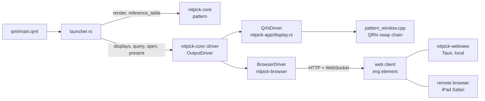

# Output drivers

## Overview

An output driver shows a rendered test pattern on one display. nitpick has two drivers:
- **QRhi** (`qrhi`): a full-screen Qt window with an HDR swap chain on a local screen. See [Swap chain output](test_patterns.md#swap-chain-output) and [HDR10 static metadata](test_patterns.md#hdr10-static-metadata).
- **Browser** (`browser`): a web page that shows the pattern as an HDR image. The page runs in a local Tauri webview (for tests) or in a remote browser, for example Safari on an iPad. See [browser_output.md](browser_output.md).

The compatibility API is one Rust trait, `OutputDriver`, in `nitpick-core` (module `driver`). It has no Qt, Tauri or network dependency. The launcher uses only this trait. The drivers do not have the same features. The API reports each feature as supported, not supported or unknown, so that the launcher can disable options and the reference table can show the limits.



## Interface

Pseudo-code (Rust). Pixel conversion and metadata encoding are inside the driver. The launcher gives code values only.

```rust
pub enum Support {
    Yes,
    No(String),      // reason, shown in the launcher
    Unknown(String), // the driver cannot detect it; reason
}

pub struct DisplayId { pub driver: &'static str, pub key: String }

pub struct DisplayInfo {
    pub id: DisplayId,
    pub name: String,             // screen name, or client name and address
    pub size: (usize, usize),     // native pixels; the size of the reference table
}

/// Fixed features of the driver and the display.
pub struct Capabilities {
    pub depths: Vec<(BitDepth, DepthSupport)>,
    pub encodings: Vec<(Encoding, Support)>,  // the display interprets the encoding as signalled
    pub hdr_metadata: Support,                // ST 2086 + CTA-861.3 reach the display
    pub pixel_exact: Support,                 // one pattern pixel = one display pixel
}

pub struct DepthSupport {
    pub path: String,      // for example "HDR10 swap chain", "16-bit PNG, cICP PQ"
    pub exact: Support,    // the codes reach the wire or the panel without change
}

/// Current settings of the OS, the driver and the browser. Read-only.
/// `None`: the driver cannot read the value.
pub struct ModeSettings {
    pub hdr_on: Option<bool>,
    pub gamut: Option<Gamut>,           // srgb, p3, rec2020
    pub wire_depth: Option<u8>,         // bits per component
    pub peak_nits: Option<f64>,
    pub min_nits: Option<f64>,
    pub sdr_white_nits: Option<f64>,
    pub pixel_ratio: f64,               // display pixels per layout pixel
    pub description: String,
}

pub struct Query { pub capabilities: Capabilities, pub mode: ModeSettings }

pub struct Surface { pub display: DisplayId, pub size: (usize, usize), pub description: String }

pub struct Frame<'a> {
    pub image: &'a Image,                     // codes, size = surface size
    pub format: Format,
    pub metadata: Option<&'a Hdr10Metadata>,  // None: no metadata
}

pub enum OutputError {
    Unsupported { feature: String, reason: String },
    Disconnected,
    Timeout,
    Platform(String),
}

pub trait OutputDriver {
    fn id(&self) -> &'static str;
    fn displays(&mut self) -> Vec<DisplayInfo>;
    fn query(&mut self, display: &DisplayId) -> Result<Query, OutputError>;
    /// Prepares a full-screen surface for `depth` and gives its pixel size.
    /// The launcher renders the pattern at this size.
    fn open(&mut self, display: &DisplayId, depth: BitDepth) -> Result<Surface, OutputError>;
    /// Shows the frame. Returns when the display shows it, or with an error. Returns a status line.
    fn present(&mut self, surface: &Surface, frame: &Frame) -> Result<String, OutputError>;
    fn close(&mut self, display: &DisplayId);
}
```

Rules:
- `open` and `present` return `Unsupported` for a depth, an encoding or metadata that `query` gives as `No`. For `Unknown`, they continue and the status line contains a warning.
- The launcher calculates the content light level (`metadata::light_level`). The driver only encodes the metadata.
- The launcher calls `query` again before each `open`, because the user can change the OS settings (HDR on/off, browser zoom) at any time.

## Feature matrix

| Feature | QRhi | Browser |
|---|---|---|
| Displays | local screens (`QGuiApplication::screens()`) | connected web clients |
| 10-bit | HDR10 swap chain, exact if the compositor does not change codes | 16-bit PNG, cICP; exact: `Unknown` |
| 12-bit | FP16 scRGB, not exact for `*` levels | 16-bit PNG, cICP; exact: `Unknown` |
| `pq-narrow` / `pq-full` | written as full-range PQ codes | signalled as narrow or full range |
| `hlg-narrow` | `No` on the display (interpreted as PQ); scope use only | signalled as HLG; `Unknown` |
| HDR10 metadata | Windows, Linux, macOS (see [HDR10 static metadata](test_patterns.md#hdr10-static-metadata)) | embedded in the PNG (`mDCV`, `cLLI`); effect `Unknown` |
| `hdr_on` | Windows: DXGI output colour space | CSS `(dynamic-range: high)` |
| `gamut` | Windows: DXGI output primaries | CSS `(color-gamut: …)` |
| `wire_depth` | Windows: DXGI `BitsPerColor` | `None` |
| `peak_nits`, `min_nits` | Windows: DXGI (EDID) | `None` |
| `sdr_white_nits` | `None` | `None` |
| `pixel_exact` | `Yes` (swap chain size = pattern size) | `Yes` only for an integer `pixel_ratio` and a layout that fills the viewport |

Linux and macOS QRhi give `None` for the mode settings that the table gives for Windows only.

## Technical decisions

| Decision | Options | Selected | Reason |
|---|---|---|---|
| API location | `nitpick-app`; `nitpick-core`; new crate | `nitpick-core` | The trait uses only core types (`Image`, `Format`, `Hdr10Metadata`). The browser driver crate does not depend on Qt. |
| API input | pixels in the swap chain format; code values | code values (`Image`) | Each driver has a different pixel format. The conversion is a driver detail. |
| Unsupported features | one common subset; tri-state report per feature | tri-state report | A common subset loses 10-bit exact output (QRhi) and HLG signalling (browser). `Unknown` is necessary, because a browser cannot report what the OS compositor does. |
| Call model | synchronous; asynchronous | synchronous, with a timeout in the browser driver | The launcher is synchronous and QRhi blocks until the swap chain exists. Counter-intuitive: a remote `present` blocks the Qt GUI thread for up to the timeout. |

## Testing

- Unit tests with a mock driver: the launcher disables an option for `No`, shows a warning for `Unknown`, and maps each `OutputError` to a status line.
- Each driver: `query` of a display with HDR off gives `hdr_on = Some(false)` (QRhi on Windows, browser) and the launcher shows it.

## Future enhancements

- Asynchronous `present`, so that a slow remote client does not block the launcher UI.
- A driver for a hardware pattern generator or a video output card, through the same trait.
