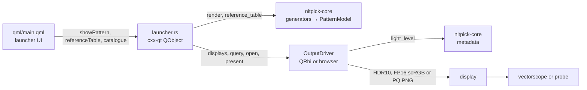
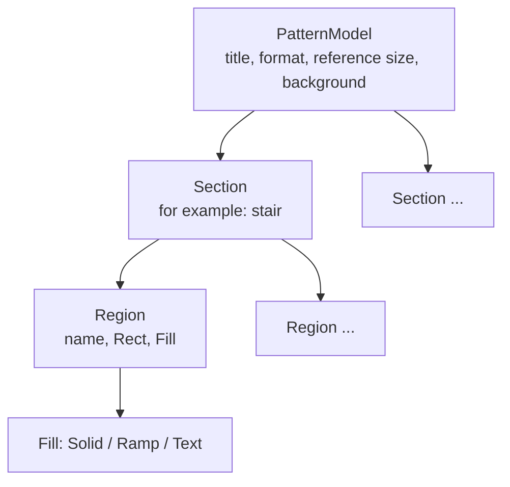

# HDR/WCG test patterns

## Overview

Static HDR test patterns full screen, for measurement with an external vectorscope or waveform monitor, or with a light probe on a display without a video input.

Scope:
- Two patterns:
  - **BT.2111-3 HDR colour bars** (`bt2111`): the colour test pattern.
  - **PQ grayscale / brightness** (`pq-grayscale`): the brightness and grayscale test pattern.
- Two bit depths: 10-bit and 12-bit code values.
- Output through an output driver: QRhi (HDR swap chain on a local screen) or browser (HDR image in a web page). See [output_driver/overview.md](output_driver/overview.md).
- A reference table for each pattern, encoding, bit depth and display size: R'G'B' codes and the Y'Cb'Cr' codes that the scope must show.

## Pattern model

`crates/nitpick-core/src/pattern/model.rs` defines one resolution-independent tree for all patterns:

- A generator (`bt2111::model`, `grayscale::model`) only builds the tree. It does not draw pixels.
- Geometry is in reference pixels. Rectangles are half-open.
- Regions draw in order. A later region covers an earlier one. The background fills all other pixels.
- `Fill::Ramp { first, last, step }` is a horizontal ramp over the codes `first`, `first + step`, … `last`.
  Let $n = (\mathrm{last} - \mathrm{first}) / \mathrm{step} + 1$ and $W$ the output ramp width in pixels.
  If $W \ge n$, pixel $i$ is $\mathrm{first} + \mathrm{step} \cdot \lfloor i n / W \rfloor$. When $W = n$, each pixel has its own code.
  If $W < n$, pixel $i$ is $\mathrm{first} + \mathrm{step} \cdot \mathrm{round}(i (n - 1) / (W - 1))$, so the first and the last code stay visible.
- `Fill::Text` is one line of 1-bit text with a height in reference pixels. The output glyph scale is
  the largest integer multiple of the 8 px font that fits the scaled height.
- `PatternModel::levels()` gives one flat level per section and region name. A ramp gives its first and
  last code. The reference table is a list of these levels, grouped by section.

Other algorithms (for example, comparison with scope readings or conversion to other formats) must read
the model, not the generator or the pixels. Exception: `metadata::light_level` reads the effective output samples, because MaxFALL is an average over the output pixels.

## Signal encodings

| Id | Range | Black / nominal peak (10-bit) | Black / nominal peak (12-bit) | Patterns |
|---|---|---|---|---|
| `pq-narrow` | narrow | 64 / 940 | 256 / 3760 | both |
| `pq-full` | full | 0 / 1023 | 0 / 4095 | both |
| `hlg-narrow` | narrow | 64 / 940 | 256 / 3760 | colour bars only |

Code values follow BT.2100 for bit depth $n$: narrow $D = \mathrm{round}((219E' + 16) \cdot 2^{n-8})$, full $D = \mathrm{round}((2^n - 1)E')$.
Permitted narrow-range codes are 4 to 1019 (10-bit) and 16 to 4079 (12-bit).
PQ uses the SMPTE ST 2084 inverse EOTF.

Each driver signals the encodings in a different way. See [Signalling](output_driver/qt.md#signalling) (QRhi) and [Code to PNG sample](output_driver/browser.md#code-to-png-sample) (browser).

The reference table converts R'G'B' to narrow-range Y'Cb'Cr' at the same bit depth with the BT.2020
non-constant-luminance matrix ($K_R = 0.2627$, $K_B = 0.0593$). For `pq-full`, the table shows
the values that a GPU outputs in YCbCr narrow-range mode. The GPU can round differently by one code.

## HDR10 static metadata

Optional, off by default. When on, the launcher sends an `Hdr10Request` to the output driver:
- SMPTE ST 2086 mastering display colour volume: primaries preset (BT.2020 or P3-D65, both D65 white), maximum and minimum luminance (default 1000 and 0.0001 cd/m²).
- CTA-861.3 content light level: `FromFrame` by default, or explicit MaxCLL and MaxFALL in cd/m². See the request type in [the output interface](output_driver/overview.md#interface).

The driver resolves automatic light levels with the shared `metadata::light_level` helper. The helper takes normalized PQ samples for the effective output signal. For each pixel it applies the PQ EOTF to R, G and B, then takes their maximum in cd/m². MaxCLL is the maximum over all pixels. MaxFALL is their mean. The driver supplies the transfer and range interpretation; the helper does not infer them from the pattern name or bit depth. QRhi's input to this calculation is in [HDR10 static metadata](output_driver/qt.md#hdr10-static-metadata); the browser's is in [Code to PNG sample](output_driver/browser.md#code-to-png-sample).

For actual HLG output, automatic absolute light levels are unavailable. They require a defined display and viewing model. `auto_light_level = No`; a `FromFrame` request returns `Unsupported`. The user can turn metadata off or enter explicit light levels. Explicit values bypass the calculation on every driver.

The resolved `Hdr10Metadata` holds natural units. The `metadata` module also provides ST 2086 and CTA-861.3 field conversions and big-endian SEI payloads (24 and 4 bytes; primaries in green, blue, red order). Each driver encodes the resolved values into its own metadata format. PNG chunks have their own field layouts and units.

## Technical decisions

| Decision | Options | Selected | Reason |
|---|---|---|---|
| HDR metadata | none; optional HDR10 static metadata | optional, off by default | The metadata changes the display tone mapping, not the signal. The scope measures the signal. The option is for display tests. |
| Pattern size | native screen size; surface size of the driver | surface size (QRhi: swap chain size; browser: viewport in display pixels) | A different size needs scaling by the compositor or the browser, which changes code values. |
| BT.2111 sizes | 2K model scaled; one model per size class | one model per size class | The 12-bit ramp of Tables 5 and 6 differs between 2K, 4K and 8K. |
| Labels | Qt text (anti-aliased); 1-bit bitmap font | bitmap font | Anti-aliasing adds intermediate levels to the scope trace. |

## Testing

Measurement settings and tests of the output depend on the driver. See [QRhi Testing](output_driver/qt.md#testing) and [browser Testing](output_driver/browser.md#testing).

## Future enhancements

- Format identification text in the BT.2111 grey side bars.
- Window (APL) patterns at a selected luminance for peak brightness measurement.
