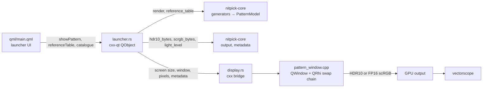
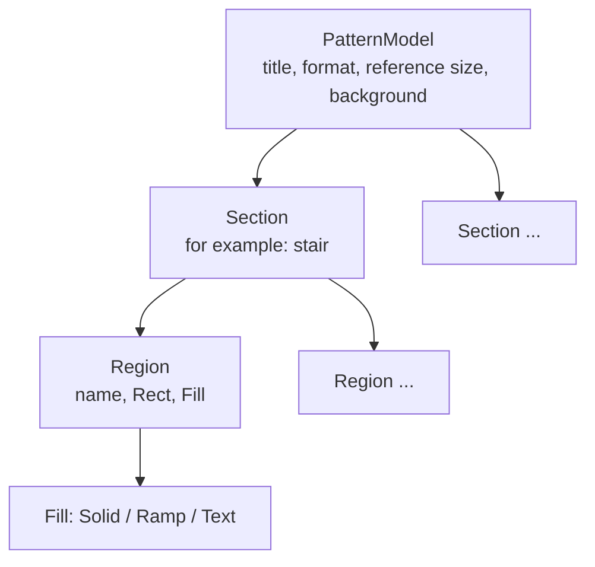

# HDR/WCG test patterns

## Overview

Static HDR test patterns full screen, for measurement with an external vectorscope or waveform monitor.

Scope:
- Two patterns:
  - **BT.2111-3 HDR colour bars** (`bt2111`): the colour test pattern.
  - **PQ grayscale / brightness** (`pq-grayscale`): the brightness and grayscale test pattern.
- Two bit depths: 10-bit and 12-bit code values.
- A borderless full-screen window that sends the code values through an HDR swap chain (see [Swap chain output](#swap-chain-output)).
- A reference table for each pattern, encoding, bit depth and screen size: R'G'B' codes and the Y'Cb'Cr' codes that the scope must show.

The pattern window closes on Esc, Q, Space or a double click.

## Pattern model

`crates/nitpick-core/src/pattern/model.rs` defines one resolution-independent tree for all patterns:

- A generator (`bt2111::model`, `grayscale::model`) only builds the tree. It does not draw pixels.
- Geometry is in reference pixels. Rectangles are half-open.
- Regions draw in order. A later region covers an earlier one. The background fills all other pixels.
- `Fill::Ramp { first, last, step }` is a horizontal ramp over the codes `first`, `first + step`, … `last`.
  Let $n = (\mathrm{last} - \mathrm{first}) / \mathrm{step} + 1$ and $W$ the output ramp width in pixels.
  If $W \ge n$, pixel $i$ is $\mathrm{first} + \mathrm{step} \cdot \lfloor i n / W \rfloor$. When $W = n$, each pixel has its own code.
  If $W < n$, pixel $i$ is $\mathrm{first} + \mathrm{step} \cdot \mathrm{round}(i (n - 1) / (W - 1))$, so the first and the last code stay visible.
- `Fill::Text` is one line of 1-bit text with a height in reference pixels. The output glyph scale is
  the largest integer multiple of the 8 px font that fits the scaled height.
- `PatternModel::levels()` gives one flat level per section and region name. A ramp gives its first and
  last code. The reference table is a list of these levels, grouped by section.

Other algorithms (for example, comparison with scope readings or conversion to other formats) must read
the model, not the generator or the pixels. Exception: `metadata::light_level` reads the rendered image, because MaxFALL is an average over the output pixels.

## Signal encodings

| Id | Range | Black / nominal peak (10-bit) | Black / nominal peak (12-bit) | Patterns |
|---|---|---|---|---|
| `pq-narrow` | narrow | 64 / 940 | 256 / 3760 | both |
| `pq-full` | full | 0 / 1023 | 0 / 4095 | both |
| `hlg-narrow` | narrow | 64 / 940 | 256 / 3760 | colour bars only |

Code values follow BT.2100 for bit depth $n$: narrow $D = \mathrm{round}((219E' + 16) \cdot 2^{n-8})$, full $D = \mathrm{round}((2^n - 1)E')$.
Permitted narrow-range codes are 4 to 1019 (10-bit) and 16 to 4079 (12-bit).
PQ uses the SMPTE ST 2084 inverse EOTF.

The display side always signals PQ / BT.2020 full range. The application writes the code values of
every encoding into it without change. Thus:
- `pq-full` is the native case.
- `pq-narrow` codes reach the wire unchanged only if the GPU output is RGB full range.
  The display then shows black at code 64 (raised black). This is expected. Set the scope to narrow range.
- `hlg-narrow` is for scope use only. The swap chain cannot signal HLG, so the display interprets the codes as PQ.

The reference table converts R'G'B' to narrow-range Y'Cb'Cr' at the same bit depth with the BT.2020
non-constant-luminance matrix ($K_R = 0.2627$, $K_B = 0.0593$). For `pq-full`, the table shows
the values that a GPU outputs in YCbCr narrow-range mode. The GPU can round differently by one code.

## Swap chain output

No swap chain API (DXGI, Vulkan, Metal) has a 12-bit integer format. Thus the bit depth selects the swap chain:

| Bit depth | Swap chain | Pixel conversion (`output` module) | Codes on the wire |
|---|---|---|---|
| 10-bit | HDR10: 10-bit unorm, PQ, BT.2020 | none: packed `R10G10B10A2` | exact, if the compositor and the driver do not change them |
| 12-bit | FP16 scRGB: linear, BT.709 primaries, 1.0 = 80 cd/m² | code → PQ EOTF → BT.2020-to-BT.709 matrix → f16 | the compositor or the driver encodes them back to PQ / BT.2020 |

A fragment shader copies one texel per pixel with `texelFetch` (no filtering, no blending). Thus the swap chain gets the texture values unchanged.

FP16 conversion of the code triple $(R', G', B')$ at depth $n$:
1. Each code is a full-range PQ code on the wire: $L = \mathrm{EOTF}_{PQ}(D / (2^n - 1))$ in cd/m².
2. $L_{709} = M \cdot L_{2020}$. $M$ is calculated from the BT.709 and BT.2020 primaries and D65.
3. The value is $L_{709} / 80$, rounded to f16.
4. Deviation from a plain conversion: rounding each component separately is not sufficient. The matrix mixes the rounding error of the bright components into the dark ones. The conversion thus searches ±2 f16 steps per component. It takes the triple that a reference decoder (exact inverse matrix, PQ inverse EOTF, round, negative values clamped to 0) decodes closest to the codes.

Results of the reference decoder:
- All 4096 12-bit grey codes decode exactly, also without the search.
- All full-range levels and all BT.709 bars of BT.2111 decode exactly.
- Saturated narrow-range bars do not decode exactly (36 levels over all formats at 2K). They have a component at 0 % (code 64 or 256). On the full-range wire this is a small positive luminance, and the f16 error of the bright components is larger than one code step there. A larger search does not solve this (±8 steps: 31 levels). The reference table marks these levels with `*`.

**Unverified:** the real compositor and driver use the same matrix and arithmetic as the reference decoder. A different matrix precision moves more levels.

## HDR10 static metadata

Optional, off by default. When on, the launcher sends:
- SMPTE ST 2086 mastering display colour volume: primaries preset (BT.2020 or P3-D65, both D65 white), maximum and minimum luminance (default 1000 and 0.0001 cd/m²).
- CTA-861.3 content light level: MaxCLL and MaxFALL. By default calculated from the rendered image: maximum and frame average of $\max(R, G, B)$ in cd/m². Codes are read as full-range PQ codes, as the display receives them. The user can enter other values.

The `metadata` module gives the values in ST 2086 units (chromaticity 0.00002, luminance 0.0001 cd/m², light level 1 cd/m²) and as big-endian SEI payloads (24 and 4 bytes; primaries in the order green, blue, red).

QRhi has no metadata API. The window sets it on the native swap chain before the first present:

| Platform | Call | Access to the native swap chain |
|---|---|---|
| Windows | `IDXGISwapChain4::SetHDRMetaData` | Qt private header `qrhid3d11_p.h` (`QD3D11SwapChain::swapChain`) |
| Linux | `vkSetHdrMetadataEXT` (device extension `VK_EXT_hdr_metadata`, requested if available) | Qt private header `qrhivulkan_p.h` (`QVkSwapChain::sc`) |
| macOS | `CAMetalLayer.EDRMetadata = [CAEDRMetadata HDR10MetadataWithDisplayInfo:…]` | public: the layer of the window `NSView` |

Each pattern window has a new swap chain without metadata, so "off" needs no call.

**In question:**
- DXGI: the documentation gives `MaxMasteringLuminance` in whole cd/m² and `MinMasteringLuminance` in 0.0001 cd/m². nitpick follows the documentation. Some sample code uses 0.0001 cd/m² for both.
- macOS: `opticalOutputScale` is 100 (linear 1.0 = 100 cd/m², as in Chromium). Its effect on a PQ layer is not documented.
- The effect of the metadata on the display is not measured.

## Technical decisions

| Decision | Options | Selected | Reason |
|---|---|---|---|
| HDR output | QRhi on all platforms; direct D3D11 on Windows and QRhi elsewhere | QRhi on all platforms | One code path for Windows, Linux and macOS. Counter-intuitive: the draw call adds a shader on Windows. `texelFetch` keeps the values, so the shader does not change codes. |
| Shaders | `qsb` at build time; precompiled files in git | `qsb` at build time | Reproducible from the GLSL source. `build.rs` embeds the result in a generated header. |
| Swap chain | HDR10 for 10-bit; FP16 scRGB for 12-bit | as listed | No API has a 12-bit integer swap chain. FP16 is the only format with more than 10 bits. QRhi checks the format first, because it falls back to SDR without an error. |
| Adapter (Windows) | default adapter; adapter of the monitor | adapter of the monitor | Prevents a cross-adapter copy on hybrid-GPU systems. QRhi gets the adapter LUID. |
| HDR metadata | none; optional HDR10 static metadata | optional, off by default | The metadata changes the display tone mapping, not the signal. The scope measures the signal. The option is for display tests. |
| Metadata on Linux | Qt private API; none | Qt private API | QRhi exposes no `VkSwapchainKHR`. Cost: the binary must use the exact Qt version of its private headers. |
| Pattern size | native screen size; swap chain size | swap chain size | A different size needs scaling by the compositor, which changes code values. |
| BT.2111 sizes | 2K model scaled; one model per size class | one model per size class | The 12-bit ramp of Tables 5 and 6 differs between 2K, 4K and 8K. |
| Labels | Qt text (anti-aliased); 1-bit bitmap font | bitmap font | Anti-aliasing adds intermediate levels to the scope trace. |

## Testing

Settings before a measurement:
1. Turn on HDR in the system display settings for the test display.
2. In the GPU control panel, set the output colour depth to 10 bpc or more (12 bpc for 12-bit). With 8 bpc, the driver dithers and the codes are not exact. On Windows the launcher shows the wire bit depth after "Show pattern".
3. Select the output format:
   - RGB full range: all encodings reach the wire unchanged.
   - YCbCr narrow range: use `pq-full`. Compare with the Y'Cb'Cr' columns of the reference table.
4. Turn off Night light and other colour filters.

## Future enhancements

- Format identification text in the BT.2111 grey side bars.
- Window (APL) patterns at a selected luminance for peak brightness measurement.
